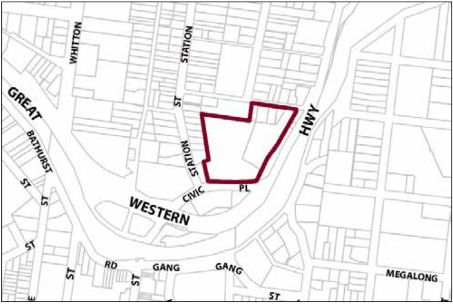

### G6.12	 Katoomba Precinct R1/R3-KA12—GWH Between

### Bowling Green Avenue and Station Street Precinct

The site contains the Renaissance Centre, a heritage item which forms a visually significant landmark at the eastern entrance to Katoomba. Development is to respond to the visual dominance of the Renaissance Centre whilst allowing for opportunities for the concentration of alternate residential development in close proximity to Katoomba town centre. Reference should be made to the precinct objectives in clause 7.6(12) of LEP 2015.

> [Picture on page 84: a picture, saved as a picture (images/part-g-locality-management-page-84-10.gif, 150 dpi).]

Part G6: Katoomba

Katoomba Precinct R1/R3-KA12—GWH Between Bowling Green Avenue and Station Street Precinct

#### Controls

C1. Development is to satisfy LEP 2015 clause 7.1 (Development in villages) and be consistent with the precinct objectives of clause 7.6(12) of LEP 2015.

C2. The height of a building is not to exceed the maximum height of building set by clause 4.3 of LEP 2015  and the accompanying Height of Buildings Map.

C3. The floor space ratio of a development is not to exceed the maximum floor space ratio set by clause 4.4 of LEP 2015  and the accompanying Floor Space Ratio Map.

C4. New work to the Renaissance Centre is to be executed in accordance with and must have regard to the recommendations of a detailed heritage assessment and conservation management plan prepared by a qualified heritage consultant aimed at minimising adverse heritage impacts related to development of the site. New development will require approval from the NSW Heritage Council.

C5. Any new buildings for the site are to be located to preserve the curtilage of the Renaissance Centre that is established, to the satisfaction of the consent authority, by the heritage impact assessment and conservation management plan for the site.

C6. The existing buildings on site are to be retained.

C7. Access to the site is to be provided via Station Street.

C8. The existing mature eucalypts are to be retained where possible and substantial plantings undertaken in order to screen hard surfaces and car parking areas from the Great Western Highway.

Part G6: Katoomba
