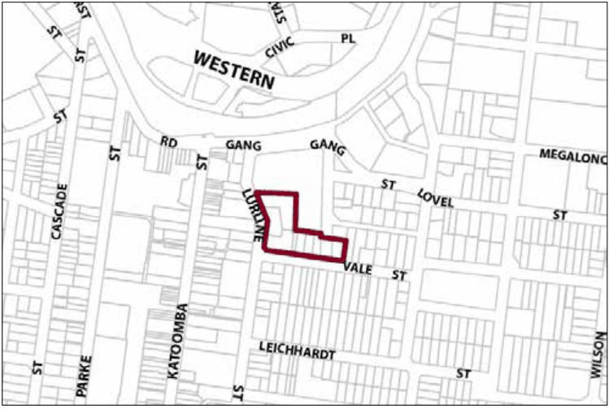

### G6.13	 Katoomba Precinct R3-KA13—Lurline and Vale

### Streets Precinct

Alternative forms of housing incorporate views to the southeast and provide passive surveillance of Kingsford Smith Park. The topography of the site promotes development that steps down the slope, thus permitting the retention of views to the south-east from Lurline Street. Design of buildings is to be responsive to the heritage significance of Kingsford Smith Park and the character of the historic buildings within the vicinity and also respond to the prominence of the location and the topography of the site. Reference should be made to the precinct objectives in clause 7.6(13) of LEP 2015.

> [Picture on page 86: a picture, saved as a picture (images/part-g-locality-management-page-86-12.gif, 150 dpi).]

Part G6: Katoomba

Katoomba Precinct R3-KA13—Lurline and Vale Streets Precinct

#### Controls

C1. Development is to satisfy LEP 2015 clause 7.1 (Development in villages) and be consistent with the precinct objectives of clause 7.6(13) of LEP 2015.

C2. The height of a building is not to exceed the maximum height of building set by clause 4.3 of LEP 2015  and the accompanying Height of Buildings Map.

C3. The floor space ratio of a development is not to exceed the maximum floor space ratio set by clause 4.4 of LEP 2015  and the accompanying Floor Space Ratio Map.

C4. The minimum setback from Lurline Street is 8m.

C5. The minimum setback from Vale Street is to be within 20% of the average setback of dwellings on adjoining allotments.

C6. Buildings are to step down the slope.

C7. Development is to take into consideration the retention of existing views from buildings on Lurline Street and is to retain view corridors from Lurline Street to the south east to the satisfaction of the consent authority.

C8. Filtered views are to be provided from the living areas of dwellings into Kingsford Smith Park where possible.

C9. Development adjacent to Vale Street is to address the street and provide an active frontage such as windows, doors and verandahs.

C10. Landscaping is not to significantly obstruct views from buildings into Kingsford Smith Park.

Part G6: Katoomba
