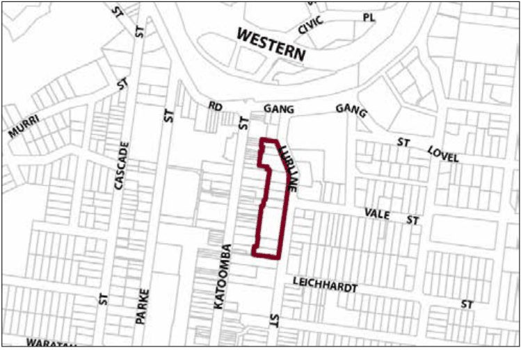

### G6.14	 Katoomba Precinct R3-KA14—Lurline Street

### Housing Precinct

Forming the eastern edge of the town centre, this precinct provides multi-dwelling accommodation for both tourists and residents in a setting that is representative of a diversity of early twentieth century period apartment buildings and guesthouses. New development is to contribute to the availability of diverse housing opportunities; however, traditional housing forms and their gardens are to be conserved and new development is to be of a built form consistent with and sympathetic to the relevant style of traditional housing. The precinct will maintain strong connections to Katoomba Street through safe and convenient stairways and laneways. Reference should be made to the precinct objectives in clause 7.6(14) of LEP 2015.

> [Picture on page 88: a picture, saved as a picture (images/part-g-locality-management-page-88-15.gif, 150 dpi).]

Part G6: Katoomba

Katoomba Precinct R3-KA14—Lurline Street Housing Precinct

#### Controls

C1. Development is to satisfy LEP 2015 clause 7.1 (Development in villages) and be consistent with the precinct objectives of clause 7.6(14) of LEP 2015.

C2. The height of a building is not to exceed the maximum height of building set by clause 4.3 of LEP 2015  and the accompanying Height of Buildings Map.

C3. The floor space ratio of a development is not to exceed the maximum floor space ratio set by clause 4.4 of LEP 2015  and the accompanying Floor Space Ratio Map.

C4. Development is to provide a front building line consistent with that established by existing and adjacent development.

C5. Buildings are to conform to established building height patterns and be set behind landscaped front gardens.

C6. Building design is to be sympathetic to existing  Federation and Inter- War apartment and guesthouse forms, and utilise open and/or glazed verandahs, traditionally-pitched roofs with appropriate roof detailing, articulated and painted brickwork walls, projecting bay windows, vertically-proportioned openings, and timber-framed balconies as relevant.

C7. Garages may front Lurline Street where the site grade and traffic safety permits.

Part G6: Katoomba
