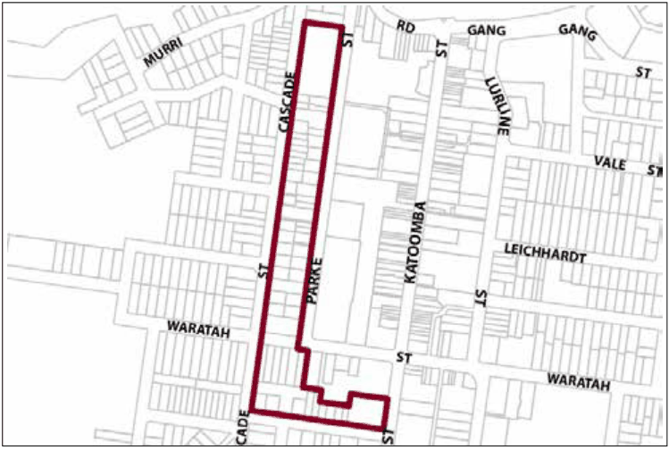

### G6.15	 Katoomba Precinct R3-KA15—Cascade and Parke

### Street Edge Precinct

Defining the western and southern edges of the town centre, this precinct serves as a transition between the retail core and adjacent residential areas. It accommodates a mix of land uses including lower order commercial and smaller home based employment activities. New development reflects the mix of residential and commercial uses, however new development will be consistent with a predominantly residential streetscape, which is characterised by one and two-storey scale development with curtilages made up of gardens and landscaping. Reference should be made to the precinct objectives in clause 7.6(15) of LEP 2015.

> [Picture on page 90: a picture, saved as a picture (images/part-g-locality-management-page-90-13.gif, 150 dpi).]

Part G6: Katoomba

Katoomba Precinct R3-KA15—Cascade and Parke Street Edge Precinct

#### Controls

C1. Development is to satisfy LEP 2015 clause 7.1 (Development in villages) and be consistent with the precinct objectives of clause 7.6(15) of LEP 2015.

C2. The height of a building is not to exceed the maximum height of building set by clause 4.3 of LEP 2015  and the accompanying Height of Buildings Map.

C3. The floor space ratio of a development is not to exceed the maximum floor space ratio set by clause 4.4 of LEP 2015  and the accompanying Floor Space Ratio Map.

C4. Buildings fronting Parke Street are to have a minimum setback of 3m.

C5. Buildings fronting Cascade Street is to have a minimum setback of 5m.

C6. Development on Cascade Street are to incorporate landscaped front gardens.

C7. New development is to be sympathetic to the traditional building forms, materials and details of the precinct, including the use of traditionally-pitched roofs, articulated layouts and forms, verandahs, timber joinery, vertically–proportioned openings and some painted external finishes, with a curtilage of landscaped areas and an address to the street provided. New development is to be similar in form and materials to quality older buildings but subservient in detail to distinguish it as new work.

C8. Parking areas are to be designed in a manner that minimises their visual impact when viewed from the public domain.

C9. Pedestrian access is to be provided to public walkways adjacent the precinct.

C10. Separate entrances are to be provided for residential and commercial uses in mixed use developments.

Part G6: Katoomba
