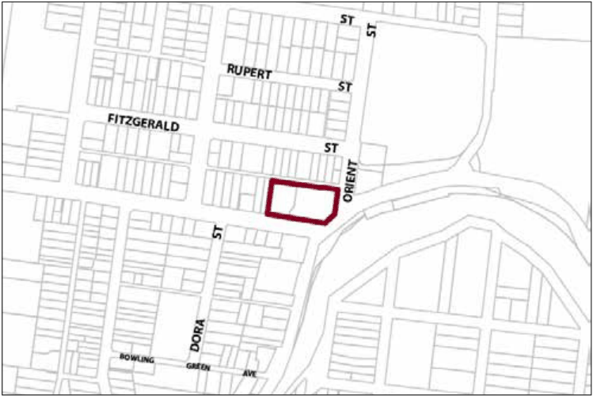

### G6.16	 Katoomba Precinct R3-KA16—Cnr Great Western

### Highway and Camp Street Precinct

Development recognises and retains the important role and prominence of the site as part of the eastern approach to Katoomba. Infill development on the site presents a high quality urban design that complements the low density scale of development on the adjoining lands and retains existing period buildings within the precinct. Existing mature plantings are retained and further planting incorporated into the future development of the site. Reference should be made to the precinct objectives in clause 7.6(16) of LEP 2015.

> [Picture on page 92: a picture, saved as a picture (images/part-g-locality-management-page-92-11.gif, 150 dpi).]

Part G6: Katoomba

Katoomba Precinct R3-KA16—Cnr Great Western Highway and Camp Street Precinct

#### Controls

C1. Development is to satisfy LEP 2015 clause 7.1 (Development in villages) and be consistent with the precinct objectives of clause 7.6(16) of LEP 2015.

C2. The height of a building is not to exceed the maximum height of building set by clause 4.3 of LEP 2015  and the accompanying Height of Buildings Map.

C3. The floor space ratio of a development is not to exceed the maximum floor space ratio set by clause 4.4 of LEP 2015  and the accompanying Floor Space Ratio Map.

C4. The setback from the Great Western Highway, Orient Street and Showground Lane boundaries of the precinct is to be consistent with that established by existing development.

C5. The setback from the Camp Street frontage is to allow for established vegetation gardens to be retained and is to be within 20% of the average setback of adjacent dwellings along Camp Street.

C6. The maximum site coverage for buildings is 50% of the total site area.

C7. Buildings facing Camp Street and Orient Street are to incorporate windows, doors, gables, awnings, verandahs and similar along these frontages.

C8. Tree plantings in accordance with the Street Tree Masterplan, are to be provided within the front building setback to Camp Street.

C9. The existing motel building and Federation cottage fronting Orient Street are both to be retained in new development.

C10. Garages and car parking are to be screened from the public domain and located internally so as not to dominate streetscape views.

Part G6: Katoomba
