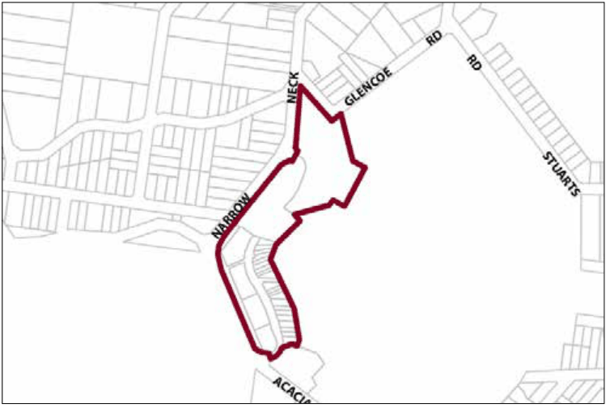

### G6.17	 Katoomba Precinct R3-KA17—Katoomba Golf

### Course Housing Precinct

The precinct will accommodate a mix of attached townhouse style dwellings and detached dwellings that contribute to meeting housing demand in accordance with changing demographics in the Blue Mountains. The development of the precinct will include high quality urban design outcomes in response to environmental constraints and the opportunities provided by its location adjacent to a ridgeline overlooking the Katoomba Golf Course, Katoomba urban area and the Blue Mountains National Park. New building works will reflect the general pattern, scale and forms of existing adjacent residential development. Reference should be made to the precinct objectives in clause 7.6(17) of LEP 2015.

> [Picture on page 94: a picture, saved as a picture (images/part-g-locality-management-page-94-14.gif, 150 dpi).]

Part G6: Katoomba

Katoomba Precinct R3-KA17—Katoomba Golf Course Housing Precinct

#### Controls

C1. Development is to satisfy LEP 2015 clause 7.1 (Development in villages) and be consistent with the precinct objectives of clause 7.6(17) of LEP 2015.

C2. The height of a building is not to exceed the maximum height of building set by clause 4.3 of LEP 2015  and the accompanying Height of Buildings Map.

C3. The floor space ratio of a development is not to exceed the maximum floor space ratio set by clause 4.4 of LEP 2015  and the accompanying Floor Space Ratio Map.

C4. The height above the existing ground level for the lowest habitable floor level is not to exceed 3m.

C5. The maximum cut is 2m for townhouses and 1m for detached dwellings.

C6. The maximum fill is 2m for townhouses and 2.5m for detached dwellings.

C7. The minimum setback from The Escarpments street frontage and the internal road street frontage (that intersects with Narrow Neck Road) is 5m for townhouses and 6m for dwelling houses.

C8. The minimum side boundary setback is 1m for townhouses and 1.5m for dwelling houses.

C9. The minimum building setback from the Narrow Neck Road boundary and the Glencoe Road boundary is 12m. A minor departure from this provision may be supported if the Council is satisfied that the objectives and provisions for the precinct will be achieved.

C10. Apart from the provision of an access road, pedestrian pathways, fences, mailboxes and the like, existing vegetation within 12m of the boundaries of the reserves of Narrow Neck Road or Glencoe Road is not to be disturbed.

Part G6: Katoomba

C11. All setback areas are to be landscaped.

C12. The maximum site cover for buildings is 40% of the total allotment area.

C13. The minimum area to be retained as soft, pervious or landscaped area (excluding hard surfaces) is 40% of the total allotment area.

C14. Development is to be sited, designed and constructed to minimise impacts on surrounding areas.

C15. Landscaping is to be compatible with the native bushland communities and exotic plantings on adjacent properties while minimising bush fire hazard.

C16. A landscaped area not less than 5m wide is to be provided between any building and the golf course. That area is to be planted with species that will, at maturity, provide a soft filtered view of the building from the golf course. The species used to achieve this screening are to be either endemic to the area or non-invasive exotic species compatible with the existing plantings used on the golf course.

C17. Provision is to be made around and between any building for the planting of trees that grow to sufficient heights to provide a canopy that will reduce the prominence of such buildings in the landscape when viewed from distant viewpoints. Plant species that minimise bush fire hazard are preferred.

C18. Building design is to integrate with the surrounding residential scale and to enhance amenity through the creation of view corridors, view sharing, passive solar design, quality architectural treatment and recessive colour schemes (neutral or earthy tones with low reflectivity).

C19. Driveways, parking areas and garages are not to dominate any street frontage, and are to be integrated with the design of surrounding landscaped areas.

C20. A maximum of two vehicular access points are to be provided to access the combined development. Each access point is to incorporate a roundabout in the existing public road to be located and designed to the Council’s satisfaction.

C21. A combined cycleway and footpath is to be provided from the junction of Glencoe and Narrow Neck Roads to the existing golf clubhouse.

Part G6: Katoomba
