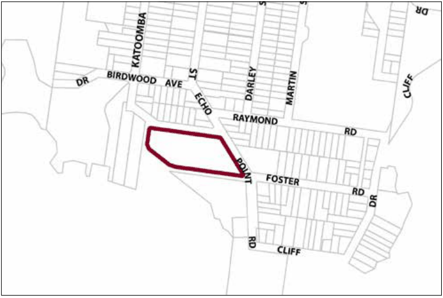

### G6.18	 Katoomba Precinct R1-KA18 - Lilianfels

This precinct operates as a substantial tourist accommodation complex that has been incorporated into a highly significant heritage site. Lilianfels Park to the south and the surrounding streets are of high streetscape and cultural value adjacent the Echo Point area. The precinct is adjacent multiple significant and spectacular views and viewing points. Future development must take into consideration the sensitivity of the location in relation to exceptionally important areas of natural and cultural value. Consideration of bulk and scale, settings, views, architectural treatments and commercial signage are paramount. Reference should be made to the precinct objectives in clause 7.6(18) of LEP 2015.

> [Picture on page 97: a picture, saved as a picture (images/part-g-locality-management-page-97-13.gif, 150 dpi).]

Part G6: Katoomba

Katoomba Precinct R1-KA18—Lilianfels

#### Controls

C1. Development is to satisfy LEP 2015 clause 7.1 (Development in villages) and be consistent with the precinct objectives of clause 7.6(18) of LEP 2015.

C2. The height of a building is not to exceed the maximum height of building set by clause 4.3 of LEP 2015  and the accompanying Height of Buildings Map.

C3. The floor space ratio of a development is not to exceed the maximum floor space ratio set by clause 4.4 of LEP 2015  and the accompanying Floor Space Ratio Map.

Part G6: Katoomba

| C4. | A minimum curtilage of 30m is to be retained around Lilianfels within which no new above-ground development is to occur. |
|---|---|
| C5. | Stands of mature trees, including street plantings, are to be preserved. |
| C6. | Lilianfels garden, and its principal elements (paths, hedges, gazebos) is to be retained, restored and enhanced according to management principles of a relevant conservation management plan. |
| C7. | The minimum setback to any road frontage for all new buildings is 10m. |
| C8. | Vehicular access to any new development is to be restricted to Echo Point Road and/or Panorama Drive. |
| C9. | Vehicular access-ways are not to be created on or within 15m of a corner. |
| C10. | Landscaping of the site is to be in accordance with professionally prepared and approved plans, utilising predominantly non-invasive exotic plantings and elements characteristic to the locality. |
| C11. | No more than 30% of the surface area of the land is to be developed with buildings. |
| C12. | No more than 10% of the surface area is to be hard paved. |
| C13. | No uses or activities deemed to be noisy or disruptive to the residential amenity of the area will be supported. |
| C14. | The use of the land is limited to low-key, guesthouse-style tourist accommodation and associated facilities such as a restaurant or tea room. |
| C15. | No new building development north of Lilianfels is to occur. |
| C16. | No new building is to exceed the maximum height above ground level of Lilianfels, or visually dominate it or surrounding roadways. |
| C17. | Existing views from adjacent residences to the south are to be maintained. |
| C18. | New development which is to be located to the east of Lilianfels is not to exceed two storeys in height, where the second storey is contained within a pitched roof space. |
| C19. | The architectural treatment and design of new development is to be sympathetic and subservient to Lilianfels in form, materials and detailing. |

C20. All parking demands generated by any new development are to be met and fully provided on-site.

C21. New work to Lilianfels is to be executed in accordance with a detailed conservation management plan prepared by a qualified heritage consultant and will require approval from the NSW Heritage Council.

Part G6: Katoomba
