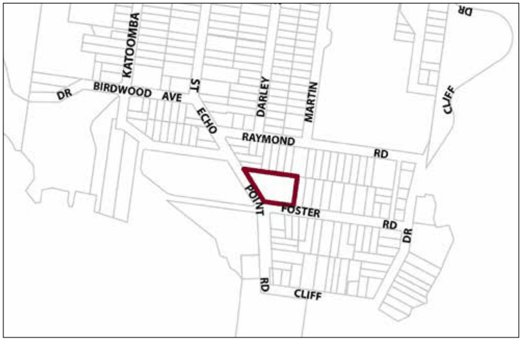

### G6.19	 Katoomba Precinct R1-KA19—Echo Point Road

### Precinct

This precinct currently operates as budget to mid-range tourist accommodation and enjoys views towards the iconic Echo Point. In addition, significant sightlines into the site are exposed as visitors leave the major tourist attraction of Echo Point traveling north along Echo Point Road. The site adjoins the Lilianfels precinct to the west and nestles within a residential area characterised by single dwelling houses with prominent traditional garden settings. Future development must take into consideration the sensitivity of the location in relation to the important areas of cultural and heritage value. Consideration of bulk and scale, settings, views, architectural treatments and commercial signage are paramount. Reference should be made to the precinct objectives in clause 7.6(19) of LEP 2015.

> [Picture on page 100: a picture, saved as a picture (images/part-g-locality-management-page-100-15.gif, 150 dpi).]

Part G6: Katoomba

Katoomba Precinct R1-KA19—Echo Point Road Precinct

#### Controls

C1. Development is to satisfy LEP 2015 clause 7.1 (Development in villages) and be consistent with the precinct objectives of clause 7.6(19) of LEP 2015.

C2. The height of a building is not to exceed the maximum height of building set by clause 4.3 of LEP 2015 and the accompanying Height of Buildings Map.

C3. The floor space ratio of a development is not to exceed the maximum floor space ratio set by clause 4.4 of LEP 2015 and the accompanying Floor Space Ratio Map.

C4. The minimum setback to Forster Road frontage for all new buildings is 15m.

C5. The minimum setback to Echo Point Road frontage for all new buildings is 10m.

C6. The minimum setback to the side (eastern) boundary is to be 6m. Setback is to be landscaped to ensure adjoining residential amenity is protected.

C7. The minimum setback to the rear (northern) boundary is to be 3m to allow for sufficient landscaping to screen the development from residential properties to the north.

C8. Landscaping of the site is to be in accordance with professionally prepared and approved plans, utilising predominantly non-invasive exotic planting and elements characteristic to the locality.

C9. Landscaping of the site should provide screening of the development from both Forster Road and Echo Point Road.

Part G6: Katoomba

C10. Existing healthy and structurally sound mature trees are to be retained and protected.

C11. A minimum of 60% of the site area is to be soft pervious or landscaped area.

C12. No uses or activities deemed to be noisy or disruptive to the residential amenity of the area will be supported.

C13. Vehicular access-ways are not to be created on or within 15m of the intersection of Echo Point Road and Forester Road.

C14. All parking demands generated by any new development are to be met and fully provided on-site.

C15. Car parking is to be screened from the public domain and integrated with surrounding landscaped areas.

Note: Additional landscape controls specific to the R1 zone apply, refer to Part C3.8
