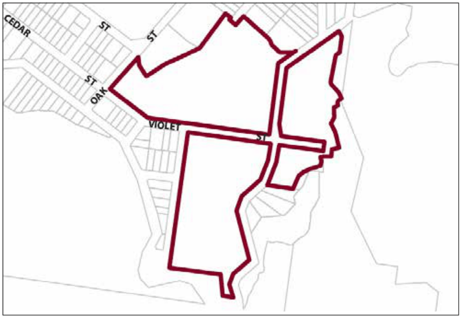

### G6.20	 Katoomba Precinct RE2/SP3-KA20—Violet Street

### Precinct

Recreational and tourism related activities have long been established within this precinct, which is located on the edge of the escarpment and world heritage listed national park, well outside the Katoomba town centre. The precinct provides employment and business opportunities which complement the town centres and provide increased variety for recreation and tourism related land

uses. The precinct is also adjoined by residential development and the Katoomba golf course. Future development must take into consideration the sensitivity of the location in relation to the exceptionally important areas of environmental and cultural value. Consideration of bulk and scale, settings, views, architectural treatments, commercial signage and residential amenity are paramount. Reference should be made to the precinct objectives in clause 7.6(20) of LEP 2015.

> [Picture on page 102: a picture, saved as a picture (images/part-g-locality-management-page-102-16.gif, 150 dpi).]

Part G6: Katoomba

Katoomba Precinct RE2/SP3-KA20— Violet Street Precinct

#### Controls

C1. Development is to satisfy LEP 2015 clause 7.1 (Development in villages) and be consistent with the precinct objectives of clause 7.6(20) of LEP 2015.

C2. The height of a building is not to exceed the maximum height of building set by clause 4.3 of LEP 2015 and the accompanying Height of Buildings Map.

C3. The floor space ratio of a development is not to exceed the maximum floor space ratio set by clause 4.4 of LEP 2015 and the accompanying Floor Space Ratio Map.

C4. Buildings and other structures located on land identified as having Scenic Landscape Value on the Scenic Landscape Value Map are to be landscaped so as to minimise the visual impact from any public place, Reserve or National Park, including but not limited to Echo Point.

C5. All buildings on 119 Cliff Drive, Katoomba are to be distributed throughout the site so as to minimise the impact when viewed from any given point, either internally or externally.

C6. The existing bushland character of the precinct is to be retained and enhanced.

C7. The minimum setback for any new development, from any road reserve is 8m.

C8. The maximum building site coverage for land at 41 Violet Street, Katoomba and land at 119 Cliff Drive is 15%.

Part G6: Katoomba

C9. The minimum area to be retained as soft pervious or landscaped (excluding hard surfaces) on land at 41 Violet Street and 119 Cliff Drive, Katoomba is 70% of the total allotment area.

In calculating the landscaped area of 41 Violet Street, the landscaped area can include an area for car parking up to a maximum of 15,000m2, provided that the car parking area incorporates effective water sensitive urban design measures, in accordance with Blue Mountains DCP 2015.

C10. The minimum area to be retained as soft pervious or landscaped area (excluding hard surfaces) on land at 2 Violet Street, Katoomba (Scenic World) is 10% of that part of the site not zoned C2 Environmental Conservation.

C11. The minimum area to be retained as soft pervious or landscaped (excluding hard surfaces) on land at 4-12 Violet Street, Katoomba is 60% of the total allotment area.

C12. Development is to provide articulation and building modulation in order to minimise the bulk of buildings.

C13. Development must consider amenity impact on the adjoining residential dwellings and include reasonable measures to mitigate impacts.

C14. Development is to provide landscaping along the street frontages that is reflective of landscape character and existing endemic vegetation communities along Cliff Drive and Violet Street.

C15. Car parking is to be integrated with landscaped areas such that it is well screened from the public domain. Parking areas should be located so as to not to adversely impact upon streetscape, pedestrian circulation, building character and residential amenity.

Note 1: Additional landscape controls specific to the SP3 zone apply, refer to Part C3.8

Note 2: Additional landscape controls specific to car parking areas apply, refer to Part F

Part G6: Katoomba
