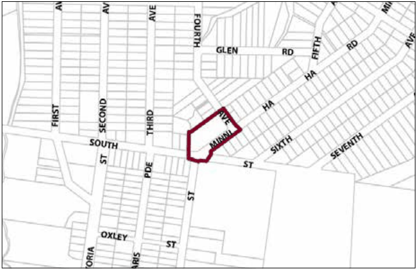
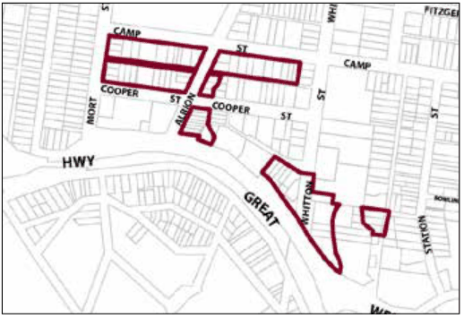

### G6.21	 Katoomba Precinct E1-KA021—Minni-Ha-Ha

### Shops Katoomba

This precinct is a compact local centre, accommodating a diverse range of small scale retail and other commercial businesses that serve the local community as well as visitors. Future development promotes the creation of a distinct village identity and provides the coordinated design of business signage and shop fronts in accordance with a village theme. Non-residential uses are compatible with residential uses and do not unreasonably affect amenity. Reference should be made to the precinct objectives in clause 7.6(21) of LEP 2015.

> [Picture on page 105: a picture, saved as a picture (images/part-g-locality-management-page-105-12.gif, 150 dpi).]

Part G6: Katoomba

Katoomba Precinct E1-KA021—Minni-Ha-Ha Shops Katoomba

#### Controls

C1. Development is to satisfy LEP 2015 clause 7.1 (development in villages) and be consistent with the precinct objectives of clause 7.6(21) of LEP 2015.

C2. The height of a building is not to exceed the maximum height of building set by clause 4.3 of LEP 2015 and the accompanying Height of Buildings Map.

C3. The floor space ratio of a development is not to exceed the maximum floor space ratio set by clause 4.4 of LEP 2015 and the accompanying Floor Space Ratio Map.

Part G6: Katoomba

| C4. | Development is to provide front setbacks consistent with that of adjacent buildings. For corner allotments the secondary setback is to be a minimum of 3 metres. Side and rear setbacks will be subject to a merit based assessment having regard to the character of the area and amenity of the neighbouring properties |
|---|---|
| C5. | The height above ground for the lowest habitable floor level is not to exceed 1m. |
| C6. | Cut or fill within 5m of any property boundary is not to exceed 0.5m. |
| C7. | All setback areas are to be landscaped. |
| C8. | The maximum site cover for buildings is 50% of the total allotment area. |
| C9. | The minimum area to be retained as soft, pervious or landscaped area (excluding hard surfaces) is 25% of the total allotment area. |
| C10. | Walls and structures are to protect and enhance sight lines in the public domain. |
| C11. | Walls are not to be left blank or unarticulated. |
| C12. | Local design themes are to predominate over corporate signage and reflect the village character. |
| C13. | Signage is to be coordinated with shop front design. |
| C14. | On-site car parking is to be concealed behind commercial premises, or screened by landscaping or an architectural treatment that is consistent with the building adjoining the point of access. |
| C15. | On any allotment adjoining an existing residential property, facades are to locate balconies or windows, or both, in a way that is designed to protect residential amenity. |
| C16. | Any parking and heavy vehicle loading and manoeuvring areas are to be designed to minimise visual impact when viewed from the public domain, and to be safely and efficiently designed. |
| C17. | Each secondary frontage to a public road, lane way or public place is to provide a visible and active street frontage distributed along a minimum of 65% of that frontage. |
| C18. | Street corners are to be reinforced through design elements such as splay walls and orientation of entry and window elements. |

G6.22	 Katoomba Precinct E4-KA022—Camp, Cooper,

### Whitton & Freelander Streets Katoomba

This precinct provides facilities and services that meet the day to day needs of workers in and around the area, as well as supports the local economy. The precinct is surrounded by established low density residential areas. Therefore, it is necessary to facilitate compatible employment uses, with new development incorporating measures to mitigate operational impacts upon adjoining or adjacent residential land uses. Future development is designed and landscaped, to create a transition between employment precincts and low density residential areas, while low density residential development in established residential areas does not compromise existing employment uses. Reference should be made to the precinct objectives in clause 7.6(22) of LEP 2015.

> [Picture on page 107: a picture, saved as a picture (images/part-g-locality-management-page-107-14.gif, 150 dpi).]

Part G6: Katoomba

Katoomba Precinct E4-KA022—Camp, Cooper, Whitton & Freelander Streets

#### Controls

C1. Development is to satisfy LEP 2015 clause 7.1 (development in villages) and be consistent with the precinct objectives of clause 7.6(22) of LEP 2015.

C2. The height of a building is not to exceed the maximum height of building set by clause 4.3 of LEP 2015 and the accompanying Height of Buildings Map.

C3. The floor space ratio of a development is not to exceed the maximum floor space ratio set by clause 4.4 of LEP 2015 and the accompanying Floor Space Ratio Map.

C4. Setbacks will be subject to a merit-based assessment.

C5. The maximum site cover for buildings is 50% of the total allotment area.

C6. The minimum area to be retained as soft, pervious or landscaped area (excluding hard surfaces) is 40% of the total allotment area.

C7. Cut or fill within 5m of any property boundary is not to exceed 0.5m.

C8. All setbacks are to be landscaped.

C9. The design and location of the buildings respond effectively to individual site constraints and minimise site disturbance and clearing of vegetation.

C10. Rear yards of non-residential developments are to be landscaped to screen parking areas and other service-related spaces.

C11. Any fencing along the front boundary of the site and along any side boundary that is located within the front building setback applying to the land must be decorative. The sole use of pre-painted metal or standard paling fencing is not permitted.

C12. Driveways, parking areas and garages are not to dominate any street frontage, and are to be integrated with the design of surrounding landscaped areas.

Part G6: Katoomba

C13. All parking demands generated by developments are to be met fully on-site.

C14. Carparking spaces are not permitted within the front setback area unless adequately screened by dense screen plantings and only where it can be demonstrated to be in character with the existing streetscape.

C15. Loading and unloading facilities are required for the erection or use of any building.

C16. Any parking and loading and manoeuvring areas are to be designed to minimise visual impact when viewed from the public domain, and to be safely and efficiently designed.

C17. An area for storing garbage and recycling shall be provided, suitably located and screened. Where a development adjoins residential development, the garbage storage area must be located at least 3 metres from the common boundary of the residential property and the development site.

C18. All non-residential development must be designed and constructed to provide access to and within all areas or facilities of the development where there is a reasonable expectation for access by any individual, accompanying persons or groups. The access is to be in accordance with AS 1428 – Design for Access and Mobility.

C19. Acoustic treatments are to be incorporated where necessary and practicable to minimise disturbance to any residents of adjoining dwellings or accommodation suites.

C20. Buildings are to reflect the principles of water sensitive urban design.

C21. Development is to provide articulation and building modulation in order to minimise the bulk of buildings. Refer to Part B2.3 of this DCP.

C22. On any allotment adjoining an existing residential land use, facades are to locate doors or windows, or both, in a way that is designed to protect residential amenity.

C23. New development is to be sympathetic to the traditional building forms, materials and details of the precinct, including the use of traditionally pitched roofs, articulated layouts and forms, verandahs, timber joinery, vertically–proportioned openings and some painted external finishes, with a curtilage of landscaped areas and an address to the street provided. New development is to be similar in form and materials to quality older buildings but subservient in detail to distinguish it as new work.

Part G6: Katoomba

C24. New development is to respond sympathetically to the adjacent setback patterns and respect established building settings and views.

C25. Overshadowing of adjoining buildings and impact on solar access to the living areas and private open space of those buildings is minimised

C26. Setbacks for residential development on land consisting of or including an area of less than 4,000m2:

(a) front building setback is to be within 20% of the average setback of buildings on immediately adjoining allotments in established areas or, where there are no buildings on these allotments, and

(b) in the case of corner lots, building setback from the secondary frontage is to be a minimum of 3m, and

(c) setback from side and rear boundaries is to be a minimum of 1m.

C27. The maximum site cover for residential buildings and buildings ancillary to the main building is 40 per cent of the total allotment area or 160 square metres, whichever is the greater.

C28. Pervious area for residential development will comprise at least 40% of the lot.
