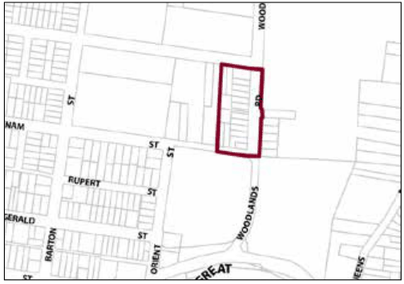
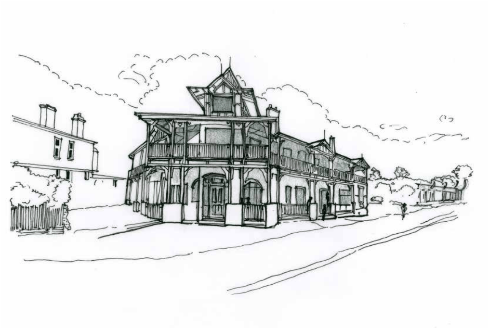

### G6.24	 Katoomba Precinct E4-KA024—Woodlands Road

### Katoomb

This precinct provides facilities and services that meet the day to day needs of workers in and around the area, as well as supports the local economy. The precinct is surrounded by established low density residential areas and bushland communities. Therefore, it is necessary to facilitate compatible employment uses, with new development incorporating measures to mitigate operational impacts upon adjoining or adjacent residential land uses. Future development is designed and landscaped in accordance with its bushland setting, to create a transition between employment precincts and low density residential areas, while low density residential development in established residential areas does not compromise existing employment uses. Reference should be made to the precinct objectives in clause 7.6(22) of LEP 2015.

> [Picture on page 113: a picture, saved as a picture (images/part-g-locality-management-page-113-15.gif, 150 dpi).]

Part G6: Katoomba

Katoomba Precinct E4-KA024—Woodlands Road Katoomba

#### Controls

C1. Development is to satisfy LEP 2015 clause 7.1 (development in villages) and be consistent with the precinct objectives of clause 7.6(22) of LEP 2015.

C2. The height of a building is not to exceed the maximum height of building set by clause 4.3 of LEP 2015 and the accompanying Height of Buildings Map.

C3. The floor space ratio of a development is not to exceed the maximum floor space ratio set by clause 4.4 of LEP 2015 and the accompanying Floor Space Ratio Map.

C4. Setbacks are to be a minimum 8m and side and rear setbacks are to be a minimum of 3m.

Part G6: Katoomba

| C5. | The maximum site cover for buildings is 50% of the total allotment area. |
|---|---|
| C6. | The minimum area to be retained as soft, pervious or landscaped area (excluding hard surfaces) is 40% of the total allotment area. |
| C7. | Cut or fill within 5m of any property boundary is not to exceed 0.5m. |
| C8. | Landscaping is to minimise impacts on neighbouring bushland communities whilst minimising bushfire hazard. New landscape plantings are to be either endemic to the locality or be of low to nil invasive potential. |
| C9. | Rear yards of non-residential developments are to be landscaped to screen parking areas and other service-related spaces. |
| C10. | Any fencing along the front boundary of the site and along any side boundary that is located within the front building setback applying to the land must be decorative. The sole use of pre-painted metal or standard paling fencing is not permitted. |
| C11. | All parking demands generated by developments are to be met fully on-site. |
| C12. | Carparking spaces are not permitted within the front setback area unless adequately screened by dense screen plantings and only where it can be demonstrated to be in character with the existing streetscape. |
| C13. | Loading and unloading facilities are required for the erection or use of any non-residential development. |
| C14. | Any parking and heavy vehicle loading and manoeuvring areas are to be designed to minimise visual impact when viewed from the public domain, and to be safely and efficiently designed. |
| C15. | An area for storing garbage and recycling shall be provided, suitably located and screened. Where a development adjoins residential development, the garbage storage area must be located at least 3 metres from the common boundary of the residential property and the development site. |
| C16. | All non-residential development must be designed and constructed to provide access to and within all areas or facilities of the development where there is a reasonable expectation for access by any individual, accompanying persons or groups. The access is to be in accordance with AS 1428 – Design for Access and Mobility. |

C17. Acoustic treatments are to be incorporated where necessary and practicable to minimise disturbance to any residents of adjoining dwellings or accommodation suites.

C18. Buildings are to reflect the principles of water sensitive urban design.

C19. Development is to provide articulation and building modulation in order to minimise the bulk of buildings. Refer to Part B2.3 of this DCP.

C20. On any allotment adjoining an existing residential land use, facades are to locate doors or windows, or both, in a way that is designed to protect residential amenity.

C21. Building design is to have regard to the heritage significance of adjacent precincts.

C22. Setbacks for residential development

(a) front building setback is to be within 20% of the average setback of buildings on immediately adjoining allotments in established areas or, where there are no buildings on these allotments, a minimum of 8m from the primary road frontage, and

Part G6: Katoomba

(b) in the case of corner lots, building setback from the secondary frontage is to be a minimum of 3m, and

(c) in the case of hatchet shaped lots, building setback from the rear boundary of the lot in front is to be a minimum of 9m, and

(d) setback from side and rear boundaries is to be a minimum of 1m.

C23. The site coverage for residential development including buildings ancillary to the main building, is 40% of the total allotment area or 160m2 , whichever is greater.

C24. Pervious area for residential development will comprise at least 40% of the lot.

Part G6: Katoomba

### LAWSON

| G7.1 | Lawson Precinct E1-LA01—Town Centre Precinct | 740 |
|---|---|---|
| G7.2 | Lawson Precinct R3-LA02—San Jose Avenue Precinct | 744 |
| G7.3 | Lawson Precinct R3-LA03—Loftus Street Precinct | 746 |
| G7.4 | Lawson Precinct R3-LA04—Housing Precinct | 748 |
| G7.5 | Lawson Precinct E4-LA05—Adeline & Cataract Streets Lawson | 750 |

> [Picture on page 117: a picture, saved as a picture (images/part-g-locality-management-page-117-3.gif, 150 dpi).]
