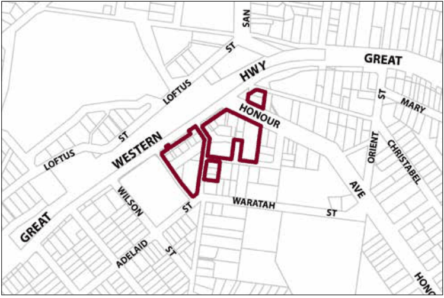

### G7.1 Lawson Precinct E1-LA01—Town Centre Precinct

The Lawson Town Centre precinct has experienced significant changes associated with the widening of the Great Western Highway. The Lawson Village Centre Masterplan was prepared to guide future development of the Town Centre Precinct, which is undergoing revitalisation. A site-specific DCP was also prepared to promote and guide the progression of the Masterplan. The predominant objectives of the Masterplan have been achieved with the creation of the public domain within the new town centre. The restored Heatherbrae has become the focus for a new village centre and park. The Lawson DCP has been consolidated into the existing Town Centre Precinct controls following the completion of the public domain elements, to ensure that future development within the precinct remains consistent with the aims of the Masterplan and the DCP.

> [Picture on page 118: a picture, saved as a picture (images/part-g-locality-management-page-118-14.gif, 150 dpi).]

Part G7: Lawson

Lawson Precinct E1-LA01—Town Centre Precinct

#### Desired future character

The Town Centre precinct presents opportunities to enhance community well-being through the expansion and improvement of commercial and community facilities, whilst retaining the village scale and the cultural elements important to the local community and history of Lawson. The retail /commercial activities within the town centre cater for the needs of the community and passing highway trade including tourism opportunities. Sustainability and accessibility are further components of the continuing redevelopment of the town centre. The relationship with the Highway and railway is enhanced and protected, as is the clear urban structure of the roads, streets and public spaces. Vehicular parking areas fronting shops along the Highway provide good access for Highway

traffic; however, a new focus for local retail and community activity is protected and enhanced to the rear of shops that face the Highway. Good parking availability and safe pedestrian routes interact to provide a compact urban structure with high levels of amenity and accessibility. A sense of place and positive links to the past are enhanced through landscape elements and built form, with adequate open space and safe pedestrian-friendly places. New built form seeks to complement the traditional character of surrounding buildings and the character of other villages. Welcoming open spaces are defined by built form. Four public spaces predominate:

(a) Douglass Square: Heritage character around Douglass Square is retained and interpreted, enhancing this place as the main civic and historical place in Lawson, and a heritage gateway to the town centre;

(b) Heatherbrae: The setting and landscape of Heatherbrae is a ‘Village Park’ fronting New Street as a second public domain space. Important views of and from Heatherbrae and distant views of the natural environment to the south are retained and enhanced;

(c) A Village Square is a focal point behind the shops that front the Highway, with outdoor seating and retail frontages;

(d) The Community Centre is capable of extension, with a community garden area at the rear.

Part G7: Lawson

These public spaces are interconnected though walkways and pathways. The primary entrance to the town centre is marked at the intersection of New Street and the Great Western Highway. Two public spaces act as pedestrian gateways to the precinct; at Douglass Square and at the Mid Mountains Community Centre. New Street is consolidated as the main street in the Lawson town centre. Diverse commercial activity caters for both locals and visitors, with an emphasis on a strong local economy. Additional shop buildings give an expanded active street frontage layout that adds vitality and viability to the precinct. Commercial uses are maintained along the Highway to attract passing trade. Additional residential accommodation or additional commercial uses are housed in two-storey buildings facing the Highway, where shop-top housing can enable passive surveillance and after-hours activity. Community spaces in the vicinity of the Mid Mountains Community Centre and Heatherbrae support a sense of place. Reference should be made to the precinct objectives in Clause 7.7(1) of LEP 2015.

Note: The Community Infrastructure Contributions Plan for Lawson Town Centre  (Lawson Contributions Plan) applies to this precinct. Parking credits are identified within the Lawson Contributions Plan for certain lots fronting the Great Western Highway. The plan can be accessed via Council’s website.

#### Controls

C1. Development is to satisfy LEP 2015 clause 7.1 (Development in villages) and be consistent with the precinct objectives of clause 7.7(1) of LEP 2015.

C2. The height of a building is not to exceed the maximum height of building set by clause 4.3 of LEP 2015  and the accompanying Height of Buildings Map.

C3. The floor space ratio of a development is not to exceed the maximum floor space ratio set by clause 4.4 of LEP 2015  and the accompanying Floor Space Ratio Map.

C4. Development is to have a zero side setback, except where the side boundary adjoins a public place, where side setbacks greater than zero may be considered, but only when it can be demonstrated that an active frontage is provided.

C5. Development may provide a maximum site cover of 100% of the total allotment area.

C6. Visible retail or other commercial activity is to be promoted along the entire length of primary street frontages.

Part G7: Lawson

C7. Each secondary frontage to a public road, lane way or public place is to provide a visible and active street frontage distributed along a minimum of 65% of that frontage.

C8. Street corners are to be reinforced through design elements such as splay walls and orientation of entry and window elements.

C9. New development, including alteration and additions to existing shopfronts, is to have regard to the scale, forms and detailing of traditional shopfront buildings, and to ensure that where appropriate, continuous awnings and/or balconies for weather protection are provided.

Note: Guidelines on traditional shopfront design are found in B3.1.3 Infill shopfront buildings in B3 Character and design, and in D9.7 Traditional shopfront buildings in Part D Heritage  where heritage considerations apply.

C10. Servicing areas are to be located to the rear of buildings fronting the Highway to maintain a continuous retail streetscape.

C11. Appropriate site servicing facilities for retail, commercial and residential uses are to be located and designed to minimise their impact on the amenity of adjoining properties and the streetscape.

C12. Existing landscape features throughout the town centre are to be retained and enhanced. Reinstate and / or interpret early tree planting layouts wherever possible.

C13. Additional tree plantings that enhance streets and public domain areas are encouraged.

C14. Significant views to and from Heatherbrae are not to be built out or obscured.

C15. Development in the public domain is to consider and where relevant satisfy the requirements of the Lawson Village Centre Masterplan and the Lawson Public Domain Manual.

Part G7: Lawson
