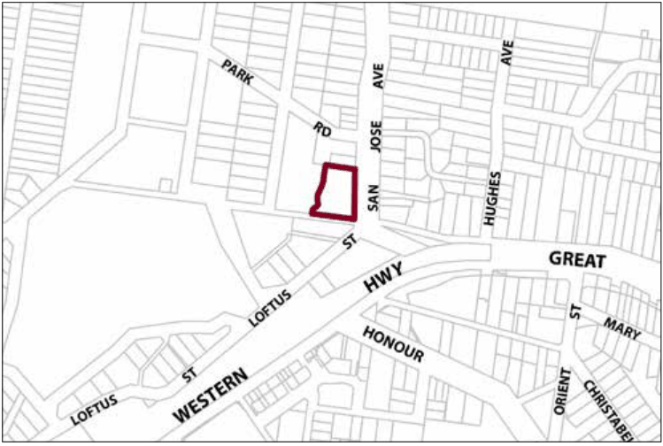

### G7.2 Lawson Precinct R3-LA02—San Jose Avenue

### Precinct

Development of alternative housing forms provides innovative designs that incorporate elements reflective and sympathetic to the Stratford Girls School tower. The tower continues to be a significant visual and cultural element within Lawson and as such, any development protects and responds to the heritage significance of the site. Reference should be made to the precinct objectives in clause 7.7(2) of LEP 2015.

> [Picture on page 122: a picture, saved as a picture (images/part-g-locality-management-page-122-9.gif, 150 dpi).]

Part G7: Lawson

Lawson Precinct R3-LA02—San Jose Avenue Precinct

#### Controls

C1. Development is to satisfy LEP 2015 clause 7.1 (Development in villages) and be consistent with the precinct objectives of clause 7.7(2) of LEP 2015.

C2. The height of a building is not to exceed the maximum height of building set by clause 4.3 of LEP 2015  and the accompanying Height of Buildings Map.

C3. The floor space ratio of a development is not to exceed the maximum floor space ratio set by clause 4.4 of LEP 2015  and the accompanying Floor Space Ratio Map.

C4. The scale of development is to not exceed the scale of the previous sanatorium and Stratford Girls School building, being a 2-storey brick structure with hipped iron roofs and a maximum height of 8m.

C5. The minimum setback from the San Jose Avenue boundary of the site is 12m.

C6. The minimum setback from the side boundary adjoining Avon House (10 San Jose Avenue) is 8m.

C7. Land zoned C2 Environmental Conservation is not to be taken into consideration when calculating the floor space ratio.

C8. The three-storey tower located in the south-east corner of the site, and its immediate curtilage, are to be retained. The height, massing and location of any development is to ensure that the tower is maintained as the visually dominant feature of the site, particularly when viewed from the surrounding public roads.

C9. Development is to have regard to the recommendations of a detailed heritage impact statement and conservation management plan, and to minimise the impact of development on the site.

C10. The two course, rock-faced masonry wall along the boundary of the site to San Jose Avenue is to be retained as a feature of the site.

C11. The mature boundary trees, including pines and cypresses, located along the San Jose Avenue boundary of the site are to be retained as part of any redevelopment.

Part G7: Lawson

C12. Land zoned C2 Environmental Conservation is to be revegetated with locally indigenous vegetation.

C13. Design elements of the sanatorium and Stratford Girls School building such as brick construction, hipped corrugated metal roofing, arched windows and verandahs are to be incorporated in any building design.
