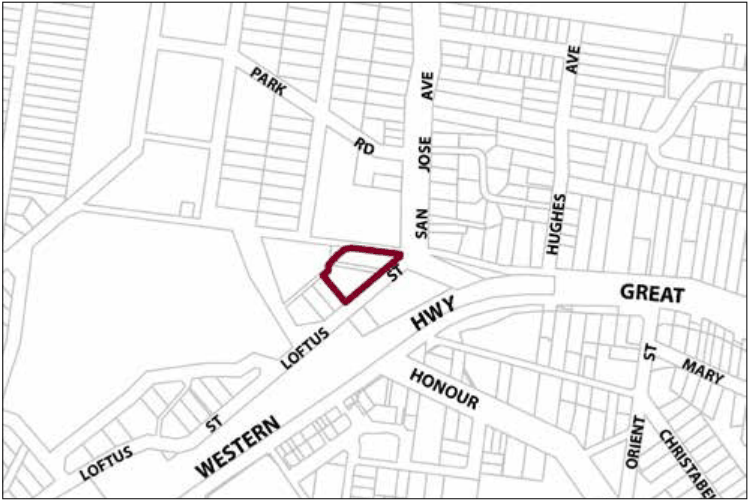

### G7.3 Lawson Precinct R3-LA03—Loftus Street Precinct

The two heritage items within the precinct are maintained and conserved. The relationship between the two buildings is retained and these buildings remain in use for public purposes. Landscaping elements are introduced within the Loftus Street setback reflective of the garden character typical of the locality. Residential development is provided to the rear of the site in a manner that responds to the topography of the site. Reference should be made to the precinct objectives in Clause 7.7(3) of LEP 2015.

> [Picture on page 124: a picture, saved as a picture (images/part-g-locality-management-page-124-11.gif, 150 dpi).]

Part G7: Lawson

Lawson Precinct R3-LA03—Loftus Street Precinct

#### Controls

C1. Development is to satisfy LEP 2015 clause 7.1 (Development in villages) and be consistent with the precinct objectives of clause 7.7(3) of LEP 2015.

C2. The height of a building is not to exceed the maximum height of building set by clause 4.3 of LEP 2015  and the accompanying Height of Buildings Map.

C3. The floor space ratio of a development is not to exceed the maximum floor space ratio set by clause 4.4 of LEP 2015  and the accompanying Floor Space Ratio Map.

C4. Land zoned C2 Environmental Conservation is not to be taken into consideration when calculating the floor space ratio.

Note: Refer to the LEP 2015 Floor Space Ratio Map.

C5. Landscape screening is to be provided for the development when viewed from Loftus Street.

C6. A curtilage is to be provided to the heritage items in the following manner: 15m to the west of the former Shire offices, 6m to the north-west of the Shire offices and the former Electricity Substation, and 4m to the south-west of the former Electricity Substation.

C7. Development is to have regard to the recommendations of a detailed heritage impact statement and conservation management plan, and to minimise the impact of development on the site.

C8. The heritage items on the site are to be retained and incorporated into the design of the development.

C9. Public access to the heritage items is to be maintained.

C10. Land between the two heritage items is to be maintained and landscaped.

C11. The land between the heritage buildings may be considered suitable for the purpose of driveways used to access a future housing development on the site if the treatment of the entry and driveways, including landscaping, complements the heritage buildings.

Part G7: Lawson

C12. Land zoned C2 Environmental Conservation is to be revegetated with locally indigenous vegetation.
