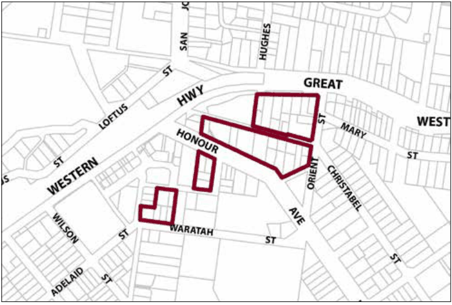

### G7.4 Lawson Precinct R3-LA04—Housing Precinct

A mix of single and multiple-unit dwellings are located close to the town centre and expand the range of residential accommodation available in the Lawson Village. All heritage items in the precinct are conserved. Redevelopment is encouraged to restore existing traditional cottages, and retain visually significant elements of established garden settings. New buildings reflect the pattern, scale and architectural style of traditional modest cottages surrounded by established gardens. Reference should be made to the precinct objectives in clause 7.7(4) of LEP 2015.

> [Picture on page 126: a picture, saved as a picture (images/part-g-locality-management-page-126-11.gif, 150 dpi).]

Part G7: Lawson

Lawson Precinct R3-LA04—Housing Precinct

#### Controls

C1. Development is to satisfy LEP 2015 clause 7.1 (Development in villages) and be consistent with the precinct objectives of clause 7.7(4) of LEP 2015.

C2. The height of a building is not to exceed the maximum height of building set by clause 4.3 of LEP 2015  and the accompanying Height of Buildings Map.

C3. The floor space ratio of a development is not to exceed the maximum floor space ratio set by clause 4.4 of LEP 2015  and the accompanying Floor Space Ratio Map.

C4. The height above ground for the lowest habitable floor level is not to exceed 1.5m.

C5. Cut or fill within 5m of any property boundary is not to exceed 0.5m.

C6. Development is to provide setbacks to the primary street frontage consistent with that of adjacent buildings.

C7. Side boundary setbacks are to be a minimum of 2m.

C8. All setback areas are to be landscaped.

C9. The maximum site cover for buildings is 50% of the total allotment area.

C10. The minimum area to be retained as soft, pervious or landscaped area (excluding hard surfaces) is 40% of the total allotment area.

C11. Development is to be sited, designed and constructed to minimise impacts upon surrounding bushland.

C12. Landscaping is to minimise impacts on neighbouring bushland communities whilst minimising bush fire hazard. New landscape plantings are to be either endemic to the locality or be of low to mid invasive potential.

Part G7: Lawson

C13. New development is to be sympathetic to traditional building forms, materials and details, including the use of traditionally-pitched roofs, articulated layouts and forms, verandahs, timber joinery, vertically– proportioned openings and some painted external finishes, with a curtilage of landscaped areas and an address to the street provided. New development is to be similar in form and materials to quality older buildings but subservient in detail to distinguish it as new work.

C14. Buildings are not to exceed 15m width or depth in any direction.

C15. Driveways, parking areas and garages are not to dominate any street frontage, and are to be integrated with the design of surrounding landscaped areas.
