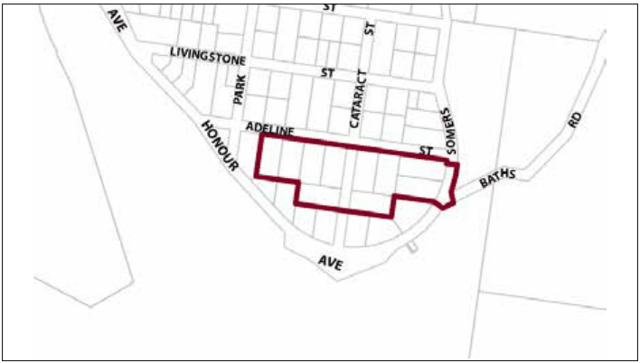
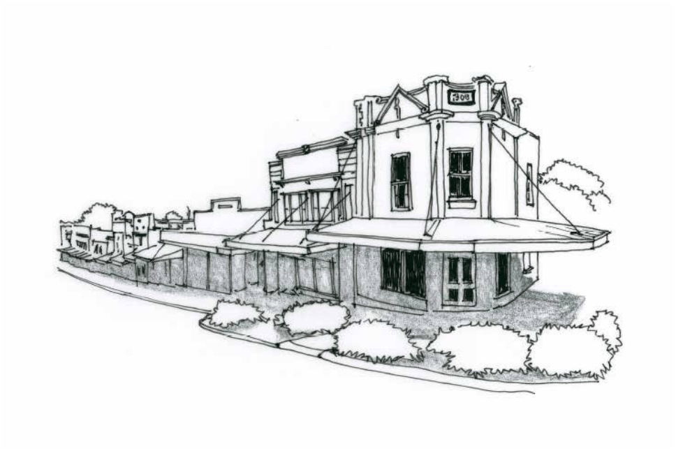

### G7.5 Lawson Precinct E4-LA05—Adeline & Cataract

### Streets Lawson

This precinct provides facilities and services that meet the day to day needs of workers in and around the area, as well as supports the local economy. The precinct is surrounded by established low density residential areas and bushland communities. Therefore, it is necessary to facilitate compatible employment uses, with new development incorporating measures to mitigate operational impacts upon adjoining or adjacent residential land uses. Future development is designed and landscaped in accordance with its bushland setting, to create a transition between employment precincts and low density residential areas, while low density residential development in established residential areas does not compromise existing employment uses. Reference should be made to the precinct objectives in clause 7.7(5) of LEP 2015.

> [Picture on page 128: a picture, saved as a picture (images/part-g-locality-management-page-128-14.gif, 150 dpi).]

Part G7: Lawson

Lawson Precinct E4-LA05—Adeline & Cataract Streets Lawson

#### Controls

C1. Development is to satisfy LEP 2015 clause 7.1 (development in villages) and be consistent with the precinct objectives of clause 7.7(5) of LEP 2015.

C2. The height of a building is not to exceed the maximum height of building set by clause 4.3 of LEP 2015 and the accompanying Height of Buildings Map.

C3. The floor space ratio of a development is not to exceed the maximum floor space ratio set by clause 4.4 of LEP 2015 and the accompanying Floor Space Ratio Map.

C4. Setbacks are to be a minimum 4m and a maximum of 8m from the front boundary and side and rear setbacks will be subject to a merit-based assessment.

C5. The minimum area to be retained as pervious area for land is 30% of the total allotment area.

C6. Cut or fill within 5m of any property boundary is not to exceed 0.5m.

C7. Landscaping is to minimise impacts on neighbouring bushland communities whilst minimising bushfire hazard. New landscape plantings are to be either endemic to the locality or be of low to nil invasive potential.

C8. Existing priority weeds must be removed or controlled where identified on a proposed development site.

C9. Any fencing along the front boundary of the site and along any side boundary that is located within the front building setback applying to the land must be decorative. The sole use of pre-painted metal or standard paling fencing is not permitted.

C10. All parking demands generated by developments are to be met fully on-site.

C11. Any parking and heavy vehicle loading and manoeuvring areas are to be designed to minimise visual impact when viewed from the public domain, and to be safely and efficiently designed.

Part G7: Lawson

C12. An area for storing garbage and recycling shall be provided, suitably located and screened. Where a development adjoins residential development, the garbage storage area must be located at least 3 metres from the common boundary of the residential property and the development site.

C13. Any lighting system utilised in common areas, car parking areas and along pathways must be baffled to ensure that a light source is not directly visible from a habitable room window of any residential development, whilst maintaining adequate lighting of the subject site.

C14. New development is to incorporate appropriate levels of lighting to all pedestrian areas.

C15. All development for non-residential purposes must be designed and constructed to provide access to and within all areas or facilities of the development where there is a reasonable expectation for access by any individual, accompanying persons or groups. The access is to be in accordance with AS 1428 – Design for Access and Mobility.

C16. Acoustic treatments are to be incorporated where necessary and practicable to minimise disturbance to any residents of adjoining dwellings or accommodation suites.

C17. The development must be designed and located so that solar access to the living areas (excludes bedrooms, bathrooms and utility areas) and private open space areas of any adjoining residential properties or any employees outdoor recreation areas is not reduced to less than 3 hours between 9am and 3pm on 21st June.

C18. All buildings are to be insulated to maximise the energy efficiency of the building by providing insulation of the roof or ceiling with a minimum R3 rating. A minimum R1.5 insulation is required within the walls of any building.

C19. Warehouse and industrial buildings shall be equipped with permanent ridge venting.

C20. On any allotment adjoining an existing residential land use, facades are to locate doors or windows, or both, in a way that is designed to protect residential amenity.

C21. Buildings are to reflect the principles of water sensitive urban design.

Part G7: Lawson

C22. Setbacks for residential

(a) front building setback is to be within 20% of the average setback of buildings on immediately adjoining allotments in established areas or, where there are no buildings on these allotments, a minimum of 8m from the primary road frontage, and

(b) in the case of corner lots, building setback from the secondary frontage is to be a minimum of 3m, and

(c) in the case of hatchet shaped lots, building setback from the rear boundary of the lot in front is to be a minimum of 9m, and

(d) setback from side and rear boundaries is to be a minimum of 1m.

C23. The site coverage for residential development shall not exceed—

(a) if the area of the relevant part is less than 1,000 square metres—160 square metres or 30% of the relevant part (whichever is greater), or

(b) if the area of the relevant part is at least 1,000 square metres, but less than 2,000 square metres—300 square metres plus an additional number of square metres equal to 10% of the amount by which the area of the relevant part exceeds 1,000 square metres, or

(c) if the area of the relevant part is at least 2,000 square metres—400 square metres plus an additional number of square metres equal to 5% of the amount by which the area of the relevant part exceeds 2,000 square metres, but not exceeding 2,500 square metres.

(d) despite subclause (a), (b) and (c), development consent may be granted for development that exceeds the maximum site coverage permitted by those paragraphs if a report prepared by a suitably qualified person demonstrates that the development would have a beneficial effect on stormwater management by incorporating measures such as infiltration and detention systems.

C24. Pervious area for residential development will comprise at least 60% of the lot.

Part G7: Lawson

Part G7: Lawson

### LEURA

| G8.1 | Leura Precinct E1-LE01—Leura Mall Precinct | 756 |
|---|---|---|
| G8.2 | Leura Precinct R1-LE02—Leura Gateway Precinct | 759 |
| G8.3 | Leura Precinct R1-LE03—Southern Tourist Precinct | 761 |
| G8.4 | Leura Precinct R3-LE04—Grose Street North Precinct | 763 |
| G8.5 | Leura Precinct R3-LE05—Wascoe Street Precinct | 765 |
| G8.6 | Leura Precinct R3-LE06—Eastern Edge Precinct | 766 |
| G8.7 | Leura Precinct RP-LE07 – Former Leura Golf Clubhouse Precinct | 768 |
| G8.8 | Leura Precinct R1-LE08—Chambers Road Precinct | 772 |
| G8.9 | Leura Precinct SP3-LE07— Sublime Point Road Precinct | 774 |

> [Picture on page 133: a picture, saved as a picture (images/part-g-locality-management-page-133-3.gif, 150 dpi).]
