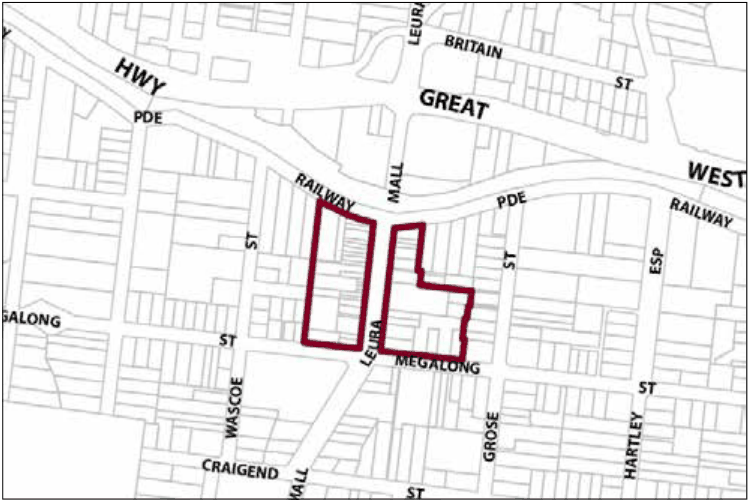

### G8.1 Leura Precinct E1-LE01—Leura Mall Precinct

This precinct continues to operate as a traditional shopping strip for Leura residents as well as the central focus for tourists to Leura. Presenting a village scale and character, the streetscape is dominated by the near continuous row of one- and two-storey shop fronts of early twentieth-century Federation, Edwardian and Inter-War buildings. The large central median island lined with cherry trees represents a safe haven for pedestrians with the adjacent footpaths providing important areas of character and interest. New development is to be of the highest design quality and to respect the existing character and scale of this fine-grained commercial precinct. The mall will increasingly become a community focus area and gathering place for local residents and tourists. The precinct will experience a gradual increase in the range of local services and facilities available, and require the reuse and development of upper floor areas for commercial and residential uses. The precinct is to remain a pedestrian-friendly environment and provide a range of retail uses and services. Reference should be made to the precinct objectives in clause 7.8(1) of LEP 2015.

> [Picture on page 134: a picture, saved as a picture (images/part-g-locality-management-page-134-19.gif, 150 dpi).]

Part G8: Leura

Leura Precinct E1-LE01—Leura Mall Precinct

#### Controls

C1. Development is to satisfy LEP 2015 clause 7.1 (Development in villages) and be consistent with the precinct objectives of clause 7.8(1) of LEP 2015.

C2. The height of a building is not to exceed the maximum height of building set by clause 4.3 of LEP 2015  and the accompanying Height of Buildings Map.

C3. The floor space ratio of a development is not to exceed the maximum floor space ratio set by clause 4.4 of LEP 2015  and the accompanying Floor Space Ratio Map.

C4. Development is to generally have zero front and side setbacks, unless a side boundary adjoins the public domain and an active street frontage is proposed that positively contributes to the public domain.

C5. Development may provide a maximum site cover of 100% of the total allotment area, except where adjoining an allotment within zone E4 Environmental Living or within the block bounded by Quinns Avenue, Wascoe Street, and Megalong Street, where the maximum site cover is to be 70% of the total allotment area.

C6. The existing continuity of retail and other businesses facing Leura Mall, Megalong Street or Railway Parade is to be maintained.

Part G8: Leura

C7. On properties with secondary frontages to the public domain, new commercial businesses are to be promoted along at least 50% of those ground level frontages to public carparks, side streets and laneways, and for all storeys above ground, balconies and/or extensive windows overlooking the street are to be provided.

C8. New development is to have regard to the scale, forms and detailing of traditional shopfront buildings, and to ensure that where appropriate, continuous awnings and/or balconies are provided.

Note: Guidelines on traditional shopfront design are found in B3.1.3 Infill shopfront buildings in B3 Character and design, and in D9.7 Traditional shopfront buildings in Part D Heritage  where heritage considerations apply.

C9. For properties with existing two-storey traditional shop terraces, future development is to retain and restore the principal shop front structure plus the adjoining rooms.

Note: Guidelines on traditional shopfront design are found in B3.1.3 Infill shopfront buildings in B3 Character and design, and in D9.7 Traditional shopfront buildings in Part D Heritage  where heritage considerations apply.

C10. Development on large allotments is to distribute floorspace into well-articulated structures that are composed of separate wings or interconnected buildings, with traditionally pitched roofs and appropriately landscaped garden courtyards with canopy trees.

C11. On-site parking areas are to be accessed only from the rear or side of buildings via existing public carparks, laneways or secondary streets, and are to be concealed behind retail or business floorspace wherever possible.

C12. The existing pedestrian network should be expanded by promoting new retail frontages surrounding the public carparks or facing side streets and laneways.

C13. Solar access to the public domain is to be protected and enhanced.

C14. Continuous weather protection along all public frontages in the form of awnings or overhanging balconies is to be provided.

C15. Ground floor walls and structures are to protect and enhance sight lines in public places.

Part G8: Leura
