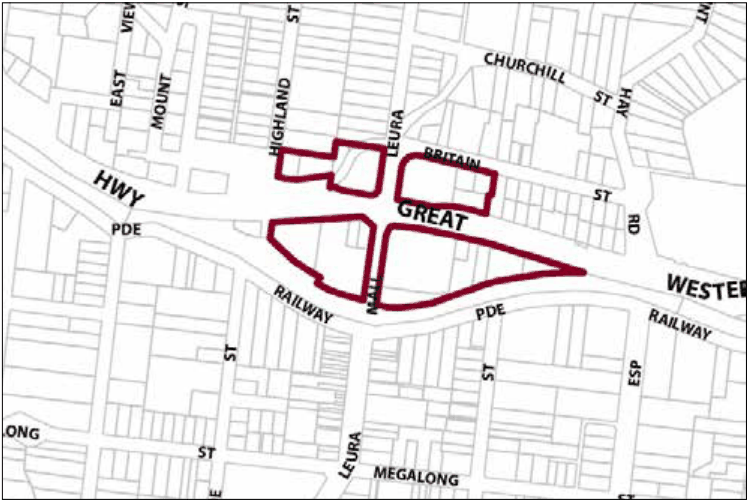

### G8.2 Leura Precinct R1-LE02—Leura Gateway Precinct

Located adjacent to the primary road and rail corridors, this precinct experiences substantial redevelopment of sites and operates as the “gateway” to the Leura Village. New development supports this gateway role by presenting urban design of the highest quality that contributes to a positive first experience of the Leura Village. This, together with a mix of land uses that support the tourist role of the village serves as an enticement to passing traffic. Development of this precinct, including the changes to the Highway interchange, assist in enhancing both pedestrian and vehicle access to the Village and enhance connectivity between north and south Leura. Whilst offering high levels of accessibility to both pedestrians and vehicles, potential conflicts between the two are minimised. The form and scale of new development responds to that of existing buildings in the village and new buildings shall address both the highway and the Leura Mall. Signage associated with development is provided at a modest scale and does not seek to be legible from the distant approaches. New buildings on the old Chateau Napier site respect the heritage of the previous use, but recapture the landmark status of that site. Reference should be made to the precinct objectives in clause 7.8(2) of LEP 2015.

> [Picture on page 137: a picture, saved as a picture (images/part-g-locality-management-page-137-20.gif, 150 dpi).]

Part G8: Leura

Leura Precinct R1-LE02—Leura Gateway Precinct

#### Controls

C1. Development is to satisfy LEP 2015 clause 7.1 (Development in villages) and be consistent with the precinct objectives of clause 7.8(2) of LEP 2015.

Part G8: Leura

| C2. | The height of a building is not to exceed the maximum height of building set by clause 4.3 of LEP 2015 and the accompanying Height of Buildings Map. |
|---|---|
| C3. | The floor space ratio of a development is not to exceed the maximum floor space ratio set by clause 4.4 of LEP 2015 and the accompanying Floor Space Ratio Map. |
| C4. | The height above ground for the lowest habitable floor level is not to exceed 1.5m. |
| C5. | Cut or fill within 5m of any property boundary is not to exceed 0.5m. |
| C6. | Development is to provide setbacks to the Great Western Highway and Leura Mall consistent with that of existing and adjacent buildings in the precinct. |
| C7. | The maximum site cover for buildings is 50% of the total allotment area. |
| C8. | The minimum area to be retained as soft, pervious or landscaped area (excluding hard surfaces) is 40% of the total allotment area. |
| C9. | New development is to be sympathetic to nearby traditional building forms, materials and details, including the use of traditionally-pitched roofs, articulated layouts and forms, verandahs, timber joinery, vertically–proportioned openings and some painted external finishes, with a curtilage of landscaped areas and an address to the street provided. New development is to be similar in form and materials to quality older buildings but subservient in detail to distinguish it as new work. |
| C10. | Buildings are not to exceed 18m width or depth in any direction. |
| C11. | New development may incorporate prominent or landmark features at the corner of Leura Mall and the Great Western Highway. |
| C12. | Driveways, parking areas and garages are not to dominate any street frontage, and are to be integrated with the design of surrounding landscaped areas. |
| C13. | Gardens and landscaped areas are to protect and enhance exotic and indigenous canopy trees, which provide a visual backdrop that contributes to the character of the precinct. |
