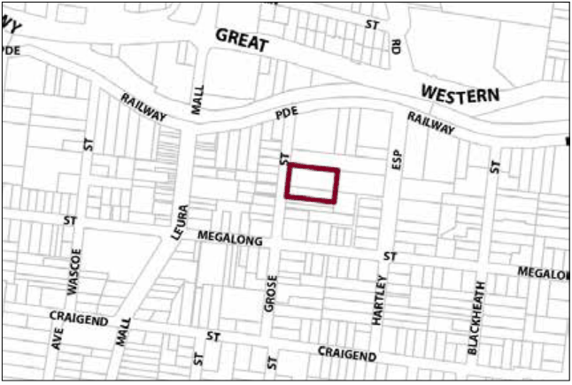

### G8.4 Leura Precinct R3-LE04—Grose Street North

### Precinct

An area that has a significant streetscape character. Older cottages are retained whilst sensitively designed residential infill development is located at the rear of lots. Development on vacant lots is to  maintain the existing residential character through the presentation of single storey dwellings with landscaped front setbacks. Reference should be made to the precinct objectives in clause 7.8(4) of LEP 2015.

> [Picture on page 141: a picture, saved as a picture (images/part-g-locality-management-page-141-9.gif, 150 dpi).]

Part G8: Leura

Leura Precinct R3-LE04—Grose Street North Precinct

#### Controls

C1. Development is to satisfy LEP 2015 clause 7.1 (Development in villages) and be consistent with the precinct objectives of clause 7.8(4) of LEP 2015.

C2. The height of a building is not to exceed the maximum height of building set by clause 4.3 of LEP 2015  and the accompanying Height of Buildings Map.

C3. The floor space ratio of a development is not to exceed the maximum floor space ratio set by clause 4.4 of LEP 2015  and the accompanying Floor Space Ratio Map.

C4. The minimum setback from Grose Street is 12m.

C5. Existing older dwellings (pre-1946) are to be retained and incorporated as part of the redevelopment of the site.

C6. Design of buildings is to allow for direct views from the living areas of dwellings into the adjoining parkland.

C7. Landscaping is to be in character with adjoining gardens and is to be provided within the front setback.

Part G8: Leura
