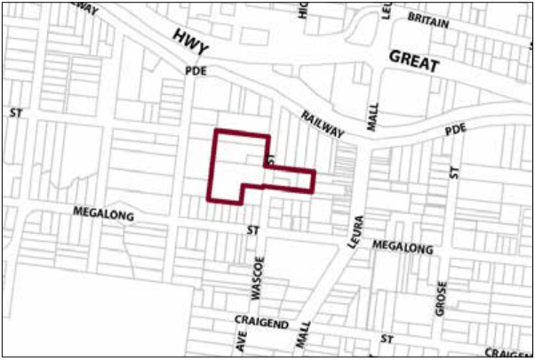

### G8.5 Leura Precinct R3-LE05—Wascoe Street Precinct

Alternative forms of housing are consolidated in close proximity to Leura village. Mitigation measures are undertaken that minimise the impact of development and contribute to the regeneration of the adjacent watercourse buffer areas. Reference should be made to the precinct objectives in clause 7.8(5) of LEP 2015.

> [Picture on page 143: a picture, saved as a picture (images/part-g-locality-management-page-143-6.gif, 150 dpi).]

Leura Precinct R3-LE05—Wascoe Street Precinct

#### Controls

Part G8: Leura

C1. Development is to satisfy LEP 2015 clause 7.1 (Development in villages) and be consistent with the precinct objectives of clause 7.8(5) of LEP 2015.

C2. The height of a building is not to exceed the maximum height of building set by clause 4.3 of LEP 2015  and the accompanying Height of Buildings Map.

C3. The floor space ratio of a development is not to exceed the maximum floor space ratio set by clause 4.4 of LEP 2015  and the accompanying Floor Space Ratio Map.

C4. The minimum setback from Wascoe Street is 8m.

C5. Existing older dwellings (pre-1946) are to be retained and incorporated as part of the redevelopment of any site.

C6. Development is to promote a landscape setting and provide screening of future development through planting of appropriate trees and shrubs that minimise the visibility of development from Megalong Street.

C7. Development is to provide active street frontages to Wascoe Street and Quinns Avenue.
