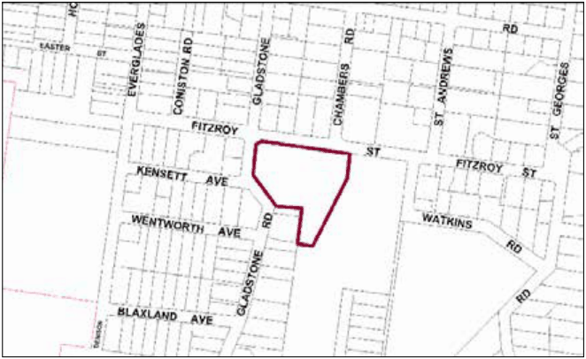

### G8.7 Leura Precinct RP-LE07 – Former Leura Golf

### Clubhouse Precinct

Formerly the site of the Leura Golf Clubhouse and Bowling Club, which has its origins in the early twentieth century, the Former Leura Golf Clubhouse Precinct is in an area of Leura recognised for its streetscape character, landscaped garden setting and areas of older housing. The site has a prominent position on the tourist route between the Leura town centre and Sublime Point. Development in the precinct accommodates accessible housing and a range of services and facilities to meet the needs of residents. Future housing development should contribute to providing a quality living environment for older people, with access to necessary services and facilities. As the focal element of the precinct, the former Leura Golf Clubhouse should be retained as a facility for residents and in recognition of its contribution to the streetscape. The precinct contributes to the character of the locality by establishing a landscape setting and gardens within building setbacks and common open space. Buildings respect the scale and architectural form of surrounding development through articulated roof forms and floor plans and by presenting a generally single-storey appearance.

> [Picture on page 146: a picture, saved as a picture (images/part-g-locality-management-page-146-19.gif, 150 dpi).]

Part G8: Leura

Leura Precinct RP-LE07 – Former Leura Golf Clubhouse Precinct

#### Objectives

O1. To enable the provision of accessible housing with a building form and scale consistent with residential character in the locality and utilising the facilities provided by the former Leura Golf Clubhouse.

O2. To ensure the retention and enhancement of the former Leura Golf Clubhouse for use as a community facility and in recognition of its contribution to the streetscape character of the locality.

O3. To minimise the impact of development on the environment and on residential amenity through appropriate siting and design of buildings.

O4. To maintain and improve streetscape character by establishing a landscaped garden setting, consistent with the settings of residential and other land uses in the locality.

#### Controls

C1. The height of a building is not to exceed the maximum height of building set by clause 4.3 of LEP 2015  and the accompanying Height of Buildings Map.

Note: The height of a building fronting Fitzroy Street may be measured from the finished ground level of the bowling green (rather than from street level):

(a) if measuring from that level is necessary to preserve the landscape setting of the building or to enhance the relationship of the building to Fitzroy Street by limiting the visual prominence of its roof structure, and

(b) provided that the building will have a single-storey appearance from Fitzroy Street.

Part G8: Leura

C2. The floor space ratio of a development is not to exceed the maximum floor space ratio set by clause 4.4 of LEP 2015  and the accompanying Floor Space Ratio Map.

C3. The retention of the Clubhouse as a common facility for residents and an integral component of the streetscape is encouraged.

C4. Buildings fronting Fitzroy Street are to have a setback of not less than 12m and not more than 15m.

C5. Buildings fronting Gladstone Road are to have a setback of not less than 8m.

C6. No buildings are to be located between the former Leura Golf Clubhouse and Fitzroy Street, in an area extending 10m from the outermost walls of the Clubhouse.

C7. A building on land that adjoins residential zoned land or the golf course is to have:

(a) if the building has a building height of 6m or less—an average setback of not less than 4.5m, or

(b) if the building has a building height greater than 6m—an average setback of not less than 6m.

C8. A building located within 50m of the southernmost boundary of the Former Leura Golf Clubhouse Precinct is only likely to be supported if the building:

(a) has a setback of at least 10m from that boundary, and

(b) maintains adequate view lines from each adjoining property on residential zoned land to the golf course, and

(c) contains no more than two dwellings, and

(d) provides a transition in terms of bulk, scale and form between development within the precinct and the housing forms on adjoining residential zoned land.

C9. The maximum site coverage for buildings (including ancillary buildings, swimming pools and tennis courts) is 30% of the total precinct area, except for buildings within 50m of Fitzroy Street, where the maximum site coverage is 1,000m2 (excluding the site coverage of any existing buildings).

C10. The minimum area to be retained as soft, pervious or landscaped areas (excluding hard surfaces) is 55% of the total precinct area.

Part G8: Leura

C11. New development fronting Fitzroy Street is to be sympathetic to nearby traditional building forms, materials and details, including the use of traditionally-pitched roofs, articulated layouts and forms, verandahs, timber joinery, vertically–proportioned openings and some painted external finishes, with a curtilage of landscaped areas and an address to the street provided. New development is to be similar in form and materials to quality older buildings but subservient in detail to distinguish it as new work.

C12. Development on land in the Former Leura Golf Clubhouse Precinct is not to have a detrimental effect on the contribution of the former Leura Golf Clubhouse to the streetscape and character of the locality.

C13. Consent for development on land in the Former Leura Golf Clubhouse Precinct may be granted subject to a condition that requires the creation of a restrictive or positive covenant that provides for the retention and continued maintenance of the former Leura Golf Clubhouse, but this subclause does not:

(a) limit the kinds of conditions that may be imposed on a development consent, or

(b) allow conditions to be imposed on a development consent otherwise than in accordance with the Environmental Planning and Assessment Act 1979.

C14. Consent will not be granted for development involving the demolition of the exterior, or part of the exterior, of the former Leura Golf Clubhouse unless Council is satisfied that the building, or part of the building, proposed for demolition, is either structurally unsound (on the basis of documentary evidence), and not economically repairable (on the basis of documentary evidence prepared by a suitably qualified person that demonstrates that the cost of the repair would exceed the value of the repaired building).

C15. Built forms are to provide a transition from larger buildings in the centre of the Former Leura Golf Clubhouse Precinct to domestic scale cottages, as viewed from the golf course and any public place.

C16. Generally buildings are to have pitched tiled roofs, with materials and form that complement the former Leura Golf Clubhouse. However, low-pitched and/or decked roofs are permissible to internal roof areas of buildings if they are not visible from a public place or from adjacent properties.

C17. Soil within the Fitzroy Street front building setback is to be remediated to provide a deep planting zone, which is to be planted to provide a garden setting that will make a significant contribution to the streetscape within 10 to 15 years.

Part G8: Leura

C18. Buildings are to reflect the principles of water sensitive urban design.

C19. A landscaped screen sufficient to separate the site from existing residential properties on residential zoned land and the golf course is to be provided along the perimeter of the shared boundaries.

C20. Buildings  are to retain existing solar access for a minimum of 3 hours between the hours of 9am to 3pm on 21 June for the living rooms and private open space of existing dwellings.

C21. A variety of heights and forms are to be incorporated, and varied setbacks are encouraged.

C22. Vehicular access to the precinct is to be limited to a single point of access to Fitzroy Street.

C23. Vehicular access, parking and garages for dwellings fronting Fitzroy Street are to be located to the rear of the former bowling green to minimise visibility from the street.
