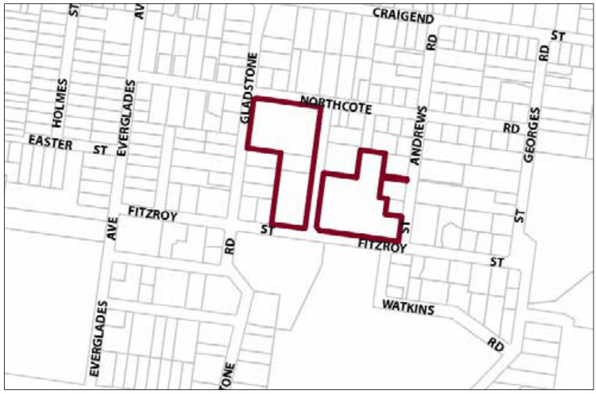

### G8.8 Leura Precinct R1-LE08—Chambers Road Precinct

This precinct incorporates the Waldorf Leura Gardens Resort and Blue Mountains International Hotel Management School as complementary tourist and visitor land uses. Both sites feature landscaped gardens in keeping with prominent traditional garden settings of the adjoining residential area. New development is to retain the visually significant elements of established garden settings and will be sensitive to the pattern, scale, form and detailing of surrounding residential dwellings. Reference should be made to the precinct objectives in clause 7.8(8) of LEP 2015.

> [Picture on page 150: a picture, saved as a picture (images/part-g-locality-management-page-150-10.gif, 150 dpi).]

Part G8: Leura

Leura Precinct R1-LE08—Chambers Road Precinct

#### Controls

C1. Development is to satisfy LEP 2015 clause 7.1 (Development in villages) and be consistent with the precinct objectives of clause 7.8(8) of LEP 2015.

C2. The height of a building is not to exceed the maximum height of building set by clause 4.3 of LEP 2015 and the accompanying Height of Buildings Map.

C3. The floor space ratio of a development is not to exceed the maximum floor space ratio set by clause 4.4 of LEP 2015 and the accompanying Floor Space Ratio Map.

C4. The minimum setback from the street frontages is 8m.

C5. The minimum setback to any side and rear boundary where the precinct boundary does not adjoin a street is 1.0m.

C6. The maximum site coverage for each part of the precinct, that is, east of Chambers Road and west of Chambers Road, shall not exceed 40% of the site area.

C7. The minimum area to be retained as soft, pervious or landscaped area (excluding hard surfaces) for each part of the precinct, that is, east of Chambers Road and west of Chambers Road, is 50%.

C8. Development is to provide articulation and building modulation in order to minimise the bulk of buildings.

C9. Development is to be sympathetic in terms of bulk, scale and form and provide for an appropriate transition to adjoining residential dwellings.

C10. Development is to provide landscaping to adjoining street frontages that is reflective of the traditional garden setting typical of the surrounding neighbourhood.

C11. Any future landscaping works is to ensure that the existing landscape character is retained and enhanced.

Part G8: Leura

C12. Development is to be undertaken in a manner which conserves significant landscape elements. Where their conservation cannot be achieved sufficient compensatory plantings of similar structure, form and character to the existing landscape is to be provided and maintained.

C13. Development is to retain and enhance the landscaped areas at the corner of Northcote and Gladstone Road (of approximately 1,500m²) and at the corner of St Andrew Road and Fitzroy Street (of approximately 2,500m²), in keeping with the traditional garden setting typical of the surrounding neighbourhood.

C14. Garages, access and car parking are to be integrated into landscaped areas such that they are well screened from the public domain with garages and parking areas located so as not to adversely impact upon streetscape, pedestrian circulation, building character and adjoining residential amenity.
