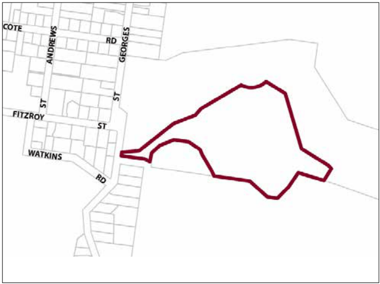
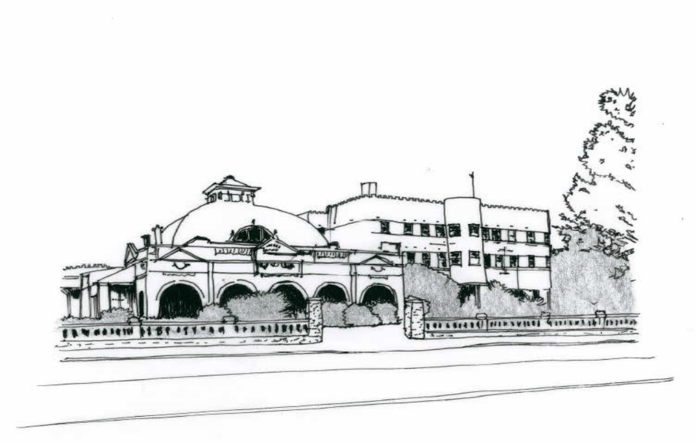

### G8.9 Leura Precinct SP3-LE07— Sublime Point Road

### Precinct

The Fairmont Resort is located on the edge of Leura Village and the World Heritage Blue Mountains National Park overlooking the Jamison Valley to the south and Leura Golf course to the north. The resort provides luxury accommodation and includes facilities suitable for both weddings and conferences. Existing native vegetation on the site is to be retained as a protective interface to the adjoining National Park. Future development must take into consideration the sensitivity of the location in relation to the exceptionally important areas of environmental and cultural value. Consideration of bulk and scale, settings, views, architectural treatments and commercial signage are paramount. Note: Precinct controls do not apply to land zoned C2 Environmental Conservation Reference should be made to the precinct objectives in clause 7.8(7) of LEP 2015.

> [Picture on page 152: a picture, saved as a picture (images/part-g-locality-management-page-152-17.gif, 150 dpi).]

Part G8: Leura

Leura Precinct SP3-LE07— Sublime Point Road Precinct

#### Controls

C1. Development is to satisfy LEP 2015 clause 7.1 (Development in villages) and be consistent with the precinct objectives of clause 7.8(7) of LEP 2015.

C2. The height of a building is not to exceed the maximum height of building set by clause 4.3 of LEP 2015 and the accompanying Height of Buildings Map.

C3. The floor space ratio of a development is not to exceed the maximum floor space ratio set by clause 4.4 of LEP 2015 and the accompanying Floor Space Ratio Map.

C4. The minimum setback from the street frontage is 8.0m.

C5. The maximum site cover for buildings is 20% of the total allotment area.

C6. Development is to be located within the central core of the site to minimise and mitigate any impact of development on the adjoining National Park and land zoned C2 Environmental Conservation.

C7. Development is to provide articulation and building modulation in order to minimise the bulk of buildings.

C8. Development is to utilise non-reflective material and muted colours that ensure the development blends into the broader landscape when viewed from any public place.

Part G8: Leura

C9. The minimum area to be retained as soft, pervious or landscaped area (excluding hard surfaces) is 65% of the total allotment area.

C10. Plant species used within landscaping adjoining land zoned C1 or C2, must be endemic to that locality.

C11. Garages, access and car parking are to be integrated into landscaped areas such that they are well screened from the public domain. Garages and parking areas shall not adversely impact upon streetscape, pedestrian circulation, and building character.

Part G8: Leura

### MEDLOW BATH

G9.1 Medlow Bath Precinct SP3-MB01—Great Western Highway Precinct

778

> [Picture on page 155: a picture, saved as a picture (images/part-g-locality-management-page-155-4.gif, 150 dpi).]
