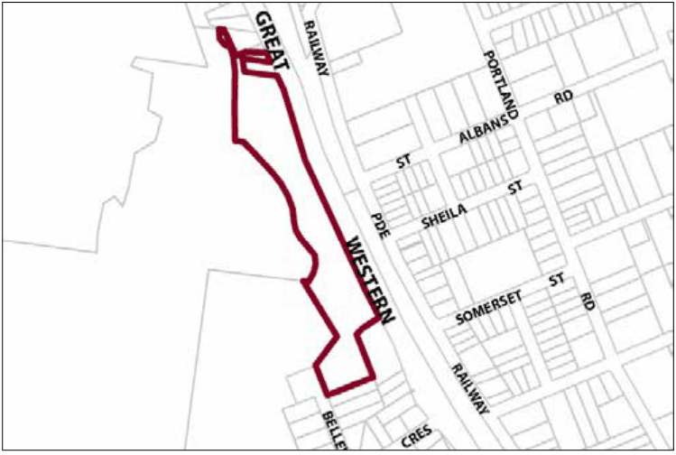

### G9.1 Medlow Bath Precinct SP3-MB01—Great Western

### Highway Precinct

The area is characterised by the historical association of the site with the Hydro Majestic and the development of associated tourist and highway uses. The area has views over Megalong Valley and is constrained by the presence of the escarpment on the south-western boundary. Future development is to respond to the environmental constraints imposed by the precinct’s location and maintain the dominance of the Hydro Majestic. Tourist uses are to be consolidated and the area promoted as a predominant tourist attraction within the Blue Mountains. Reference should be made to the precinct objectives in clause 7.9 of LEP 2015.

> [Picture on page 156: a picture, saved as a picture (images/part-g-locality-management-page-156-12.gif, 150 dpi).]

Part G9: Medlow Bath

Medlow Bath Precinct SP3-MB01—Great Western Highway Precinct

#### Controls

C1. Development is to satisfy LEP 2015 clause 7.1 (Development in villages) and be consistent with the precinct objectives of clause 7.9 of LEP 2015.

C2. Consent must not be granted unless the consent authority has considered a heritage impact statement and conservation management plan that proposes measures to minimise the impact of development on the Hydro Majestic and its grounds.

Note: Refer to the heritage provisions of D Heritage Conservation.

C3. The height of a building is not to exceed the maximum height of building set by clause 4.3 of LEP 2015  and the accompanying Height of Buildings Map.

C4. The floor space ratio of a development is not to exceed the maximum floor space ratio set by clause 4.4 of LEP 2015  and the accompanying Floor Space Ratio Map.

C5. The minimum front setback is 10m.

C6. The maximum site coverage for any development is not to exceed 35%.

C7. Appropriate landscaping shall be provided within the front setback.

C8. The existing mature vegetation on the site (particularly Pinus radiata) is to be retained.

C9. Front facades are to address the street and be well-articulated through the provision of architectural features including doors, windows and verandahs.

C10. Building height and roof pitch are to be varied in order to minimise the bulk of buildings.

Part G9: Medlow Bath

C11. Tree planting should be consistent with existing exotic landscaped gardens within the area.

C12. New development is to be constructed of non-reflective, muted colours that do not undermine the visual dominance of the Hydro Majestic Hotel when viewed from Megalong Valley.

C13. The minimum building setback to the C2 zone is 10m.

C14. New development is to be sympathetic in materials and architectural details to the original Hydro Majestic building and any approved Conservation Management Plan for the site. New development is not to adversely impact on the setting and character of the Hydro Majestic particularly when viewed from the Great Western Highway.

C15. Successional planting is to retain and enhance the existing landscape character of the site.

C16. Landscaping adjoining the land zoned C2 Environmental Conservation is to be largely comprised of endemic vegetation.

Note: Additional landscape controls specific to the SP3 zone apply, refer to Part C3.8

Part G9: Medlow Bath

### MOUNT RIVERVIEW

G10.1 Mount Riverview Precinct E1-MR01—Rusden Road Mall Mount Riverview Precinct

782
