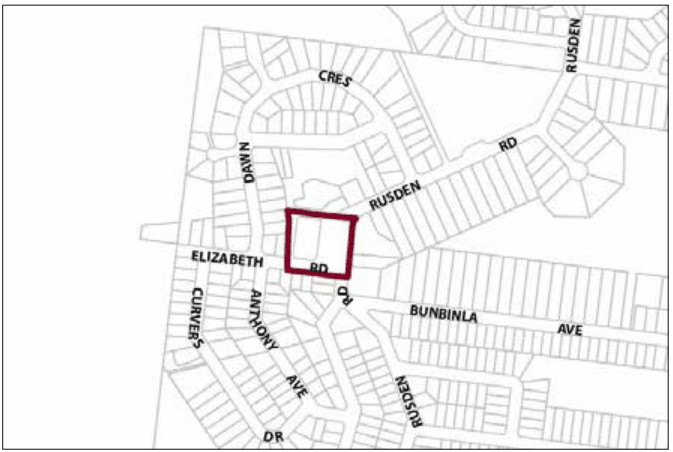
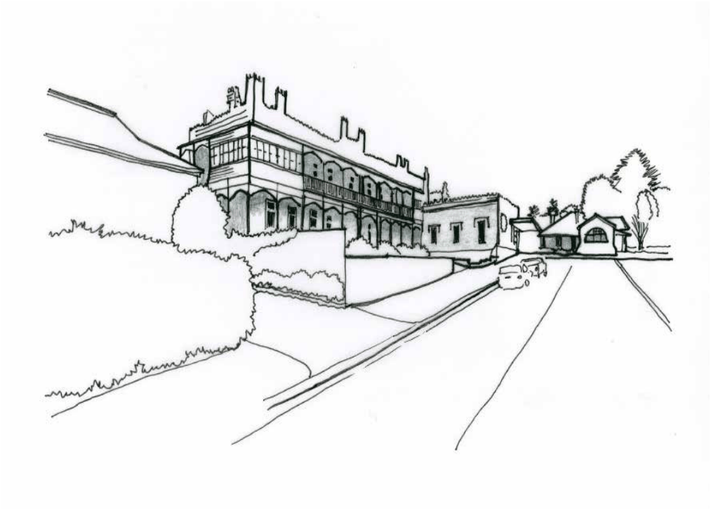

### G10.1	 Mount Riverview Precinct E1-MR01—Rusden

### Road Mall Mount Riverview Precinct

This precinct is a compact local centre, accommodating a diverse range of small scale retail and other commercial businesses that serve the local community as well as visitors. Future development promotes the creation of a distinct village identity and provides the coordinated design of business signage and shop fronts in accordance with a village theme. Non-residential uses are compatible with residential uses and do not unreasonably affect amenity. Reference should be made to the precinct objectives in clause 7.9A of LEP 2015.

> [Picture on page 160: a picture, saved as a picture (images/part-g-locality-management-page-160-11.gif, 150 dpi).]

Part G4: Glenbrook

Part G10: Mount Riverview

Mount Riverview Precinct E1-MR01—Rusden Road Mall Mount Riverview Precinct

#### Controls

C1. Development is to satisfy LEP 2015 clause 7.1 (development in villages) and be consistent with the precinct objectives of clause 7.9A of LEP 2015.

C2. The height of a building is not to exceed the maximum height of building set by clause 4.3 of LEP 2015 and the accompanying Height of Buildings Map.

C3. The floor space ratio of a development is not to exceed the maximum floor space ratio set by clause 4.4 of LEP 2015 and the accompanying Floor Space Ratio Map.

C4. Setbacks are subject to a merit-based assessment having regard to the character of the area and amenity of the neighbouring properties.

C5. The height above ground for the lowest habitable floor level is not to exceed 1m.

C6. Cut or fill within 5m of any property boundary is not to exceed 0.5m.

C7. All setback areas are to be landscaped.

C8. The maximum site cover for buildings is 70% of the total allotment area.

C9. The minimum area to be retained as soft, pervious or landscaped area (excluding hard surfaces) is 20% of the total allotment area.

C10. Walls and structures are to protect and enhance sight lines in the public domain.

C11. Walls are not to be left blank or unarticulated.

C12. Local design themes are to predominate over corporate signage and reflect the village character.

C13. Signage is to be coordinated with shop front design.

Part G4: Glenbrook

Part G10: Mount Riverview

C14. On-site car parking is to be concealed behind commercial premises, or screened by landscaping or an architectural treatment that is consistent with the building adjoining the point of access.

C15. On any allotment adjoining an existing residential property, facades are to locate balconies or windows, or both, in a way that is designed to protect residential amenity.

C16. Any parking and heavy vehicle loading and manoeuvring areas are to be designed to minimise visual impact when viewed from the public domain, and to be safely and efficiently designed.

C17. Each secondary frontage to a public road, lane way or public place is to provide a visible and active street frontage distributed along a minimum of 65% of that frontage.

C18. Street corners are to be reinforced through design elements such as splay walls and orientation of entry and window elements.

C19. Servicing areas are to be located to the rear, western side of buildings to maintain a continuous retail streetscape.

Part G4: Glenbrook

Part G10: Mount Riverview

### MOUNT VICTORIA

| G11.1 | Mount Victoria Precinct E1-MV01—Town Centre Precinct | 786 |
|---|---|---|
| G11.2 | Mount Victoria Precinct R1-MV02—Station Street Precinct | 788 |
| G11.3 | Mount Victoria Precinct R1-MV03—Harley Avenue Precinct | 790 |

> [Picture on page 163: a picture, saved as a picture (images/part-g-locality-management-page-163-3.gif, 150 dpi).]
