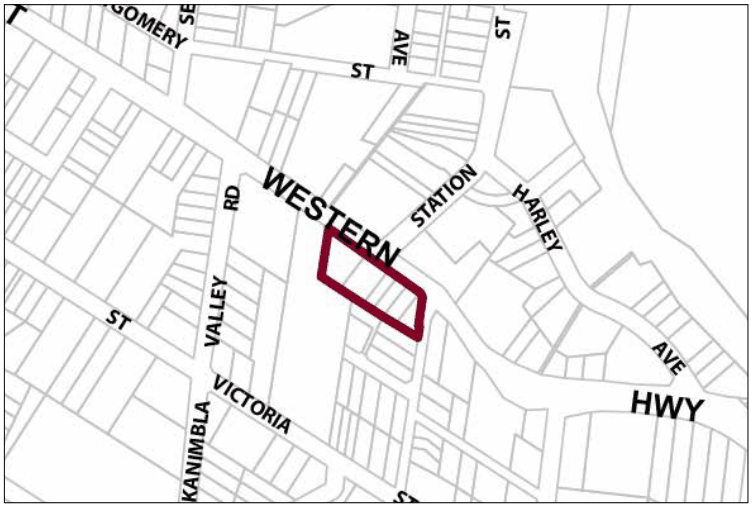

### G11.1	 Mount Victoria Precinct E1-MV01—Town Centre

### Precinct

This is a compact town centre, accommodating a diverse range of small-scale retail and other businesses that serve the resident community as well as visitors, plus a scattering of existing residences. A variety of modestly-scaled cottages, shops and former civic buildings are arranged in a traditional country town pattern that comprises a continuous row of single storey buildings with shop-fronts and garden forecourts. This pattern of buildings provides a scenic and distinctive Highway backdrop, and structures range from the late-Victorian period to the Inter-War period. Buildings provide an active street frontage along the Highway, encouraging pedestrian movement along a safe footpath that is protected from through traffic. Reference should be made to the precinct objectives in clause 7.10(1) of LEP 2015.

> [Picture on page 164: a picture, saved as a picture (images/part-g-locality-management-page-164-16.gif, 150 dpi).]

Part G11: Mount Victoria

Mount Victoria Precinct E1-MV01—Town Centre Precinct

#### Controls

C1. Development is to satisfy LEP 2015 clause 7.1 (Development in villages) and be consistent with the precinct objectives of clause 7.10(1) of LEP 2015.

C2. The height of a building is not to exceed the maximum height of building set by clause 4.3 of LEP 2015  and the accompanying Height of Buildings Map.

C3. The floor space ratio of a development is not to exceed the maximum floor space ratio set by clause 4.4 of LEP 2015  and the accompanying Floor Space Ratio Map.

C4. New development is to respond sympathetically to the adjacent setback patterns and respect established building settings and views.

C5. The maximum site cover for buildings is 50% of the total allotment area.

C6. The minimum area to be retained as soft, pervious or landscaped area (excluding hard surfaces) is 40% of the total allotment area.

C7. Additional floorspace is to be accommodated in single-storey wings added to an existing building, or accommodated in a separate pavilion located to the rear of an existing building and surrounded by landscaped open space.

C8. Gardens are to provide a backdrop of canopy trees along rear boundaries, plus scattered trees and shrubs along any front or side setbacks.

Part G11: Mount Victoria

C9. Driveways, parking areas and garages can be visible from the Highway where appropriate but are not to dominate the street frontage. Safe access must be provided to and from the Highway, and parking areas, driveways and garages are to be integrated with the design of surrounding landscaped areas.
