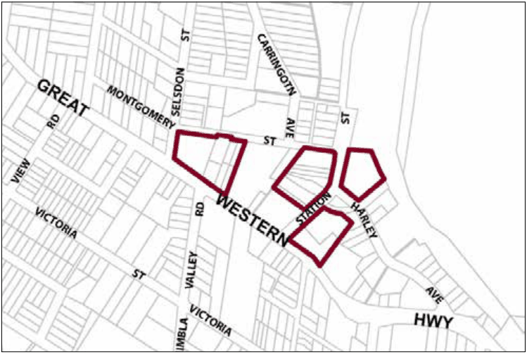

### G11.2	 Mount Victoria Precinct R1-MV02—Station Street

### Precinct

This precinct accommodates a diverse range of small-scale retail and other businesses serving the local community, plus some permanent residences. The variety of buildings and garden settings remain historically and scenically distinctive, and includes landmark guesthouses and hotels, modest shop-terraces and cottages, plus visually prominent backdrops of canopy trees located in back yards or the neighbouring park. Future development is to conserve and enhance the local architectural heritage that includes a range of styles from the mid-Victorian to the Edwardian period, and maintain the established diversity of architectural form and design. Active street frontages are maintained, encouraging pedestrian movement along footpaths that are protected from the undesirable impacts of through traffic. Reference should be made to the precinct objectives in clause 7.10(2) of LEP 2015.

> [Picture on page 166: a picture, saved as a picture (images/part-g-locality-management-page-166-16.gif, 150 dpi).]

Part G11: Mount Victoria

Mount Victoria Precinct R1-MV02—Station Street Precinct

#### Controls

C1. Development is to satisfy LEP 2015 clause 7.1 (Development in villages) and be consistent with the precinct objectives of clause 7.10(2) of LEP 2015.

C2. The height of a building is not to exceed the maximum height of building set by clause 4.3 of LEP 2015  and the accompanying Height of Buildings Map.

C3. The floor space ratio of a development is not to exceed the maximum floor space ratio set by clause 4.4 of LEP 2015  and the accompanying Floor Space Ratio Map.

C4. The height above ground for the lowest habitable floor level is not to exceed 1m.

C5. Cut or fill within 5m of any property boundary is not to exceed 0.5m.

C6. New development is to respond sympathetically to the adjacent setback patterns and respect established building settings and views.

C7. For allotments on the eastern side of Station Street, development is to provide minimum rear boundary setbacks of 10m.

C8. The maximum site cover for buildings is 40% of the total allotment area.

C9. The minimum area to be retained as soft, pervious or landscaped area (excluding hard surfaces) is 50% of the total allotment area.

C10. Building design is to have regard to the heritage significance of existing buildings and gardens.

Part G11: Mount Victoria

C11. Additional floorspace is to be accommodated in wings added to an existing building, or accommodated in a separate pavilion located to the rear of an existing building and surrounded by landscaped open space.

C12. Gardens are to provide a backdrop of canopy trees compatible with species established in Mount Victoria Park, plus scattered trees and shrubs where front or side setbacks are provided.

C13. Driveways, parking areas and garages are not to dominate any street frontage, are to be located to the rear of buildings and accessed from secondary streets or rights of way, and are to be integrated with the design of surrounding landscaped areas.
