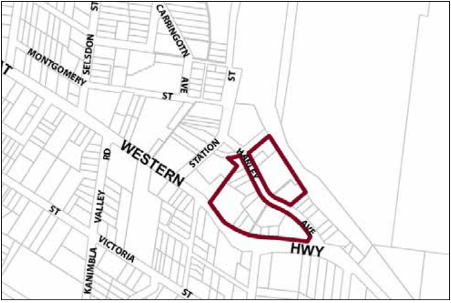
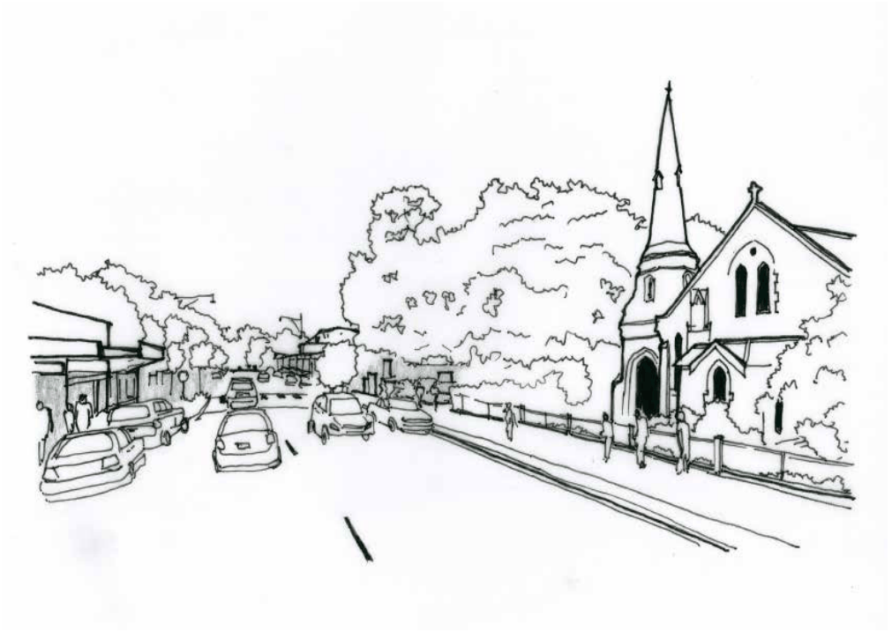

### G11.3	 Mount Victoria Precinct R1-MV03—Harley

### Avenue Precinct

This precinct provides a variety of accommodation for tourists and permanent residents. New residential-style buildings in garden settings minimise disturbance to existing hillside topography and maintain the continuity of existing canopy trees that are visually significant features along the Highway. New buildings will be consistent with and sympathetic to the forms and materials of Victorian, Federation and Edwardian period architecture, and be compatible with the distinctive architectural heritage of the village. Visible indoor activity is maintained along active street frontages to Harley Avenue, encouraging pedestrian movement along footpaths that are protected from the undesirable impacts of through traffic. Reference should be made to the precinct objectives in clause 7.10(3) of LEP 2015.

> [Picture on page 168: a picture, saved as a picture (images/part-g-locality-management-page-168-15.gif, 150 dpi).]

Part G11: Mount Victoria

Mount Victoria Precinct R1-MV03—Harley Avenue Precinct

#### Controls

C1. Development is to satisfy LEP 2015 clause 7.1 (Development in villages) and be consistent with the precinct objectives of clause 7.10(3) of LEP 2015.

C2. The height of a building is not to exceed the maximum height of building set by clause 4.3 of LEP 2015  and the accompanying Height of Buildings Map.

C3. The floor space ratio of a development is not to exceed the maximum floor space ratio set by clause 4.4 of LEP 2015  and the accompanying Floor Space Ratio Map.

C4. The height above ground for the lowest habitable floor level is not to exceed 1.5m.

C5. Cut or fill within 5m of any property boundary is not to exceed 0.5m.

C6. The minimum setback to Harley Avenue is to be 10m.

C7. On corner allotments, the setback to the secondary frontage is to be a minimum of 6m.

C8. Side boundary setbacks are to be a minimum of 3m.

C9. Rear boundary setbacks are to be a minimum of 10m.

C10. The maximum site cover for buildings is 40% of the total allotment area.

C11. The minimum area to be retained as soft, pervious or landscaped area (excluding hard surfaces) is 50% of the total allotment area.

Part G11: Mount Victoria

C12. New development is to be sympathetic to the traditional building forms, materials and details of the precinct, including the use of traditionally-pitched roofs, articulated layouts and forms, verandahs, timber joinery, vertically–proportioned openings and some painted external finishes, with a curtilage of landscaped areas and an address to the street provided. New development is to be similar in form and materials to quality older buildings but subservient in detail to distinguish it as new work.

C13. Development is to respond to the topography through appropriate siting and stepped building forms.

C14. Landscaping is to conserve existing visually prominent trees and be based on appropriate design, layout and species selection.

C15. Garden areas are to maintain the existing backdrop of canopy trees along the Highway boundary, as well as provide space for new trees and shrubs in front and side yards to frame buildings, driveways and parking areas.

C16. Driveways, parking areas and garages are not to dominate any street frontage, and are to be integrated with the design of surrounding landscaped areas.

Part G11: Mount Victoria

### SPRINGWOOD

| G12.1 | Springwood Precinct E2-SP01—Town Centre Precinct | 794 |
|---|---|---|
| G12.2 | Springwood Precinct R3-SP02—Ferguson Road Precinct | 797 |
| G12.3 | Springwood Precinct R3-SP03—Western Precinct | 799 |
| G12.4 | Springwood Precinct R3-SP04—Southern Precinct | 801 |
| G12.5 | Springwood Precinct R3-SP05—Eastern Precinct | 803 |
| G12.6 | Springwood Precinct E4-SP06—Ferguson Road Precinct | 805 |

> [Picture on page 171: a picture, saved as a picture (images/part-g-locality-management-page-171-3.gif, 150 dpi).]
