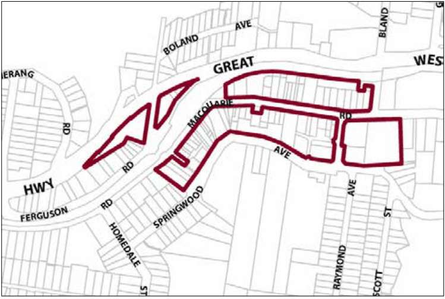

### G12.1	 Springwood Precinct E2-SP01—Town Centre

### Precinct

This precinct remains a compact town centre, accommodating a diverse range of small-to-medium scale retailers, other businesses and permanent residents. Buildings are arranged in a traditional main street pattern with continuous rows of one- and two-storey shop fronts interspersed by landmark hotels, with a scattering of visually prominent canopy trees on hillsides facing Springwood Avenue and the railway. Development provides visible indoor activity facing all public places, including streets, laneways and car parks, in order to concentrate pedestrian movement outdoors and to encourage informal community meeting places. Buildings are designed to reflect the local architectural tradition of Edwardian and Inter-War retail terraces, displaying some overall diversity of form and design, and maintaining National Park vistas that are available from public places. Reference should be made to the precinct objectives in clause 7.11(1) of LEP 2015.

> [Picture on page 172: a picture, saved as a picture (images/part-g-locality-management-page-172-17.gif, 150 dpi).]

Part G12: Springwood

#### Springwood Precinct E2-SP01—Town Centre Precinct

#### Controls

C1. Development is to satisfy LEP 2015 clause 7.1 (Development in villages) and be consistent with the precinct objectives of clause 7.11(1) of LEP 2015.

C2. The height of a building is not to exceed the maximum height of building set by clause 4.3 of LEP 2015  and the accompanying Height of Buildings Map.

C3. The floor space ratio of a development is not to exceed the maximum floor space ratio set by clause 4.4 of LEP 2015  and the accompanying Floor Space Ratio Map.

C4. Development is to have a zero front setback, except to Springwood Avenue, where the setbacks are to be 6m with landscaping provided.

C5. Development is to have a zero side setback, except where the side boundary adjoins the public domain, in which case setbacks greater than zero may be considered if an active frontage is provided.

C6. The maximum site cover for buildings is 100% of the total allotment area, except on properties with frontages to Springwood Avenue where the maximum site cover is 70%.

C7. The existing continuity of retail and other business premises on properties that face Macquarie or Raymond Roads is to be retained.

Part G12: Springwood

C8. On properties with secondary frontages to the public domain, new retail or other business premises to those secondary frontages are to be promoted along at least 50% of ground level frontages to public carparks, side streets and laneways, and for all storeys above ground, balconies and/or extensive windows facing the public domain are to be provided.

C9. On properties facing Springwood Avenue, extensive balconies and/or windows are to be provided in all facades facing that street.

C10. New development is to have regard to the scale, forms and detailing of traditional shopfront buildings, and to ensure that where appropriate, continuous awnings and/or balconies are provided.

Note: Guidelines on traditional shopfront design are found in B3.1.3 Infill shopfront buildings in B3 Character and design, and in D9.7 Traditional shopfront buildings in Part D Heritage  where heritage considerations apply.

C11. On properties that contain two-storey traditional shop buildings, new development is to retain the principal shopfront structure and elements, and also the adjoining rooms.

Note: Guidelines on traditional shopfront design are found in B3.1.3 Infill shopfront buildings in B3 Character and design, and in D9.7 Traditional shopfront buildings in Part D Heritage  where heritage considerations apply. Development on large allotments is to distribute floorspace into

well-articulated structures that are composed of separate wings or interconnected buildings, with traditionally pitched roofs and appropriately landscaped garden courtyards.

C12. Existing canopy trees are to be retained to frame building presentation. New landscaping is to be appropriately-sized and characteristic of the locality.

C13. On-site parking areas are to be accessed only from the rear or side of buildings via existing public car parks, laneways or secondary streets, and are to be concealed behind retail or business floorspace wherever possible.

C14. The existing pedestrian network is to be expanded by promoting new retail frontages surrounding the public domain.

C15. Solar access to the public domain is to be protected and enhanced.

C16. Continuous weather protection along all public frontages in the form of awnings or overhanging balconies is to be provided.

C17. Ground floor walls and structures are to protect and enhance sight lines in public places.

Part G12: Springwood
