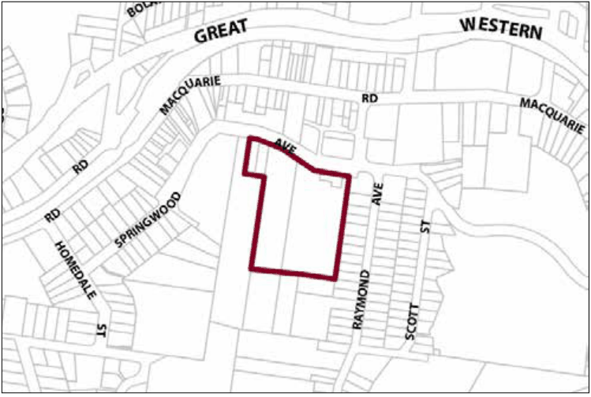

### G12.4	 Springwood Precinct R3-SP04—Southern Precinct

Multiple-unit dwellings in this precinct are planned and constructed to protect the neighbouring bushland reserve of Fairy Dell from adverse visual or environmental impacts, as well as to provide an attractive backdrop to the Springwood Village centre and to expand the range of residential accommodation that is available in the Springwood Village. Buildings and site works are confined to street frontages along Springwood Avenue, avoiding disturbance to steeper wooded slopes surrounding Fairy Dell. Substantial landscape buffers of canopy trees and understorey are maintained along all street and park boundaries, screening buildings and maintaining a quiet bushland atmosphere in the neighbouring reserve. Reference should be made to the precinct objectives in clause 7.11(4) of LEP 2015.

> [Picture on page 179: a picture, saved as a picture (images/part-g-locality-management-page-179-14.gif, 150 dpi).]

Part G12: Springwood

Springwood Precinct R3-SP04—Southern Precinct

#### Controls

C1. Development is to satisfy LEP 2015 clause 7.1 (Development in villages) and be consistent with the precinct objectives of clause 7.11(4) of LEP 2015.

C2. The height of a building is not to exceed the maximum height of building set by clause 4.3 of LEP 2015  and the accompanying Height of Buildings Map.

C3. The floor space ratio of a development is not to exceed the maximum floor space ratio set by clause 4.4 of LEP 2015  and the accompanying Floor Space Ratio Map.

C4. The height above ground for the lowest habitable floor level is not to exceed 1.5m.

C5. Cut or fill within 5m of any property boundary is not to exceed 0.5m.

C6. The minimum setback from Springwood Avenue is 10m.

C7. Side boundary setbacks are to be a minimum of 4m.

C8. All setback areas are to be landscaped.

C9. The maximum site cover for buildings is 30% of the total allotment area.

C10. The minimum area to be retained as soft, pervious or landscaped area (excluding hard surfaces) is 60% of the total allotment area.

C11. Buildings and landscaping are to minimise impacts on the surrounding bushland and environmentally sensitive land whilst minimising bushfire hazard. New landscape plantings are to be either endemic to the locality or be native species of low to mid invasive potential.

Part G12: Springwood

C12. Buildings are to incorporate design elements that integrate new development sensitively with the bushland setting. This includes well-articulated and site-responsive forms, pitched roofs that align with the topography, and earthy materials and colours.

C13. Buildings are not to exceed 25m width or depth in any direction.

C14. Any non-residential activities are to be accommodated in buildings with a residential character.

C15. Driveways, parking areas and garages are not to dominate any street frontage, and are to be integrated with the design of surrounding landscaped areas.
