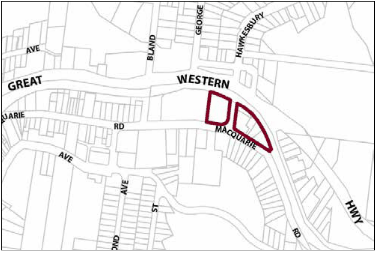

### G12.5	 Springwood Precinct R3-SP05—Eastern Precinct

Multiple-unit dwellings in this precinct are designed to establish an attractive and distinctive eastern gateway to the neighbouring town centre, as well as expanding the range of residential accommodation that is available in the Springwood Village. In order to provide a visually distinctive backdrop to the neighbouring town centre, buildings are surrounded by landscaped settings that include copses of tall eucalypts. Building forms are well-articulated and incorporate traditional building elements such as traditionally-pitched hipped and/or gabled roofs, dry-pressed brickwork walls and timber joinery for traditionally-designed verandahs and balconies. Reference should be made to the precinct objectives in clause 7.11(5) of LEP 2015.

> [Picture on page 181: a picture, saved as a picture (images/part-g-locality-management-page-181-14.gif, 150 dpi).]

Part G12: Springwood

Springwood Precinct R3-SP05—Eastern Precinct

#### Controls

C1. Development is to satisfy LEP 2015 clause 7.1 (Development in villages) and be consistent with the precinct objectives of clause 7.11(5) of LEP 2015.

C2. The height of a building is not to exceed the maximum height of building set by clause 4.3 of LEP 2015  and the accompanying Height of Buildings Map.

C3. The floor space ratio of a development is not to exceed the maximum floor space ratio set by clause 4.4 of LEP 2015  and the accompanying Floor Space Ratio Map.

C4. The height above ground for the lowest habitable floor level is not to exceed 1m.

C5. Cut or fill within 5m of any property boundary is not to exceed 0.5m.

C6. The minimum setback to Macquarie Road or Hawkesbury Road frontage is 6m.

C7. On corner allotments, the setback to the secondary frontage is to be a minimum of 4m.

C8. Side boundary setbacks is to be a minimum of 2m, except to any boundary adjoining the railway, where setbacks are to be a minimum of 8m.

C9. The maximum site cover for buildings is 55% of the total allotment area.

C10. The minimum area to be retained as soft, pervious or landscaped area (excluding hard surfaces) is 35% of the total allotment area.

Part G12: Springwood

C11. Buildings are to present a high standard of architectural form and detailing and formally address significant public domain areas within the immediate setting; service function areas are to be compact and discreetly located.

C12. New development is to be sympathetic to traditional building forms, materials and details, including the use of traditionally-pitched roofs, articulated layouts and forms, verandahs, timber joinery, vertically– proportioned openings and some painted external finishes, with a curtilage of landscaped areas and an address to the street provided. New development is to be similar in form and materials to quality older buildings but subservient in detail to distinguish it as new work.

C13. Buildings are not to exceed 15m width or depth in any direction.

C14. Any non-residential activities are to be accommodated in buildings with a residential scale and character.

C15. Driveways, parking areas and garages are not to dominate any street frontage, and are to be integrated with the design of surrounding landscaped areas.
