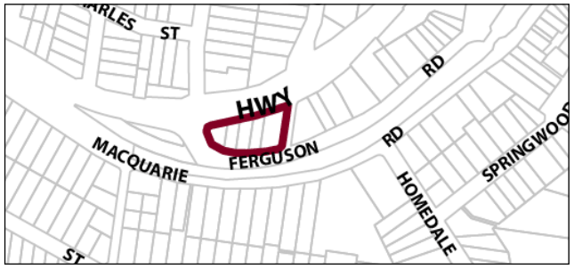

### G12.6	 Springwood Precinct E4-SP06—Ferguson Road

### Precinct

This precinct provides facilities and services that meet the day to day needs of workers in and around the area, as well as supports the local economy. The precinct is surrounded by established low density residential areas and bushland communities. Therefore, it is necessary to facilitate compatible employment uses, with new development incorporating measures to mitigate operational impacts upon adjoining or adjacent residential land uses. Future development is designed and landscaped in accordance with its bushland setting, to create a transition between employment precincts and low density residential areas, while low density residential development in established residential areas does not compromise existing employment uses. Reference should be made to the precinct objectives in clause 7.11(6) of LEP 2015.

> [Picture on page 183: a picture, saved as a picture (images/part-g-locality-management-page-183-15.gif, 150 dpi).]

Part G12: Springwood

Springwood Precinct E4-SP06—Ferguson Road Precinct

#### Controls

C1. Development is to satisfy LEP 2015 clause 7.1 (development in villages) and be consistent with the precinct objectives of clause 7.11(6) of LEP 2015.

C2. The height of a building is not to exceed the maximum height of building set by clause 4.3 of LEP 2015 and the accompanying Height of Buildings Map.

C3. The floor space ratio of a development is not to exceed the maximum floor space ratio set by clause 4.4 of LEP 2015 and the accompanying Floor Space Ratio Map.

C4. No direct vehicular access is to be provided from the Great Western Highway. Vehicular access to the development is to be provided via Ferguson Road and is to demonstrate appropriate sight distances for driveways.

C5. Front setbacks are to be a minimum of 8m from the front boundary and side rear setbacks are to be a minimum of 3m or less subject to a merit-based assessment.

C6. The maximum site cover for buildings is 50% of the total allotment area.

C7. The minimum area to be retained as soft, pervious or landscaped area (excluding hard surfaces) is 40% of the total allotment area.

C8. Cut or fill within 5m of any property boundary is not to exceed 0.5m.

C9. Any fencing along the front boundary of the site and along any side boundary that is located within the front building setback applying to the land must be decorative. The sole use of pre-painted metal or standard paling fencing is not permitted.

C10. All parking demands generated by developments are to be met fully on-site.

C11. Driveways, parking areas and garages are not to dominate any street frontage, and are to be integrated with the design of surrounding landscaped areas. Garages and car parking areas should preferably be located behind the rear alignment of the building.

Part G12: Springwood

C12. Any parking and heavy vehicle loading and manoeuvring areas are to be designed to minimise visual impact when viewed from the public domain, and to be safely and efficiently designed.

C13. An area for storing garbage and recycling shall be provided, suitably located and screened. Where a development adjoins residential development, the garbage storage area must be located at least 3 metres from the common boundary of the residential property and the development site.

C14. Any lighting system utilised in common areas, car parking areas and along pathways must be baffled to ensure that a light source is not directly visible from the Great Western Highway, whilst maintaining adequate lighting of the subject site. New development is to incorporate appropriate levels of lighting to all pedestrian areas.

C15. Buildings are not to exceed 18m width or depth in any direction. Development is to provide articulation and building modulation in order to minimise the bulk of buildings. Refer to Part B2.3 of this DCP.

C16. All non-residential development must be designed and constructed to provide access to and within all areas or facilities of the development where there is a reasonable expectation for access by any individual, accompanying persons or groups. The access is to be in accordance with AS 1428 – Design for Access and Mobility.

C17. Any non-residential activities are to be accommodated in buildings with a residential scale and character.

C18. For allotments with existing cottages, development is to continue traditional residential building forms that reflect the existing cottage, use light-weight cladding materials and articulate any facades visible from the public domain.

C19. New development is not to conflict in character or scale, but maintain consistency of streetscape.

Part G4: Glenbrook

Part G4: Glenbrook

### VALLEY HEIGHTS

G13.1 Valley Heights Precinct E4-VH01—Valley Heights Industrial Precinct

810
