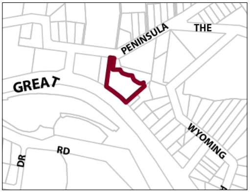

### G13.1	 Valley Heights Precinct E4-VH01—Valley Heights

### Industrial Precinct

This precinct provides facilities and services that meet the day to day needs of workers in and around the area, as well as supports the local economy. The precinct is surrounded by established low density residential areas and bushland communities. Therefore, it is necessary to facilitate compatible employment uses, with new development incorporating measures to mitigate operational impacts upon adjoining or adjacent residential land uses. Future development is designed and landscaped in accordance with its bushland setting, to create a transition between employment precincts and low density residential areas, while low density residential development in established residential areas does not compromise existing employment uses. Reference should be made to the precinct objectives in clause 7.11A of LEP 2015.

> [Picture on page 188: a picture, saved as a picture (images/part-g-locality-management-page-188-14.gif, 150 dpi).]

Part G4: Glenbrook

Part G13: Valley Heights

Valley Heights Precinct E4-VH01—Valley Heights Industrial Precinct

#### Controls

C1. Development is to satisfy LEP 2015 clause 7.1 (development in villages) and be consistent with the precinct objectives of clause 7.11A of LEP 2015.

C2. The height of a building is not to exceed the maximum height of building set by clause 4.3 of LEP 2015 and the accompanying Height of Buildings Map.

C3. The floor space ratio of a development is not to exceed the maximum floor space ratio set by clause 4.4 of LEP 2015 and the accompanying Floor Space Ratio Map.

C4. No direct vehicular access is to be provided from the Great Western Highway. Vehicular access to the development is to be provided via Peninsula Road and is to demonstrate appropriate sight distances for driveways.

C5. Setbacks are subject to a merit-based assessment.

C6. The minimum area to be retained as pervious area, is 30% of the total allotment area.

C7. Cut or fill within 5m of any property boundary is not to exceed 0.5m.

C8. Development is to be sited, designed and constructed to minimise impacts upon surrounding bushland.

C9. Landscaping is to minimise impacts on neighbouring bushland communities whilst minimising bushfire hazard. New landscape plantings are to be either endemic to the locality or be of low to nil invasive potential.

C10. Existing priority weeds must be removed or controlled where identified on a proposed development site.

Part G4: Glenbrook

Part G13: Valley Heights

C11. Any fencing along the front boundary of the site and along any side boundary that is located within the front building setback applying to the land must be decorative. The sole use of pre-painted metal or standard paling fencing is not permitted.

C12. All parking demands generated by developments are to be met fully on-site.

C13. Driveways, parking areas and garages are not to dominate any street frontage, including the Great Western Highway and are to be integrated with the design of surrounding landscaped areas.

C14. Any parking and heavy vehicle loading and manoeuvring areas are to be designed to minimise visual impact when viewed from the public domain, and to be safely and efficiently designed.

C15. An area for storing garbage and recycling shall be provided, suitably located and screened. Where a development adjoins residential development, the garbage storage area must be located at least 3 metres from the common boundary of the residential property and the development site.

C16. Any lighting system utilised in common areas, car parking areas and along pathways must be baffled to ensure that a light source is not directly visible from the Great Western Highway, whilst maintaining adequate lighting of the subject site.

C17. Buildings are to reflect the principles of water sensitive urban design.

C18. Development is to provide articulation and building modulation in order to minimise the bulk of buildings. Refer to Part B2.3 of this DCP.

Part G4: Glenbrook

Part G13: Valley Heights

### WARRIMOO

G14.1 Warrimoo Precinct E1-WM01—Warrimoo Retail Precinct

814
