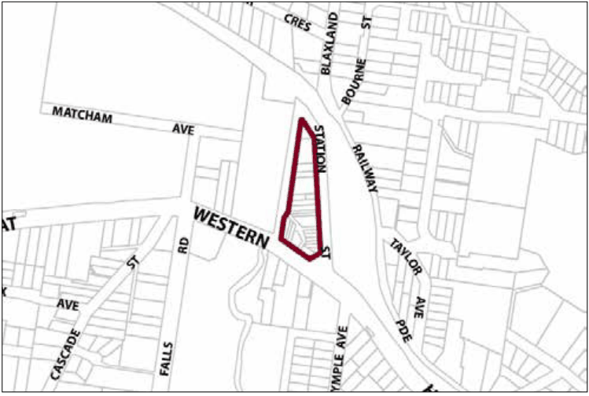

### G15.1	 Wentworth Falls Precinct E1-WF01—Town

### Centre Precinct

This remains a compact town centre, accommodating a diverse range of small retail and other local businesses, tourist-related activities and permanent residents. Modestly-scaled buildings are arranged in a traditional main street pattern, with a continuous row of one and two-storey buildings that reflect local architectural traditions yet display some variety of form and design. The form and architectural detail of landmark retail terrace buildings are preserved. Future development emphasises the distinctive character of these landmarks, and promotes new retail frontages along Plantation Street, as well as existing laneways and the Highway. Buildings provide visible indoor activity along all public frontages, and pedestrian activity is concentrated along the streets and laneways, encouraging informal community gatherings in areas that are protected from undesirable impacts of through traffic. Reference should be made to the precinct objectives in clause 7.12(1) of LEP 2015.

> [Picture on page 196: a picture, saved as a picture (images/part-g-locality-management-page-196-19.gif, 150 dpi).]

Part G15: Wentworth Falls

Wentworth Falls Precinct E1-WF01—Town Centre Precinct

#### Controls

C1. Development is to satisfy LEP 2015 clause 7.1 (Development in villages) and  be consistent with the precinct objectives of clause 7.12(1) of LEP 2015.

C2. The height of a building is not to exceed the maximum height of building set by clause 4.3 of LEP 2015  and the accompanying Height of Buildings Map.

C3. The floor space ratio of a development is not to exceed the maximum floor space ratio set by clause 4.4 of LEP 2015  and the accompanying Floor Space Ratio Map.

C4. Development is to have a zero front setback, except in Plantation Street, where the setbacks are to be a minimum of 2.5m.

C5. Development is to have a zero side setback, except where the side boundary adjoins the public domain, where setbacks greater than zero may be allowed, but only when it can be demonstrated that an active frontage will be provided.

C6. Development may provide a maximum site cover of 100% of the total allotment area.

C7. The existing continuity of retail and other business premises and shop fronts facing Station Street and the Highway is to be maintained.

Part G15: Wentworth Falls

C8. On properties facing Plantation Street or a public laneway, new retail or other business with shop fronts or accessible courtyards are to be promoted along at least 50% of ground level frontages to any public street or laneway, and for all storeys above ground, balconies and/or extensive windows overlooking the street are to be provided.

C9. New development, including alteration and additions to existing shopfronts, is to have regard to the scale, forms and detailing of traditional shopfront buildings, and to ensure that where appropriate, continuous awnings and/or balconies are provided.

Note: Guidelines on traditional shopfront design are found in B3.1.3 Infill shopfront buildings in B3 Character and design, and in D9.7 Traditional shopfront buildings in Part D Heritage  where heritage considerations apply.

C10. On properties with existing two-storey traditional shop terraces, future development is to retain and restore the principal shop front structure plus the adjoining rooms.

Note: Guidelines on traditional shopfront design are found in B3.1.3 Infill shopfront buildings in B3 Character and design, and in D9.7 Traditional shopfront buildings in Part D Heritage  where heritage considerations apply.

C11. Development on large allotments is to distribute floorspace into well-articulated structures that are composed of separate wings or interconnected buildings, with traditionally pitched roofs and appropriately landscaped garden courtyards.

C12. Existing canopy trees are to be retained to frame building presentation. New landscaping is to be appropriately-sized and characteristic of the locality.

C13. On-site parking areas are to be accessed only from the rear or side of buildings via existing public carparks, laneways or secondary streets, and are to be concealed from Station and Plantation Streets behind retail or business floorspace.

C14. Buildings fronting Plantation Street with a zero setback may be allowed as part of a development proposal that provides for variable setbacks and articulated building frontages to enhance building presentation and facilitate associated activities such as outdoor dining.

C15. The existing pedestrian network is to be expanded by promoting new retail frontages facing Plantation Street and other public places.

C16. Solar access to the public domain is to be protected and enhanced.

Part G15: Wentworth Falls

C17. Continuous weather protection along all public frontages in the form of awnings or overhanging balconies is to be provided.

C18. Ground floor walls and structures are to protect and enhance sight lines in public places.
