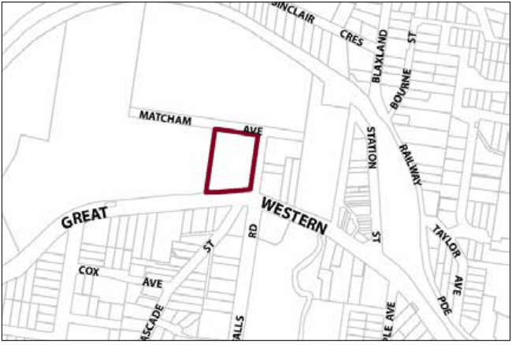

### G15.2	 Wentworth Falls Precinct R3-WF02—Adele Street

### Precinct

Containing a screen of dense vegetation, this site provides alternative housing forms in close proximity to Wentworth Falls shops. The design of buildings is sympathetic to the heritage items located adjacent to the precinct and shall include forms and finishes that minimise the visual impact of buildings from the Great Western Highway. Reference should be made to the precinct objectives in clause 7.12(2) of LEP 2015.

> [Picture on page 199: a picture, saved as a picture (images/part-g-locality-management-page-199-10.gif, 150 dpi).]

Part G15: Wentworth Falls

Wentworth Falls Precinct R3-WF02—Adele Street Precinct

#### Controls

C1. Development is to satisfy LEP 2015 clause 7.1 (Development in villages) and be consistent with the precinct objectives of clause 7.12(2) of LEP 2015.

C2. The height of a building is not to exceed the maximum height of building set by clause 4.3 of LEP 2015  and the accompanying Height of Buildings Map.

C3. The floor space ratio of a development is not to exceed the maximum floor space ratio set by clause 4.4 of LEP 2015  and the accompanying Floor Space Ratio Map.

C4. The minimum setback from the Great Western Highway is 25m.

C5. No direct vehicular access is to be provided from the Great Western Highway. Vehicular access to development on the site is to be provided via Adele Street or Matcham Street and is to demonstrate appropriate sight distances for driveways.

C6. Building form and location is to provide for active frontages of dwellings to Adele and Matcham Streets.

C7. Planting of screening vegetation is to be provided between any building and the boundary with Blue Mountains Grammar School. This screen planting is to incorporate a fence that restricts access between the building and the school.

C8. The existing bushland within the Great Western Highway setback is to be retained and, where necessary, revegetated to screen buildings from the Great Western Highway.

C9. Development for the purpose of multi-dwelling housing in this precinct will respect and complement the existing historical and heritage values of adjoining sites.

Part G15: Wentworth Falls
