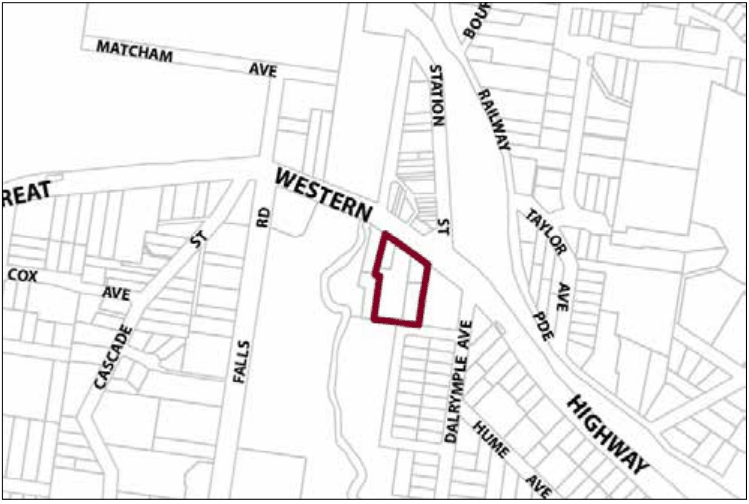
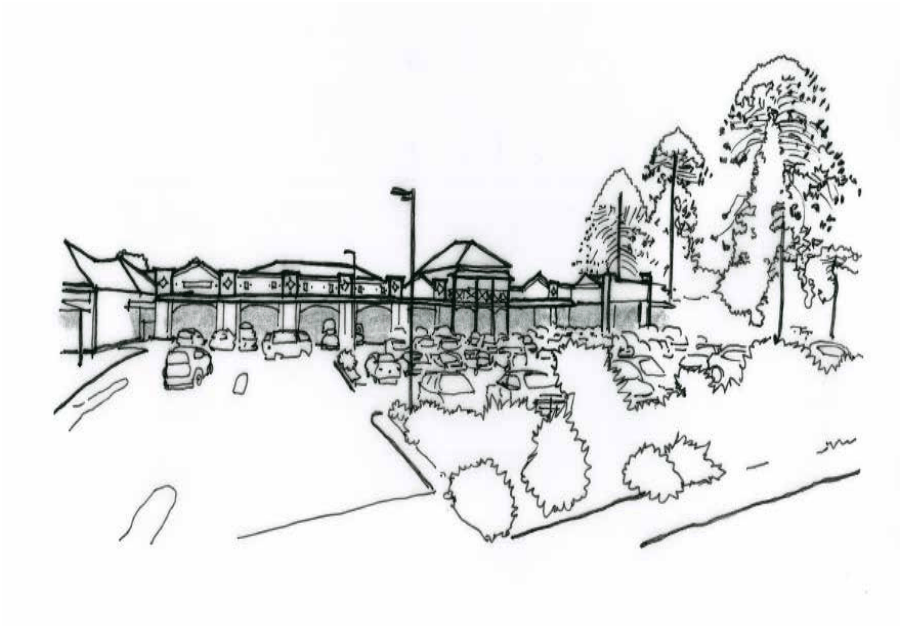

### G15.3	 Wentworth Falls Precinct R3-WF03—Great

### Western Highway Precinct

This site consolidates a range of housing alternatives and a mix of uses in close proximity to Wentworth Falls shops. Pedestrian accessibility is maximised and the design of buildings is sympathetic to the heritage items within and adjacent to the precinct. Existing buildings of heritage significance with frontage to the Great Western Highway are maintained, and provided with appropriate curtilages. The bulk of development is screened from the Great Western Highway and is accessed via Page Avenue. Reference should be made to the precinct objectives in clause 7.12(3) of LEP 2015.

> [Picture on page 201: a picture, saved as a picture (images/part-g-locality-management-page-201-12.gif, 150 dpi).]

Part G15: Wentworth Falls

Wentworth Falls Precinct R3-WF03—Great Western Highway Precinct

#### Controls

C1. Development is to satisfy LEP 2015 clause 7.1 (Development in villages) and be consistent with the precinct objectives of clause 7.12(3) of LEP 2015.

C2. The height of a building is not to exceed the maximum height of building set by clause 4.3 of LEP 2015  and the accompanying Height of Buildings Map.

C3. The floor space ratio of a development is not to exceed the maximum floor space ratio set by clause 4.4 of LEP 2015  and the accompanying Floor Space Ratio Map.

C4. The minimum setback from Page Avenue is 4m.

C5. No direct vehicular access is to be provided from the Great Western Highway. Vehicular access to the development is to be provided via Page Avenue and is to demonstrate appropriate sight distances for driveways.

C6. Building form and location is to provide activated safe and pedestrian-friendly street frontages to dwellings at Page Avenue.

C7. Development is to respect and complement the existing heritage values of adjoining sites.

Part G15: Wentworth Falls

### WINMALEE

| G16.1 | Winmalee Precinct E1-WL01 –Town Centre Precinct | 826 |
|---|---|---|
| G16.2 | Winmalee Precinct R3-WL02 – Village Housing Precinct | 828 |

> [Picture on page 203: a picture, saved as a picture (images/part-g-locality-management-page-203-3.gif, 150 dpi).]
