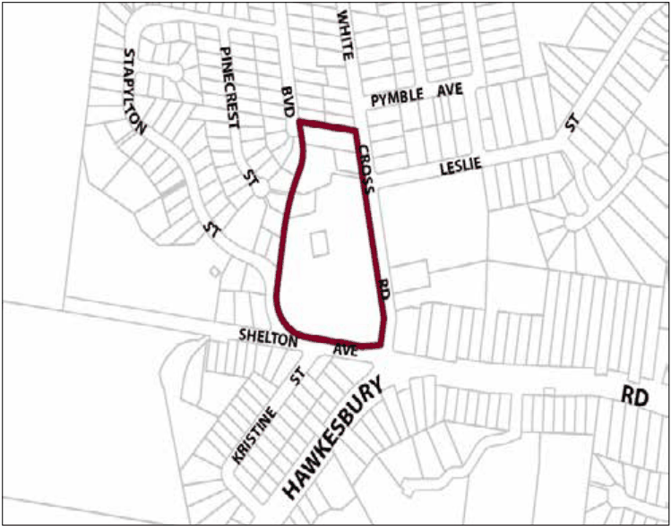

### G16.1	 Winmalee Precinct E1-WL01 –Town Centre

### Precinct

The precinct remains a compact town centre, accommodating a diverse range of retail and other businesses that complement the district level retail facilities that form the main focus of commercial activity for the precinct. Development in the northern section of the precinct is in keeping with the residential scale form and character of the surrounding residential areas. Heritage items are preserved and form a significant visual element to be taken into account in the design of new development. The development of the precinct is to incorporate the low densities and bushland character elements that have characterised the traditional development of Winmalee village. The visual impact of built components is minimised through design elements and native vegetation screening from surrounding roadways. Significant trees, including the heritage listed Bunya Pines, are retained and enhanced with new plantings, particularly within and surrounding car parking areas. Reference should be made to the precinct objectives in clause 7.13(1) of LEP 2015.

> [Picture on page 204: a picture, saved as a picture (images/part-g-locality-management-page-204-19.gif, 150 dpi).]

Part G16: Winmalee

Winmalee Precinct E1-WL01 –Town Centre Precinct

#### Controls

C1. Development is to satisfy LEP 2015 clause 7.1 (Development in villages) and be consistent with the precinct objectives of clause 7.13(1) of LEP 2015.

C2. The height of a building is not to exceed the maximum height of building set by clause 4.3 of LEP 2015  and the accompanying Height of Buildings Map.

C3. The floor space ratio of a development is not to exceed the maximum floor space ratio set by clause 4.4 of LEP 2015  and the accompanying Floor Space Ratio Map.

C4. The minimum setback is to be within 20% of the average setback of adjoining allotments.

C5. The maximum site cover for buildings is 40% of the total allotment area.

C6. External walls, where visible from the public domain are to be articulated with appropriate design elements and heavily screened with appropriate native vegetation plantings.

Part G16: Winmalee

C7. New development is to provide circulation that minimises conflicts between vehicles and pedestrians.

C8. Commercial signage is to be co-ordinated with building and shop front design to reflect a village character.

C9. The heritage items within the precinct are to be retained and incorporated into any future development proposals.
