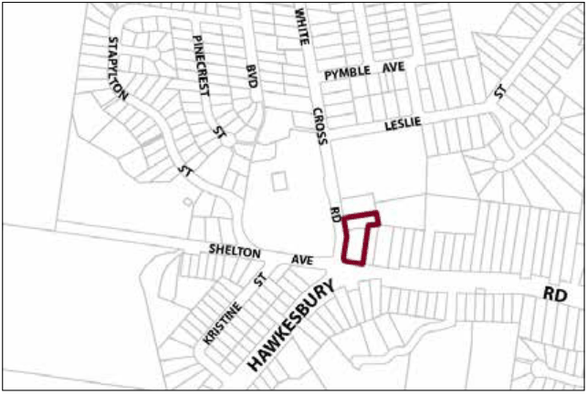
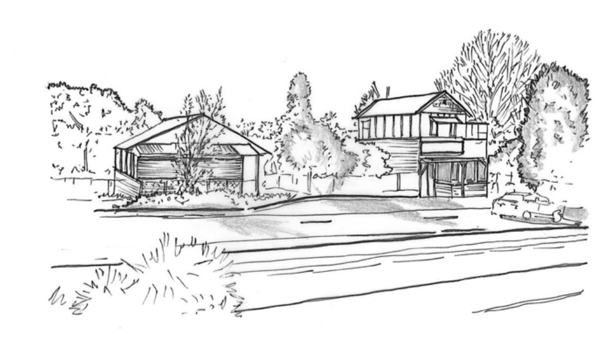

### G16.2	 Winmalee Precinct R3-WL02 – Village Housing

### Precinct

The precinct reinforces a compact town centre, accommodating a diverse range of residential, medical and other professional services that complement the adjacent district level retail and community facilities. Buildings in the precinct are designed to establish an attractive and distinctive gateway to the neighbouring town centre, as well as expanding the range of residential, medical and other professional services that are available in the Winmalee village. New building works are well-articulated and reflect the pattern and scale of the surrounding residential areas, together with surrounding gardens. In order to provide a visually distinctive backdrop to the neighbouring town centre, development is to incorporate visually significant elements of established garden settings, particularly tall eucalypts and other canopy trees. Buildings and associated infrastructure in the precinct are planned and constructed to protect neighbouring land zone C2 Environmental Conservation land from environmental effects.

Part G16: Winmalee

The development of the precinct is to incorporate the low densities and bushland character elements that have characterized the traditional development of Winmalee village. The visual impact of built components is minimised through design elements and native vegetation screening from surrounding roadways. Significant trees are retained and enhanced with new plantings, particularly within and surrounding car parking areas. Reference should be made to the precinct objectives in clause 7.13(2) of LEP 2015.

> [Picture on page 206: a picture, saved as a picture (images/part-g-locality-management-page-206-27.gif, 150 dpi).]

Winmalee Precinct R3-WL02 – Village Housing Precinct

#### Controls

C1. Development is to satisfy LEP 2015 clause 7.1 (Development in villages) and be consistent with the precinct objectives of clause 7.13(2) of LEP 2015.

C2. The height of a building is not to exceed the maximum height of building set by clause 4.3 of LEP 2015  and the accompanying Height of Buildings Map.

C3. The floor space ratio of a development is not to exceed the maximum floor space ratio set by clause 4.4 of LEP 2015  and the accompanying Floor Space Ratio Map.

C4. The height above ground level for the lowest habitable floor level is not to exceed 1.5m.

C5. Cut or fill within 5m of any property boundary is not to exceed 0.5m.

C6. The minimum setback to Hawkesbury Road is to be 8m.

C7. The minimum setback to White Cross Road is to be 6m.

C8. All setback areas are to be landscaped.

Part G16: Winmalee

C9. The maximum site cover for buildings is to be 55% of the total site area.

C10. The minimum area to be retained as soft, pervious or landscaped area (excluding hard surfaces) is to be 35% of the total site area.

C11. Buildings and landscaping are to minimise impacts on the surrounding bushland and environmentally sensitive land, whilst minimising bushfire hazard. New landscape plantings are to be either endemic to the locality or to be of low to nil invasive potential.

C12. Buildings are to incorporate design elements that integrate new development sensitively with the bushland setting. This includes well-articulated and site-responsive forms, pitched roofs that align with the topography, and earthy materials and colours.

C13. Residential buildings are not to exceed 15m in width or depth in any direction.

C14. Any non-residential activities are to be accommodated in buildings with a residential character.

C15. Driveways, parking areas and garages are not to dominate any street frontage, and are to be integrated with the design of surrounding landscaped areas.

C16. All vehicular access and egress to the site is to be via White Cross Road and located in a position that does not unreasonably interfere with the flow of vehicular and pedestrian movements on White Cross Road, and also into and out of the Winmalee Shopping Centre, adjoining properties and the Winmalee Public School.

Part G16: Winmalee

### WOODFORD

G17.1 Woodford Precinct E1-WD01 – Great Western Highway Precinct

> [Picture on page 209: a picture, saved as a picture (images/part-g-locality-management-page-209-3.gif, 150 dpi).]

832
