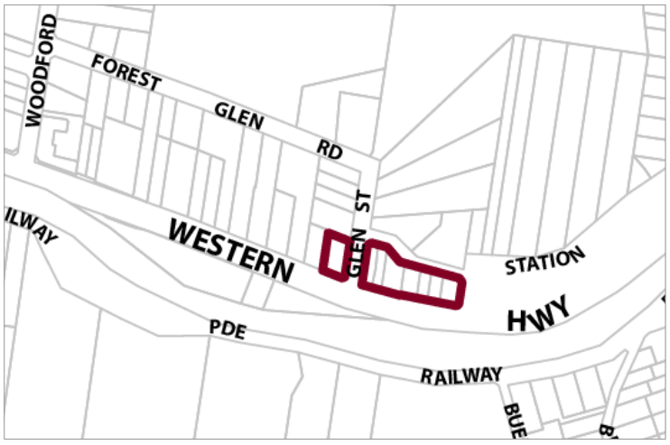

### G17.1	 Woodford Precinct E1-WD01 – Great Western

### Highway Precinct

Situated in a visually prominent position on the northern side of the Great Western Highway and adjoining residential neighbourhoods, this precinct provides a variety of small-scale retail and commercial businesses that serve the local community and visitors. New development is to promote the scenically-distinctive highway frontage to the Woodford village with building forms that reflect traditional village shops or detached dwellings with landscaped gardens and vistas towards the National Park. Reference should be made to the precinct objectives in clause 7.14 of LEP 2015.

> [Picture on page 210: a picture, saved as a picture (images/part-g-locality-management-page-210-11.gif, 150 dpi).]

Part G4: Glenbrook

Part G17: Woodford

Woodford Precinct E1-WD01 – Great Western Highway Precinct

#### Controls

C1. Development is to satisfy LEP 2015 Clause 7.1 (Development in villages) and be consistent with the precinct objectives of clause 7.14 of LEP 2015.

C2. The height of a building is not to exceed the maximum height of building as set by clause 4.3 of LEP 2015 and the accompanying Height of Buildings Map.

C3. The floor space ratio is not to exceed the maximum floor space ratio set out by clause 4.4 of LEP 2015 and the accompanying Floor Space ratio Map.

C4. New dwelling houses, including extensions to existing dwellings, bed and breakfast accommodation and short term rental accommodation are to be a minimum 8m from the boundary with the Great Western Highway.

Such developments are to be within 20% of the average setback of buildings immediately adjoining allotments for setbacks from Vautin Lane, Glen Street or Station Street and no less than 6m.

C5. Setbacks for all development types not referred to in C4 above are generally to have zero setback to the highway. Setbacks greater than zero may be considered where it can be demonstrated that precinct objectives are met.

C6. The minimum area to be retained as soft, pervious or landscaped area (excluding hard surfaces) is 35% of the total allotment area.

C7. For all new developments, all vehicular access is to be via the local road network (Vautin Lane, Glen Street and Station Street)

C8. For all new commercial developments, all loading and unloading activities of vehicles, including waste collection, are to occur from the local road network (Vautin Lane, Glen Street and Station Street).

Part G4: Glenbrook

Part G17: Woodford

C9. Any parking and vehicle loading and manoeuvring areas are to be designed to minimise visual impact when viewed from the public domain, and to be safely and efficiently designed.

C10. Car parking areas are to be screened from the public domain so as not to dominate streetscape views.

C11. Pedestrian access to any new development shall be available from the Great Western Highway frontage.

C12. For all new subdivisions, all vehicular access is to be via the local road network only (Vautin Lane, Glen Street and Station Street) and any existing vehicular crossings on the highway frontage to be closed. There will be no new vehicular accesses to the highway.

C13. All existing vegetation forming visually significant streetscape elements is to be retained and appropriate landscaping shall be provided within any setbacks.

C14. New development shall present to the Great Western Highway and local streets through the design of building facades, landscaping and fences.

C15. New development is to adopt traditional building forms and incorporate traditionally pitched roofs and/or parapets, traditional shopfront design, articulated building forms and layouts, vertically-proportioned openings, and sympathetic materials and detailing. New development is to be sympathetic to the its immediate surroundings.

Note: Guidelines on traditional shopfront design are found in B3.1.3 Infill shopfront buildings in B3 Character and design.

C16. Walls in new development visible from the public domain are not to be left blank, unadorned or unarticulated.

C17. Commercial signage is to be co-ordinated to reflect a village character.

Part G4: Glenbrook

Part G17: Woodford
