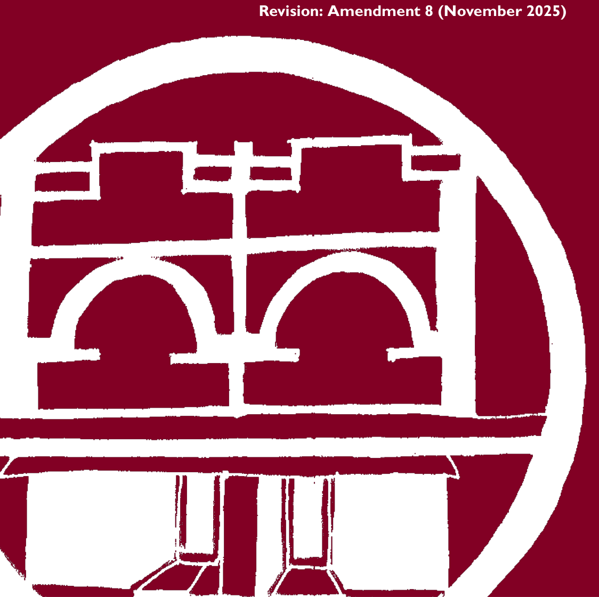
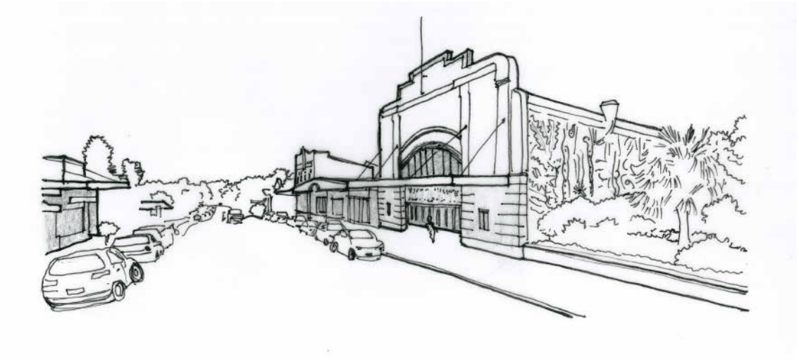

# Blue Mountains Development Control Plan 2015 - Part G Locality Management

> This chapter is split into 76 section file(s), one per numbered heading, in the order they appear in the PDF.

Source PDF: [DCP 2015_Amendment 8_Part G.pdf](DCP%202015_Amendment%208_Part%20G.pdf)

### PART G

### LOCALITY

### MANAGEMENT

#### Revision: Amendment 8 (November 2025)

> [Picture on page 1: a picture, saved as a picture (images/part-g-locality-management-page-1-5.gif, 150 dpi).]

### Introduction

The provisions in this part recognise the importance of guiding the character of new development in village centres, due either to the high development potential and/or sensitive village character of these sites. At times, a significant change or transition is anticipated within certain precincts, and the controls seek to achieve the appropriate type and level of change.

Each precinct in this part contains a character statement that encourages development to preserve and enhance existing significant structures and elements, and to contribute positively to the character of the neighbourhood through high quality contemporary design. The objectives for each precinct within this part are found in Part 7 of Blue Mountains Local Environmental Plan 2015 (LEP 2015).

This part applies to land identified by a blue outline and a precinct reference on the LEP 2015 Built Character Map. These controls apply to zones E1, E2, E4, R1, R3, SP2 and SP3, where character considerations apply to a village setting.

Land to which this part applies is also required to consider Clause 6.19 (Design excellence )of LEP 2015. This clause requires Council to have regard to a number of matters when assessing development proposals. These include the design quality and detailing, form and appearance of new development, as well as amenity impacts such as provision of views and solar access, and environmental and public domain impacts.

A guide to character considerations within precincts, including guidelines on appropriate urban design, infill development, infill shopfront buildings and medium density residential development is found in Part B3.1 of this DCP and supplements this Part.

Many sites within village precincts are heritage items or within heritage conservation areas. Where any inconsistency arises between these precinct provisions and the heritage provisions, the heritage provisions are to prevail. Reference may need to be made in these instances to the Heritage Conservation provisions of LEP 2015 in clause 5.10 (Heritage conservation)  and Part D Heritage of this DCP.

Reference should be made to other parts of this DCP, including the context and design content in Part B3, the landscaping provisions of Part C2, the heritage conservation provisions of Part D, the site development provisions of Part E, and the specific development type controls of Part F. In particular, the character provisions of D12 Specific Character considerations provide guidance on traditional building types.

#### PART G | PAGE 624

### Contents

| G1 | Blackheath | 627 |
|---|---|---|
| G2 | Blaxland | 641 |
| G3 | Faulconbridge | 657 |
| G4 | Glenbrook | 663 |
| G5 | Hazelbrook | 667 |
| G6 | Katoomba | 677 |
| G7 | Lawson | 739 |
| G8 | Leura | 755 |
| G9 | Medlow Bath | 777 |
| G10 | Mount Riverview | 781 |
| G11 | Mount Victoria | 785 |
| G12 | Springwood | 793 |
| G13 | Valley Heights | 809 |
| G14 | Warrimoo | 813 |
| G15 | Wentworth Falls | 817 |
| G16 | Winmalee | 825 |
| G17 | Woodford | 831 |

#### PART G | PAGE 625

#### PART G | PAGE 626

### BLACKHEATH

| G1.1 | Blackheath Precinct E1-BH01—Town Centre Precinct | 628 |
|---|---|---|
| G1.2 | Blackheath Precinct E1-BH02—Business Cottages Precinct | 631 |
| G1.3 | Blackheath Precinct E1-BH03—Highway Business Precinct | 633 |
| G1.4 | Blackheath Precinct R3-BH04—Wentworth Street Precinct | 635 |
| G1.5 | Blackheath Precinct R3-BH05—Cnr Hat Hill Road and Wentworth Street Precinct 637 |  |
| G1.6 | Blackheath Precinct R1-BH06— Govetts Leap Road Precinct | 639 |

> [Picture on page 5: a picture, saved as a picture (images/part-g-locality-management-page-5-3.gif, 150 dpi).]

<!-- sections -->
## Sections

1. [G1.1 Blackheath Precinct E1-BH01—Town Centre](01-g1-1-blackheath-precinct-e1-bh01-town-centre.md)
2. [G1.2 Blackheath Precinct E1-BH02—Business Cottages](02-g1-2-blackheath-precinct-e1-bh02-business.md)
3. [G1.3 Blackheath Precinct E1-BH03—Highway Business](03-g1-3-blackheath-precinct-e1-bh03-highway.md)
4. [G1.4 Blackheath Precinct R3-BH04—Wentworth Street](04-g1-4-blackheath-precinct-r3-bh04-wentworth.md)
5. [G1.5 Blackheath Precinct R3-BH05—Cnr Hat Hill Road](05-g1-5-blackheath-precinct-r3-bh05-cnr-hat-hill.md)
6. [G1.6 Blackheath Precinct R1-BH06— Govetts Leap](06-g1-6-blackheath-precinct-r1-bh06-govetts-leap.md)
7. [G2.1 Blaxland Precinct E2-BX01—Town Centre Precinct](07-g2-1-blaxland-precinct-e2-bx01-town-centre.md)
8. [G2.2 Blaxland Precinct R3-BX02—Layton Avenue](08-g2-2-blaxland-precinct-r3-bx02-layton-avenue.md)
9. [G2.3 Blaxland Precinct R3-BX03—Hope Street Precinct](09-g2-3-blaxland-precinct-r3-bx03-hope-street.md)
10. [G2.4 Blaxland Precinct R3-BX04—Village Housing](10-g2-4-blaxland-precinct-r3-bx04-village.md)
11. [G2.5 Blaxland Precinct E1-BX05—Brooklands Village](11-g2-5-blaxland-precinct-e1-bx05-brooklands.md)
12. [G2.6 Blaxland Precinct E1-BX06—East Blaxland Shops](12-g2-6-blaxland-precinct-e1-bx06-east-blaxland.md)
13. [G2.7 Blaxland Precinct E4-BX07—22-26 Attunga Road](13-g2-7-blaxland-precinct-e4-bx07-22-26-attunga.md)
14. [G3.1 Faulconbridge Precinct E1-FB01—Coomassie](14-g3-1-faulconbridge-precinct-e1-fb01-coomassie.md)
15. [G3.2 Faulconbridge Precinct E1-FB02—St Georges](15-g3-2-faulconbridge-precinct-e1-fb02-st.md)
16. [G4.1 Glenbrook Precinct E1-GB01—Glenbrook Shops](16-g4-1-glenbrook-precinct-e1-gb01-glenbrook.md)
17. [G5.1 Hazelbrook Precinct E1-HB01—Town Centre](17-g5-1-hazelbrook-precinct-e1-hb01-town-centre.md)
18. [G5.2 Hazelbrook Precinct R3-HB02—Glendarrah Street](18-g5-2-hazelbrook-precinct-r3-hb02-glendarrah.md)
19. [G5.3 Hazelbrook Precinct R3-HB03—Addington Road](19-g5-3-hazelbrook-precinct-r3-hb03-addington.md)
20. [G5.4 Hazelbrook Precinct E1-HB04 – Old Hazelbrook](20-g5-4-hazelbrook-precinct-e1-hb04-old.md)
21. [G6.1 Katoomba Precinct E2-KA01—Katoomba Street](21-g6-1-katoomba-precinct-e2-ka01-katoomba.md)
22. [G6.2 Katoomba Precinct E2-KA02—District Retail](22-g6-2-katoomba-precinct-e2-ka02-district.md)
23. [G6.3 Katoomba Precinct  E2-KA03 -  Waratah](23-g6-3-katoomba-precinct-e2-ka03-waratah.md)
24. [G6.4 Katoomba Precinct E2-KA04—Town Approach](24-g6-4-katoomba-precinct-e2-ka04-town-approach.md)
25. [G6.5 Katoomba Precinct E2-KA05—Town Entry Precinct](25-g6-5-katoomba-precinct-e2-ka05-town-entry.md)
26. [G6.6 Katoomba Precinct E2-KA06—Cultural Centre](26-g6-6-katoomba-precinct-e2-ka06-cultural.md)
27. [G6.7 Katoomba Precinct R1-KA07—Lurline Street South](27-g6-7-katoomba-precinct-r1-ka07-lurline-street.md)
28. [G6.8 Katoomba Precinct R1-KA08—Lurline Street](28-g6-8-katoomba-precinct-r1-ka08-lurline-street.md)
29. [G6.9 Katoomba Precinct R1-KA09—Gang Gang Street](29-g6-9-katoomba-precinct-r1-ka09-gang-gang.md)
30. [G6.10 Katoomba Precinct R3-KA10—Great Western](30-g6-10-katoomba-precinct-r3-ka10-great-western.md)
31. [G6.11 Katoomba Precinct R3-KA11—Dora Street](31-g6-11-katoomba-precinct-r3-ka11-dora-street.md)
32. [G6.12 Katoomba Precinct R1/R3-KA12—GWH Between](32-g6-12-katoomba-precinct-r1-r3-ka12-gwh-between.md)
33. [G6.13 Katoomba Precinct R3-KA13—Lurline and Vale](33-g6-13-katoomba-precinct-r3-ka13-lurline-and.md)
34. [G6.14 Katoomba Precinct R3-KA14—Lurline Street](34-g6-14-katoomba-precinct-r3-ka14-lurline-street.md)
35. [G6.15 Katoomba Precinct R3-KA15—Cascade and Parke](35-g6-15-katoomba-precinct-r3-ka15-cascade-and.md)
36. [G6.16 Katoomba Precinct R3-KA16—Cnr Great Western](36-g6-16-katoomba-precinct-r3-ka16-cnr-great.md)
37. [G6.17 Katoomba Precinct R3-KA17—Katoomba Golf](37-g6-17-katoomba-precinct-r3-ka17-katoomba-golf.md)
38. [G6.18 Katoomba Precinct R1-KA18 - Lilianfels](38-g6-18-katoomba-precinct-r1-ka18-lilianfels.md)
39. [G6.19 Katoomba Precinct R1-KA19—Echo Point Road](39-g6-19-katoomba-precinct-r1-ka19-echo-point.md)
40. [G6.20 Katoomba Precinct RE2/SP3-KA20—Violet Street](40-g6-20-katoomba-precinct-re2-sp3-ka20-violet.md)
41. [G6.21 Katoomba Precinct E1-KA021—Minni-Ha-Ha](41-g6-21-katoomba-precinct-e1-ka021-minni-ha-ha.md)
42. [G6.23 Katoomba Precinct E4-KA023—Lovel Street](42-g6-23-katoomba-precinct-e4-ka023-lovel-street.md)
43. [G6.24 Katoomba Precinct E4-KA024—Woodlands Road](43-g6-24-katoomba-precinct-e4-ka024-woodlands.md)
44. [G7.1 Lawson Precinct E1-LA01—Town Centre Precinct](44-g7-1-lawson-precinct-e1-la01-town-centre.md)
45. [G7.2 Lawson Precinct R3-LA02—San Jose Avenue](45-g7-2-lawson-precinct-r3-la02-san-jose-avenue.md)
46. [G7.3 Lawson Precinct R3-LA03—Loftus Street Precinct](46-g7-3-lawson-precinct-r3-la03-loftus-street.md)
47. [G7.4 Lawson Precinct R3-LA04—Housing Precinct](47-g7-4-lawson-precinct-r3-la04-housing-precinct.md)
48. [G7.5 Lawson Precinct E4-LA05—Adeline & Cataract](48-g7-5-lawson-precinct-e4-la05-adeline-and.md)
49. [G8.1 Leura Precinct E1-LE01—Leura Mall Precinct](49-g8-1-leura-precinct-e1-le01-leura-mall.md)
50. [G8.2 Leura Precinct R1-LE02—Leura Gateway Precinct](50-g8-2-leura-precinct-r1-le02-leura-gateway.md)
51. [G8.3 Leura Precinct R1-LE03—Southern Tourist Precinct](51-g8-3-leura-precinct-r1-le03-southern-tourist.md)
52. [G8.4 Leura Precinct R3-LE04—Grose Street North](52-g8-4-leura-precinct-r3-le04-grose-street.md)
53. [G8.5 Leura Precinct R3-LE05—Wascoe Street Precinct](53-g8-5-leura-precinct-r3-le05-wascoe-street.md)
54. [G8.6 Leura Precinct R3-LE06—Eastern Edge Precinct](54-g8-6-leura-precinct-r3-le06-eastern-edge.md)
55. [G8.7 Leura Precinct RP-LE07 – Former Leura Golf](55-g8-7-leura-precinct-rp-le07-former-leura-golf.md)
56. [G8.8 Leura Precinct R1-LE08—Chambers Road Precinct](56-g8-8-leura-precinct-r1-le08-chambers-road.md)
57. [G8.9 Leura Precinct SP3-LE07— Sublime Point Road](57-g8-9-leura-precinct-sp3-le07-sublime-point.md)
58. [G9.1 Medlow Bath Precinct SP3-MB01—Great Western](58-g9-1-medlow-bath-precinct-sp3-mb01-great.md)
59. [G10.1 Mount Riverview Precinct E1-MR01—Rusden](59-g10-1-mount-riverview-precinct-e1-mr01-rusden.md)
60. [G11.1 Mount Victoria Precinct E1-MV01—Town Centre](60-g11-1-mount-victoria-precinct-e1-mv01-town.md)
61. [G11.2 Mount Victoria Precinct R1-MV02—Station Street](61-g11-2-mount-victoria-precinct-r1-mv02-station.md)
62. [G11.3 Mount Victoria Precinct R1-MV03—Harley](62-g11-3-mount-victoria-precinct-r1-mv03-harley.md)
63. [G12.1 Springwood Precinct E2-SP01—Town Centre](63-g12-1-springwood-precinct-e2-sp01-town-centre.md)
64. [G12.2 Springwood Precinct R3-SP02—Ferguson Road](64-g12-2-springwood-precinct-r3-sp02-ferguson.md)
65. [G12.3 Springwood Precinct R3-SP03—Western Precinct](65-g12-3-springwood-precinct-r3-sp03-western.md)
66. [G12.4 Springwood Precinct R3-SP04—Southern Precinct](66-g12-4-springwood-precinct-r3-sp04-southern.md)
67. [G12.5 Springwood Precinct R3-SP05—Eastern Precinct](67-g12-5-springwood-precinct-r3-sp05-eastern.md)
68. [G12.6 Springwood Precinct E4-SP06—Ferguson Road](68-g12-6-springwood-precinct-e4-sp06-ferguson.md)
69. [G13.1 Valley Heights Precinct E4-VH01—Valley Heights](69-g13-1-valley-heights-precinct-e4-vh01-valley.md)
70. [G14.1 Warrimoo Precinct E1-WM01—Warrimoo Retail](70-g14-1-warrimoo-precinct-e1-wm01-warrimoo.md)
71. [G15.1 Wentworth Falls Precinct E1-WF01—Town](71-g15-1-wentworth-falls-precinct-e1-wf01-town.md)
72. [G15.2 Wentworth Falls Precinct R3-WF02—Adele Street](72-g15-2-wentworth-falls-precinct-r3-wf02-adele.md)
73. [G15.3 Wentworth Falls Precinct R3-WF03—Great](73-g15-3-wentworth-falls-precinct-r3-wf03-great.md)
74. [G16.1 Winmalee Precinct E1-WL01 –Town Centre](74-g16-1-winmalee-precinct-e1-wl01-town-centre.md)
75. [G16.2 Winmalee Precinct R3-WL02 – Village Housing](75-g16-2-winmalee-precinct-r3-wl02-village.md)
76. [G17.1 Woodford Precinct E1-WD01 – Great Western](76-g17-1-woodford-precinct-e1-wd01-great-western.md)
