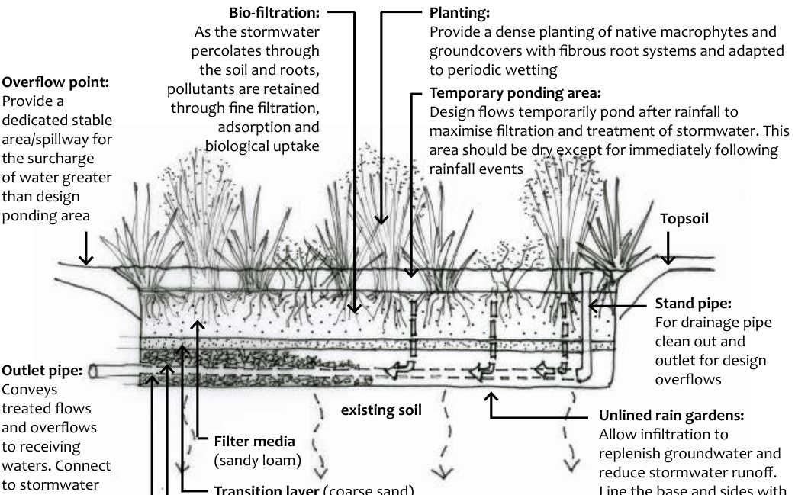

### J1 PART C6: Typical rain garden or bio-retention

### system design for single dwellings and dual occu-

### pancies

Building a rain garden is a simple way to help the environment and the health of our local waterways while providing a self-watering garden for your backyard. A rain garden is a specially prepared garden designed to capture and filter stormwater run-off from impervious areas such as roofs or other hard surfaces such as driveways or paving. A rain garden is comprised of a soil based filter (specified sandy loam material), with a sand transition layer and gravel trench underneath that contains a slotted drain pipe (ag pipe) that is connected to the drainage system. A typical system (looking through the side of the filter) is shown below.

#### Bio-filtration:

As the stormwater percolates through

Part J: Guidelines

the soil and roots, pollutants are retained through fine filtration, adsorption and

#### Planting:

Provide a dense planting of native macrophytes and groundcovers with fibrous root systems and adapted to periodic wetting

#### Temporary ponding area:

Design flows temporarily pond after rainfall to

#### Overflow point:

Provide a

> [Picture on page 5: a map, saved as a picture (images/part-j-guidelines-page-5-29.gif, 150 dpi); the street names and other small labels are on the picture.]
> Labels printed on the map (copied from the PDF, in no particular order):
> biological uptake · maximise filtration and treatment of stormwater. This · area should be dry except for immediately following · rainfall events · area/spillway for · the surcharge · of water greater · than design · ponding area · Topsoil · Stand pipe: · For drainage pipe · clean out and · outlet for design · overflows · existing soil · Filter media · (sandy loam) · Outlet pipe: · treated flows · and overflows · to receiving · waters. Connect · to stormwater · drainage system · Transition layer (coarse sand) · to prevent the filter media · Unlined rain gardens: · Allow infiltration to · replenish groundwater and · reduce stormwater runoff. · Line the base and sides with

dedicated stable

Conveys

clogging up the drainage layer Drainage layer (fine aggregate) Underdrain (slotted PVC pipe)

an impermeable membrane if infiltration to surrounding soils is not desirable e.g. if the groundwater table or bedrock is shallow

Part J1 - Figure 1: Typical rain garden system.

Typical design criteria for a rain garden or bio-retention system to be used in a single dwelling or dual occupancy development are as follows:

(a) Rain gardens may be any shape provided the filter area is at least 2% of the contributing impervious area catchment. For example, a 400 square metre impervious area catchment would require an 8 square metre rain garden. The 8 square metre system could be 4m long and 2m wide, or 8m long and 1m wide, or any other combination that gives 8 square metres in surface area.

(b) All rain gardens (except systems with the side and base lined with an impermeable membrane) should be set back from the boundary by 4m.

(c) Provide adequate setbacks to any underground services (gas, electricity, water, on-site effluent disposal systems) and to the foundations of existing buildings and structures.

(d) Rain gardens should be positioned to treat as much of the site’s impervious area runoff (from roof downpipes, rain tank overflows, driveway, paved areas) as possible.

(e) Minimum Design Criteria are as follows:

• The temporary ponding area should be at least 200mm deep.

• Filter media should be sandy loam and be between 200-400mm

depth.

Part J: Guidelines

• Transition layer should be coarse sand and be approximately100mm

depth.

• Drainage layer should be gravel and be at least 200mm depth.

• The perforated collection pipe or underdrain should be at least

90mm in diameter and be connected to the stormwater drainage

system.

(f) Infiltration from the base of the drainage layer of a rain garden is recommended to be provided where ever this can be safely accommodated by the site and environmental conditions (soil depth and permeability, depth to groundwater table or bedrock).

(g) Where rain gardens are located near shallow groundwater or bedrock, or where soils of low permeability occur, the base and sides must be lined with an impervious membrane to prevent infiltration.

(h) Provide suitable collection and disposal of design overflows to a stormwater drainage system (street gutter, inter-allotment drainage system or drainage easement), unless these overflows can be otherwise safely infiltrated within the site.

(i) Rain gardens should be densely planted with native macrophyte or groundcover species that:

• are adapted to the local climatic conditions and high and variable

nutrient and moisture conditions; and

• contain extensive fibrous root systems, spreading rhizomatous or

suckering habitat are preferred over a clumped habit; and

• are established at a minimum density of at least 8 plants per square

metre across the filter area base and any side batters; and

• provide complexity and year round coverage by including at least 4

different species within the filter area, use mainly moisture tolerant

species such as Juncus planifolius, Juncus usitatus, Carex appressa,

Gahnia, Lepidosperma, Schoenus and Restio species. Other species

that may be incorporated are Poa sieberiana, Lomandra, Patersonia,

Dianella and Blechnum species or other similar local native species.

Note: For further information consult www.melbournewater.com. au/building-and-works/stormwater-management/options-treating-stormwater/raingardens. The plant species suggested in this information need to be modified to be compatible with local Blue Mountains conditions.

Part J: Guidelines
