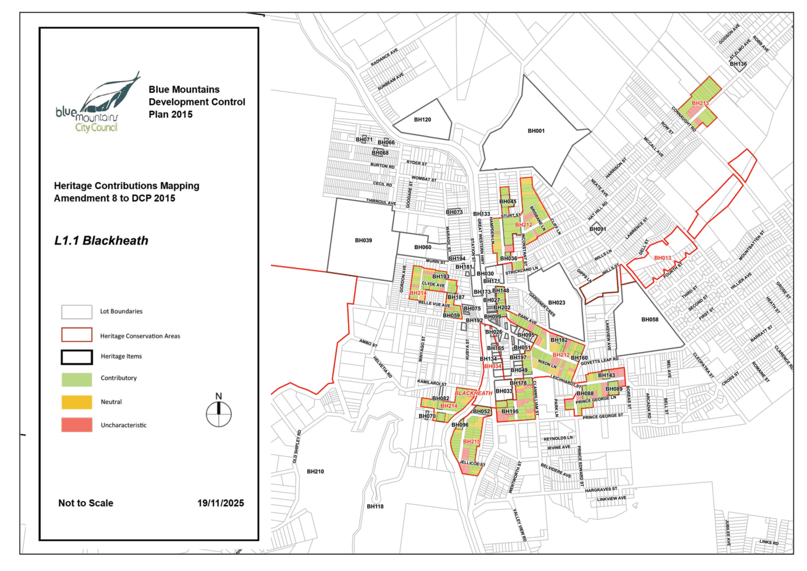
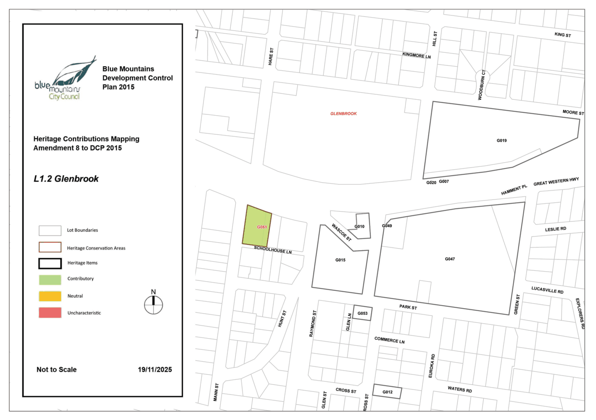
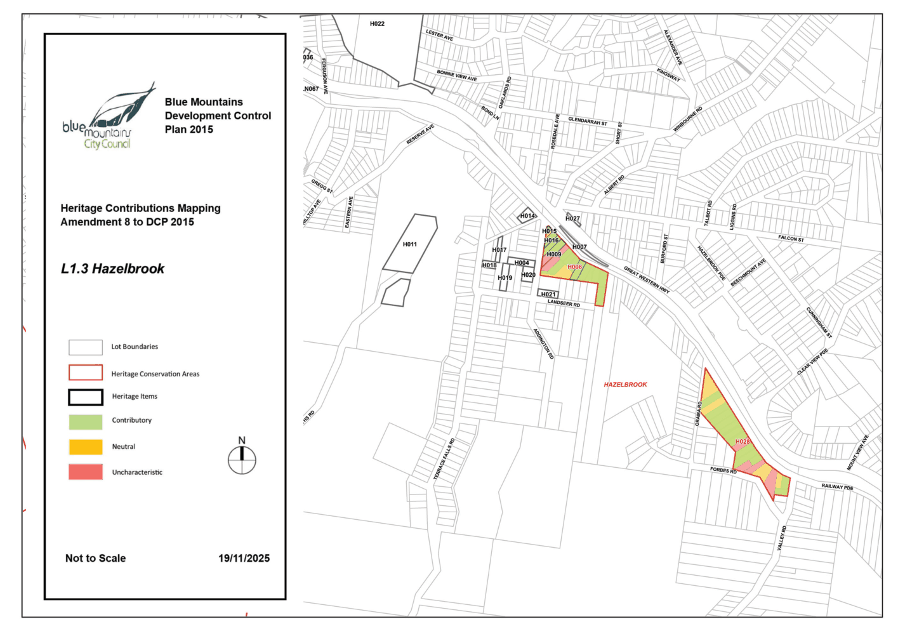
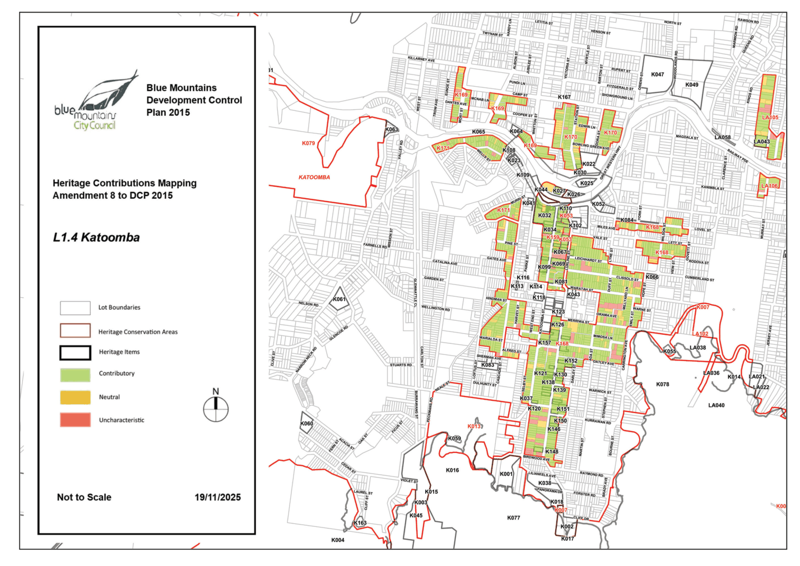
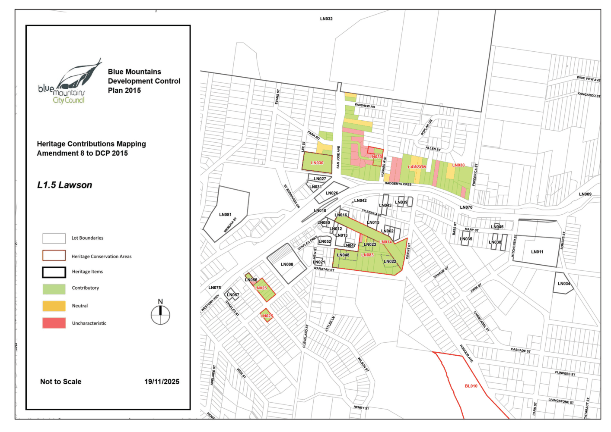
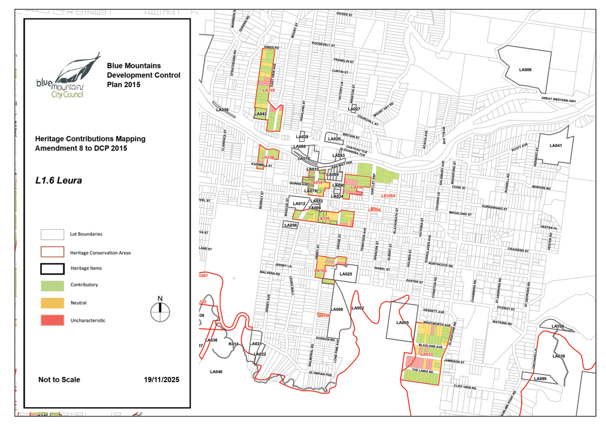
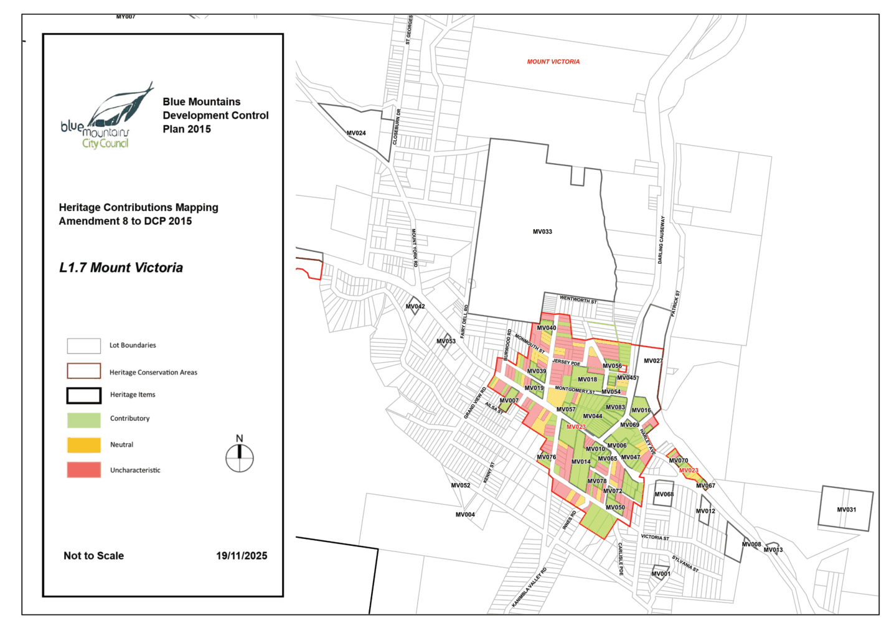
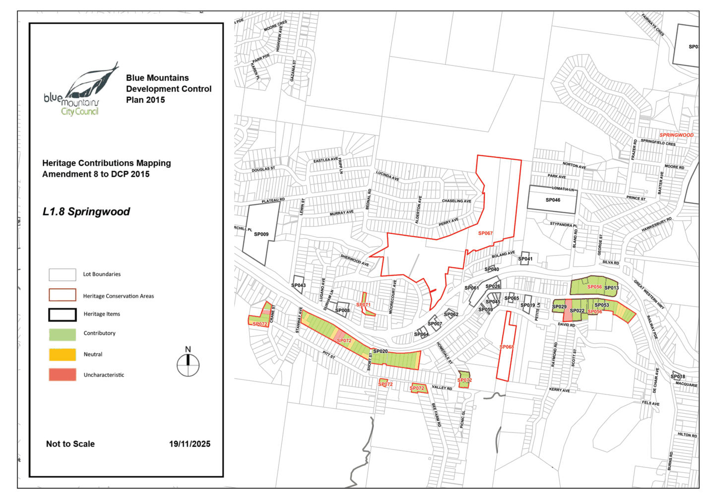
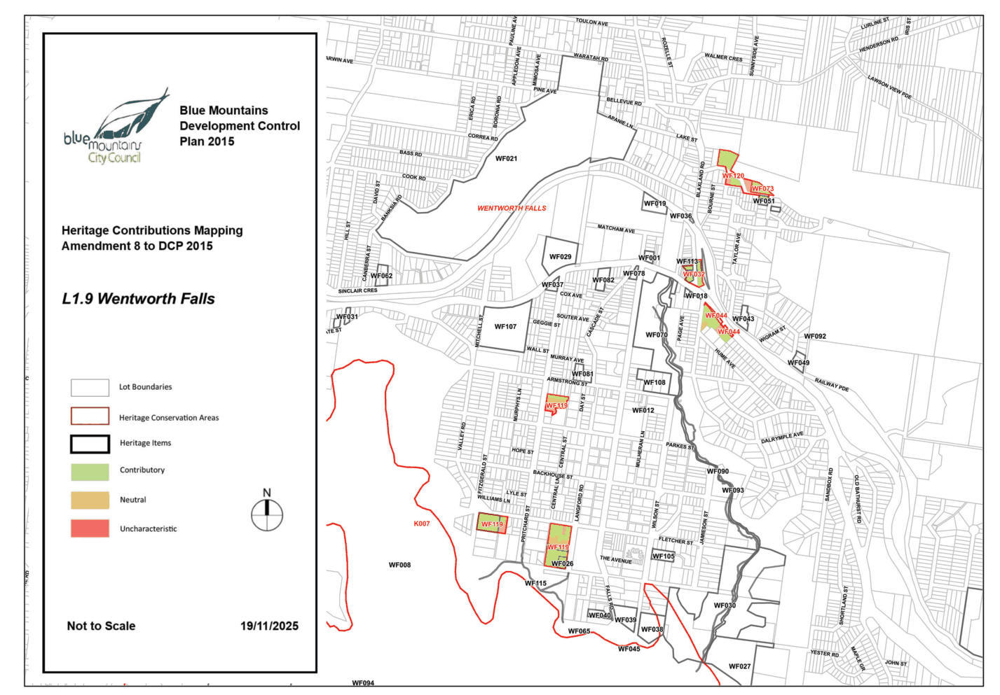

# Blue Mountains Development Control Plan 2015 - Part L Maps

Source PDF: [DCP 2015_Amendment 8_Part L.pdf](DCP%202015_Amendment%208_Part%20L.pdf)

### PART L

### MAPS

> [Picture on page 1: a picture, saved as a picture (images/part-l-maps-page-1-3.gif, 150 dpi).]

Part L: Maps

#### PART L | PAGE 904

### Contents

| Part L1 | Heritage Contribution Maps L1.1 Blackheath L1.2 Glenbrook L1.3 Hazelbrook L1.4 Katoomba L1.5 Lawson L1.6 Leura L1.7 Mount Victoria L1.8 Springwood L1.9 Wentworth Falls | 907 908 909 910 911 912 913 914 915 916 |
|---|---|---|

Part L: Maps

#### PART L | PAGE 905

Part L: Maps

#### PART L | PAGE 906

### PART L1

### HERITAGE CONTRIBUTION

### MAPS

> [Picture on page 5: a picture, saved as a picture (images/part-l-maps-page-5-4.gif, 150 dpi).]

Part L1: Heritage Contribution Maps

> [Picture on page 6: a picture, saved as a picture (images/part-l-maps-page-6-2.gif, 150 dpi).]

Part L1 - Figure 1: Blackheath

Part L1: Heritage Contribution Maps

> [Picture on page 7: a picture, saved as a picture (images/part-l-maps-page-7-2.gif, 150 dpi).]

Part L1 - Figure 2: Glenbrook

Part L1: Heritage Contribution Maps

> [Picture on page 8: a picture, saved as a picture (images/part-l-maps-page-8-2.gif, 150 dpi).]

Part L1 - Figure 3: Hazelbrook

Part L1: Heritage Contribution Maps

> [Picture on page 9: a picture, saved as a picture (images/part-l-maps-page-9-2.gif, 150 dpi).]

Part L1 - Figure 4: Katoomba

Part L1: Heritage Contribution Maps

> [Picture on page 10: a picture, saved as a picture (images/part-l-maps-page-10-2.gif, 150 dpi).]

Part L1 - Figure 5: Lawson

Part L1: Heritage Contribution Maps

> [Picture on page 11: a picture, saved as a picture (images/part-l-maps-page-11-2.gif, 150 dpi).]

Part L1 - Figure 6: Leura

Part L1: Heritage Contribution Maps

> [Picture on page 12: a picture, saved as a picture (images/part-l-maps-page-12-2.gif, 150 dpi).]

Part L1 - Figure 7: Mount Victoria

Part L1: Heritage Contribution Maps

> [Picture on page 13: a picture, saved as a picture (images/part-l-maps-page-13-2.gif, 150 dpi).]

Part L1 - Figure 8: Springwood

Part L1: Heritage Contribution Maps

> [Picture on page 14: a picture, saved as a picture (images/part-l-maps-page-14-2.gif, 150 dpi).]

Part L1 - Figure 9: Wentworth Falls
