### 3.1 Application of this Section

## 3         Development in Centres and Corridors

### 3.1 Application of this Section

To deliver a high standard of acoustic measures for residents within the Burwood Town Centre, High and Medium Density Areas, and Active Precincts to enable the delivery of housing in mixed-use areas that include entertainment and other noise-generating activities.

This section applies to Burwood’s centres and corridors, namely:

| Centre or Corridor | Zoning Under BLEP 2012 |
|---|---|
| Burwood Town Centre and Burwood Road North | B4 Mixed Use |
| Strathfield Town Centre | B4 Mixed Use |
| Enfield Local Centre | B2 Local Centre |
| Croydon Park Local Centre | B2 Local Centre |
| Croydon Neighbourhood Centre and other small areas | B1 Neighbourhood Centre |
| Parramatta Road Corridor | B6 Enterprise Corridor |

Where a type of development covered by this DCP section is permitted in another zone, Council may apply the relevant provisions from this DCP section at its discretion.

The aims of this section are: To reinforce and support the different identities, functions and character of the centres and corridor. To ensure development achieves the stated desired future character of each of the centres and corridor. To minimise the potential negative impacts of development on neighbouring low density residential properties. To encourage a safe and human scale environment at street level within centres and corridor.

#### 3.2.1 Building Design Objectives

O1 To ensure that new buildings:

Represent architectural and urban design excellence. Provide cohesive and visually interesting building appearance. Respond to surrounding notable buildings and enhances the streetscape. Integrate roof design with the building character and enhances the skyline. Encourage rooftop gardens and planting on structures that enhance the quality and amenity of open space.

General Guidelines

#### Provisions

P1 Architectural design excellence is to be achieved in the following ways:

The form and external appearance of any development should significantly improve the quality and amenity of the public domain. Cohesive design and visual interest should be provided by articulation, modulation and fenestration as well as textures, materials and colours. The development should respond positively to its context, environment and function.

P2 New facades should complement the predominant scale, proportion and rhythm of the existing streetscape.

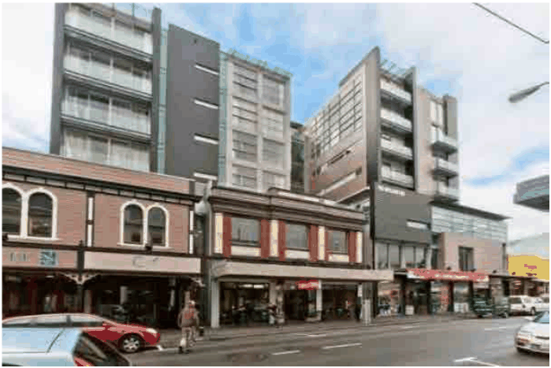

> [Picture on page 2: a picture, saved as a picture (images/section-03-development-in-centres-and-corridors-page-2-20.gif, 150 dpi).]

Example of streetscape showing the new high-density development integrated with the existing fine grain

façade of the town centre/corridor (Source: City of Auckland).

P3 Façade elements including roof form, materials, colours and awnings are to make a cohesive and visually interesting building appearance.

P4 New facades are to respond to the proportion, texture and material of surrounding notable buildings including heritage or locally valued buildings within the immediate surrounding context. Mimicking of heritage features is to be avoided.

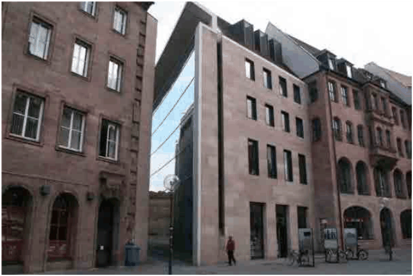

> [Picture on page 3: a picture, saved as a picture (images/section-03-development-in-centres-and-corridors-page-3-4.gif, 150 dpi).]

The building modulation and fenestration responds to the adjacent valued context. (Source: Google)

P5 Extensions and additions involving heritage elements must be designed to complement the style, form and proportions as well as materials and colours of heritage elements.

P6 Any blank walls are to be designed to have details and visual interest and be cohesive with the rest of the elevation through the use of materials, textures and colours.

P7 In infill developments, façade modulation/ articulation should reflect the key datum lines of the adjacent contributory developments.

P8 New developments on corner sites should orient to both street frontages.  Also they should accentuate the corner’s unique location with architectural features that actively engage the public realm and create a visual presence at the corner, such as:

Chamfered or rounded corners Different material and colours Recessed balconies or windows

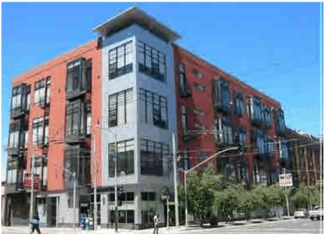

> [Picture on page 4: a picture, saved as a picture (images/section-03-development-in-centres-and-corridors-page-4-1.gif, 150 dpi).]

The corner element is to be treated differently to enhance the visual character of the public domain. (Source:

Google)

P9 Building service elements, such as drainage pipes, grilles, screens, ventilation louvres and car park entry doors should be integrated into the overall facade design.

P10 A simplified response to the required DCP height plane is encouraged.

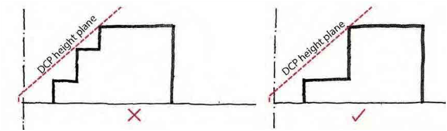

> [Picture on page 4: a picture, saved as a picture (images/section-03-development-in-centres-and-corridors-page-4-7.gif, 150 dpi).]

P11 The primary façade proportion should distinguish the podium, middle and top elements.

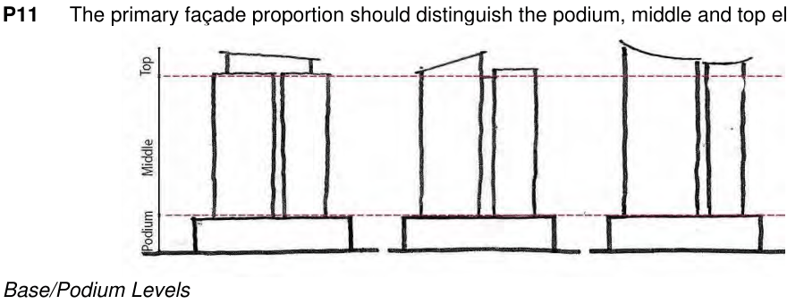

> [Picture on page 4: a picture, saved as a picture (images/section-03-development-in-centres-and-corridors-page-4-9.gif, 150 dpi).]

Base/Podium Levels

P12 Ground level façades are to have modulation every 5-6m to reflect the existing ‘fine grain’ storefront scale.

P13 Podium façade articulation above the ground level should contribute to the modulation and rhythm of the ground level and reflect a human scale development.

P14 Infill developments adjacent to small-scale heritage items and/or local valued building should respond to the adjacent façade expressions/rhythm and datums in their podium façade design.

P15 A minimum of 90% of the front façades on the ground level are to be activated with storefronts and openings.

P16 A minimum of 30% - 50% of side façades within podia are to be activated with windows and openings. This applies where a side façade is next to a heritage item, a pedestrian link or a laneway.

P17 A minimum of 60% - 70% of the rear façade within podia is to include windows and openings. This applies where the rear façade is not built to the rear boundary, or where it is built to the rear boundary but has frontage to a laneway or a pedestrian link.

P18 Main entrances are to be clearly visible from the public domain. Different materials or visually interesting modulations/rhythms are encouraged.

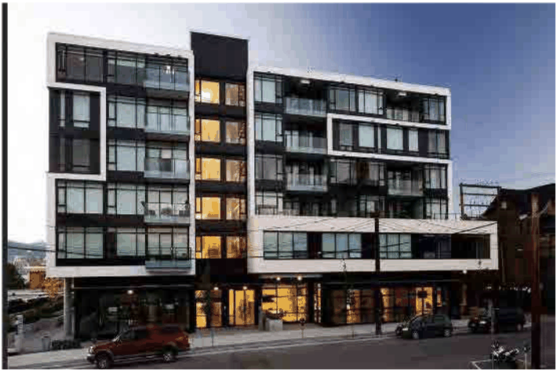

> [Picture on page 5: a picture, saved as a picture (images/section-03-development-in-centres-and-corridors-page-5-11.gif, 150 dpi).]

A different modulation to highlight the main pedestrian entrance is encouraged. (Source: Auckland Design Manual)

P19 Service/parking entrances are to have a minimum width, be integrated with the overall façade of the podium element and show quality materials around the mouth of the entrance up to 3m inwards or after the security gate.

P20 Podium façades in corner sites should activate both streets.

P21 In transitional areas (town centres to residential precincts), podium elements should reflect the smaller modulation of the residential buildings in their façade design.

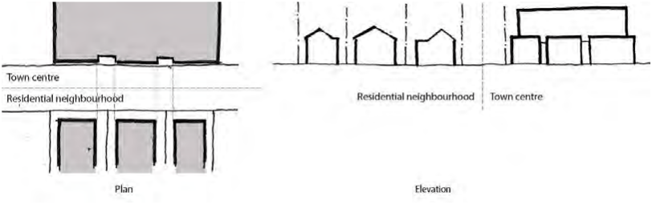

> [Picture on page 5: a picture, saved as a picture (images/section-03-development-in-centres-and-corridors-page-5-19.gif, 150 dpi).]

Middle

P22 Where the building length above the podium levels is less than 45 m but the building is attached to the adjacent building, a break every 40-45m is to be provided to avoid continuous walls of development.

P23 Front and rear façades to include 60% - 70% windows and balconies to habitable rooms.

P24 Side façades - if not attached to the adjacent development - are to include windows and openings within at least 30% - 50% of the façade visible from the public domain and the surrounding habitable areas. Where separation distances are less than the guidelines in the ADG, redirection of views from the widows and openings is encouraged to avoid adverse privacy impacts.

P25 Blank facades attached to the side boundaries, in the interim, should present visually interesting elements through materials and colours. Plain/blank walls are prohibited.

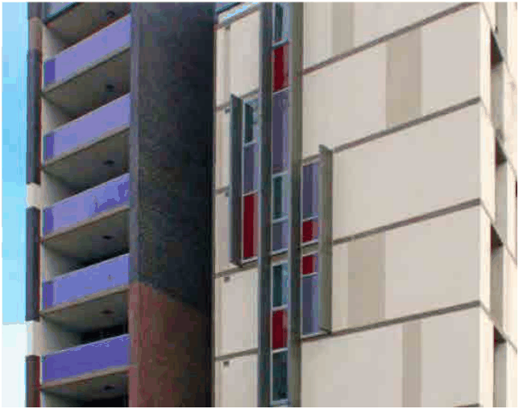

> [Picture on page 6: a picture, saved as a picture (images/section-03-development-in-centres-and-corridors-page-6-13.gif, 150 dpi).]

Modulation and articulation of blank walls to enhance the visual character of the building (Source: ADG, 4M).

P26 New development should avoid having blank walls on the northern façade. A minimum of 70% of the northern façade is to include habitable windows and balconies.

P27 Horizontal shading on the northern façades and vertical shading for eastern/western facades are encouraged to control heat gain to the internal areas.

P28 Façade proportions should reflect the internal use of each building.

P29 Variety of architectural modulation and rhythm is encouraged to enhance the visual interest of the façade. Vertical articulation is preferred to break the façade into smaller elements.

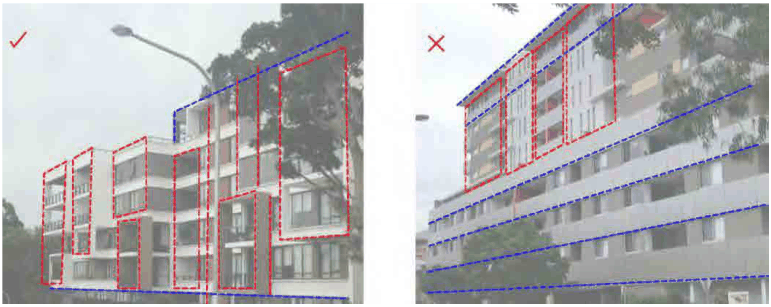

> [Picture on page 7: a picture, saved as a picture (images/section-03-development-in-centres-and-corridors-page-7-1.gif, 150 dpi).]

P30 Openings are to be recessed at a minimum of 100mm to add depth to the façade.

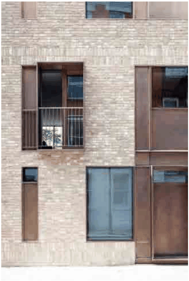

> [Picture on page 7: a picture, saved as a picture (images/section-03-development-in-centres-and-corridors-page-7-3.gif, 150 dpi).]

Recessed openings add depth to the overall façade. (Source: GMU Library)

P31 Recessed balconies are preferable to provide privacy, protection and depth to the façade.

P32 Sliding louvered panels as balcony screening are encouraged to add visual privacy and control glare and heat gain.

Building Top and Roof Gardens

P33 Roof designs are to be integrated into the overall architectural character of the building and enhance the skyline of the centre or corridor.

P34 Buildings are to have recognisable roof termination or capping distinguishable from the public domain.

P35 The use of different façade expression including articulation, material, parapet, colour and texture to differentiate the top level or roof is encouraged.

P36 Roofs must respond to the orientation of the site. For example, the use of eaves and skillion roofs to facilitate to solar access.

P37 The visual impact of service elements must be minimised by integrating them into the roof design and concealing them from view. These elements include lift over-runs, service plant rooms, vent stacks, telecommunication infrastructures, gutters and downpipes.

P38 Development must be designed with regard to how it is observed from the street and from adjacent development. Opportunities for sculptural expression to create a varied skyline must be considered.

P39 Residents shall have access to rooftop and podium gardens wherever possible. At least 50% of the roof area shall be vegetated with grasses, shrubs and trees.

P40 Planter boxes must be located at the perimeter of rooftop gardens to minimise overlooking of neighbouring dwellings.

P41 Planting containers must allow sufficient depth and volume, growing medium and irrigation to support the mature size of plants.

P42 All planting areas on structures must be designed by a suitably qualified engineer.

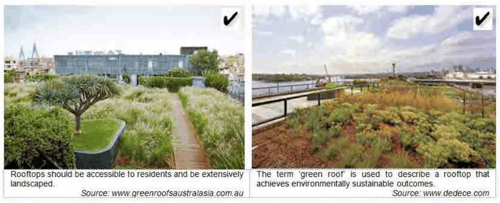

> [Picture on page 8: a picture, saved as a picture (images/section-03-development-in-centres-and-corridors-page-8-23.gif, 150 dpi).]

#### 3.2.2 Materials and Finishes Objectives

O1 To ensure that the use of superior quality external materials and finishes: Contributes to architectural and urban design excellence. Provides cohesive and visually interesting building appearance. Responds to surrounding notable buildings and enhances the streetscape. Provides longevity in external materials and finishes that are of superior quality.

#### Provisions

P1 The existing material, texture or colours of the surrounding developments are to be considered in the façade design of the new developments.

P2 The new façade is to consider the texture and materials of their adjacent heritage buildings or contributory items.

P3 Different treatment is to be considered for the base, middle and top in the overall facade composition.

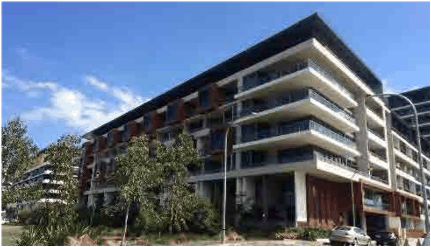

> [Picture on page 9: a picture, saved as a picture (images/section-03-development-in-centres-and-corridors-page-9-15.gif, 150 dpi).]

Façade material and finishes clearly differentiate the base, middle and top of new buildings. (Source: Google)

P4 Extensive expanses or overreliance on painted render is not permitted. Prominence is to be given to pre-coated or through-colour textured finishes in panels or similar formats.

P5 Blank walls/inactive elevations must use changes in materials, patterns, colours or other design elements to provide variation and architectural interest. This includes blank walls/ inactive elevations that may be exposed to view pending future development on adjoining land.

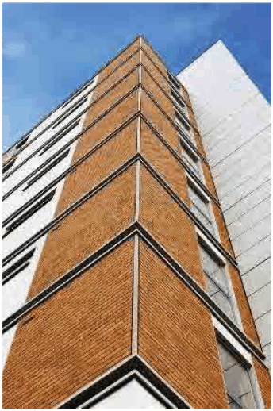

> [Picture on page 10: a picture, saved as a picture (images/section-03-development-in-centres-and-corridors-page-10-1.gif, 150 dpi).]

Blank walls must be treated to provide variation and architectural interest.

P6 Monotonous/bland façade expressions are to be avoided. Building materials and colours should be used to unify and provide visual interest to building exteriors. However, the number of materials and colours should be limited to maintain a visual simplicity and harmony.

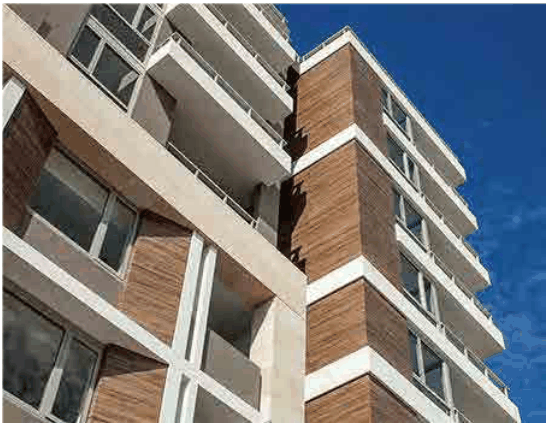

> [Picture on page 10: a picture, saved as a picture (images/section-03-development-in-centres-and-corridors-page-10-6.gif, 150 dpi).]

A combination of different materials and finishes provides a harmonious composition (Source: Google)

P7 Changes in façade material or colour should be associated with a change in façade plane or separated by a pilaster, recess or change in scale.

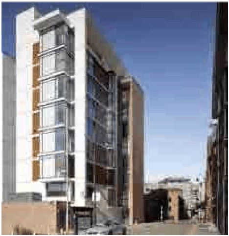

> [Picture on page 11: a picture, saved as a picture (images/section-03-development-in-centres-and-corridors-page-11-1.gif, 150 dpi).]

Primary materials are associated with the majority of the elevations of the building. (Source: Auckland Design Manual)

P8 Opening frames are generally to be recessive colours to mitigate any visual clutter of the overall façade.

P9 An appropriate palette of colours should be used. Stronger primary colours can be used as the main building colour when used in combination with lighter colours to highlight building accents and create contrast. See sample colour boards below.

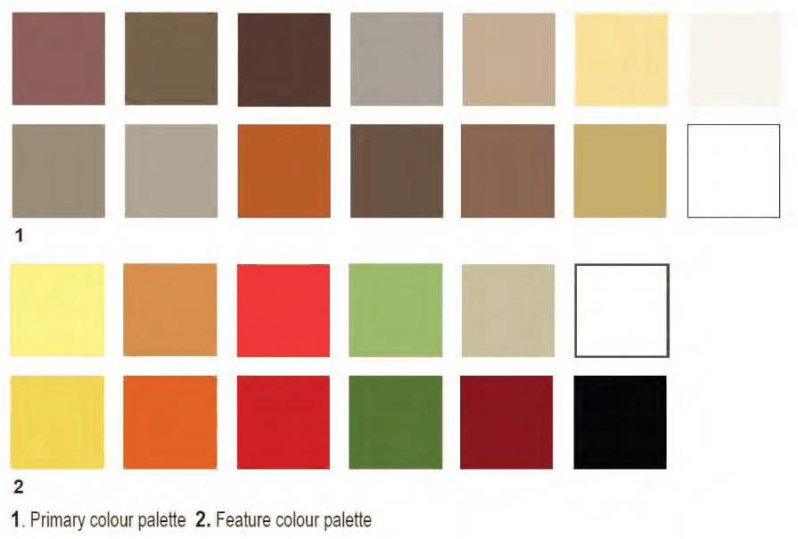

> [Picture on page 11: a picture, saved as a picture (images/section-03-development-in-centres-and-corridors-page-11-8.gif, 150 dpi).]

P10 The use of white shall only be permitted on trimming with bright colours to highlight items. Generally neutral tones should predominate and colours selected should fall into the spectrum of the preferred community colour palette.

P11 Buildings are to avoid high reflectivity glass. No clear glass balustrades will be permitted. Use of translucent or opaque materials for balustrades is encouraged.

P12 Materials in high rise building forms particularly those terminating views and vistas should help elevate the building’s iconic status.

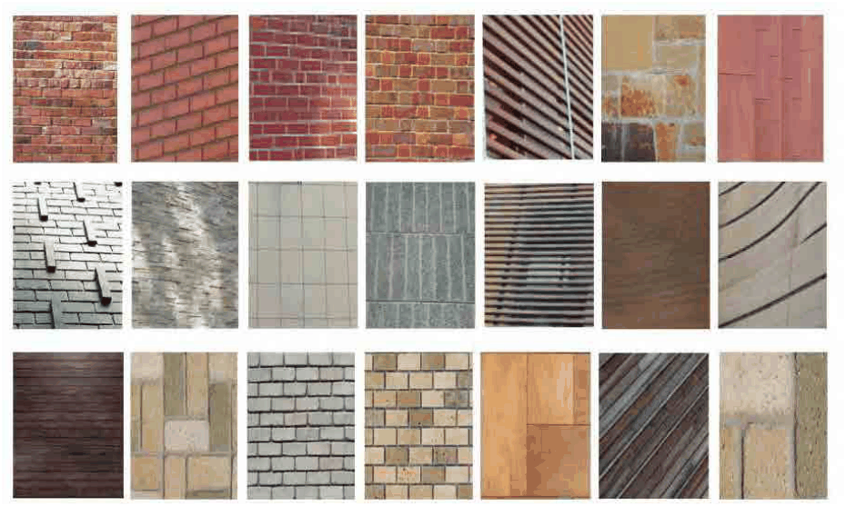

> [Picture on page 12: a picture, saved as a picture (images/section-03-development-in-centres-and-corridors-page-12-5.gif, 150 dpi).]

P5 Low maintenance and graffiti resistant materials must be used wherever possible on surfaces susceptible to graffiti.

#### 3.2.3 Lighting and Signage Objectives

O1 To ensure that that building lighting and signage: Contribute to architectural and urban design excellence. Provide cohesive and visually interesting building appearance.

#### Provisions

P1 The size of the street address sign on the main facade is to be legible for pedestrians walking in the public domain.

P2 Building names and street addresses are to have contrasting colours and/or material to enhance their legibility.

P3 External lighting to enhance the details of facade and character of the surrounding context is to be incorporated. Use of indirect lighting is encouraged.

P4 In town centres and corridors, the external lighting is to illuminate the specific character of the building including the entrances, corner element or roof features.

P5 Night-lighting of retail display windows in mixed-use buildings in town centres and corridors is encouraged.

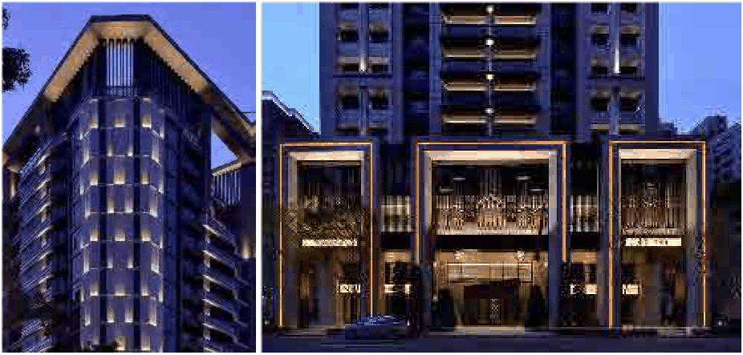

> [Picture on page 13: a picture, saved as a picture (images/section-03-development-in-centres-and-corridors-page-13-1.gif, 150 dpi).]

P6 In residential neighbourhoods, the main entrance and the pedestrian high traffic areas are to be illuminated to enhance wayfinding and safety.

P7 In both centres and corridors, and residential neighbourhoods, external lighting must be integrated to the overall streetscape character.

P8 Side elevations without window or openings must have a lighting scheme to mitigate the effects of dark inactive elevations being visible from the public domain or streetscape especially after working/trading hours.

P9 Compliance is required also with the other provisions of the BDCP concerning awnings and signage.

#### 3.2.4 Street-Front Activities and Building Access Objectives

O1 To encourage pedestrian safety, visual interest and activity at street level.

O2 To promote street front activities, especially along streets of high pedestrian use.

O3 To create building entrances that are safe and contribute positively to the streetscape and building façade design.

O4 To further strengthen activity along classified roads in centres such as Burwood Road, Liverpool Road, Georges River Road and Parramatta Road.

#### Provisions

P1 Where, as a result of the nature of the development, there are specific security requirements, security measures must form an integral part of the building design. Roller shutters are not permitted but retractable open security grilles may be considered.

P2 Ground floor level development must: Promote quality non-residential activities in accordance with the zone. Minimise the number of service doors.

Encourage visual interest on service doors with displays etc. Provide access points to and from the public domain at not more than 20 metre intervals. Provide at-grade access at entry points. Incorporate visually interesting streetscape frontages at ground level with attractive entries, clear glazed windows and window displays, artworks, articulated architecture and facade modulation.

P3 Separate and clearly identifiable entrances must be provided from the street for pedestrians and cars, and different uses (residential and non-residential).

P4 Building entrances must have a direct physical and visual connection with the street.

P5 Residential component of any development must have a clear street address and a separate entry.

P6 Outdoor dining is generally encouraged on the footpath of commercially active street frontages, subject to compliance with Council’s Outdoor Eating Area Policy.

P7 All commercial components must have a clear street address.

P8 CCTV cameras shall be installed over any entrance points (including car parking entrance) for residential flat buildings and major developments. The CCTV system shall provide a quality image that can assist with the detection of crime and be used by the NSW Police in any investigation (preferably a quality digital system). CCTV system footage shall be retained for a period of no less than fourteen days and be available upon request by the NSW Police when required.

Mailbox and Postal Facilities

P9 All mail box and postal facilities shall be incorporated into the building in accordance with the requirements of Australia Post. Mail boxes shall be sited and designed for attractive visual appearance and function, as well as to complement the architecture and environs.

P10 A locking device shall be installed to all mailboxes.

P11 Mailboxes must be integrated into the front wall such that residents collect mail from a secured internal foyer. Please refer to Figure 1 and Figure 2. External mail boxes accessible only from the footpath outside a development are not permitted.

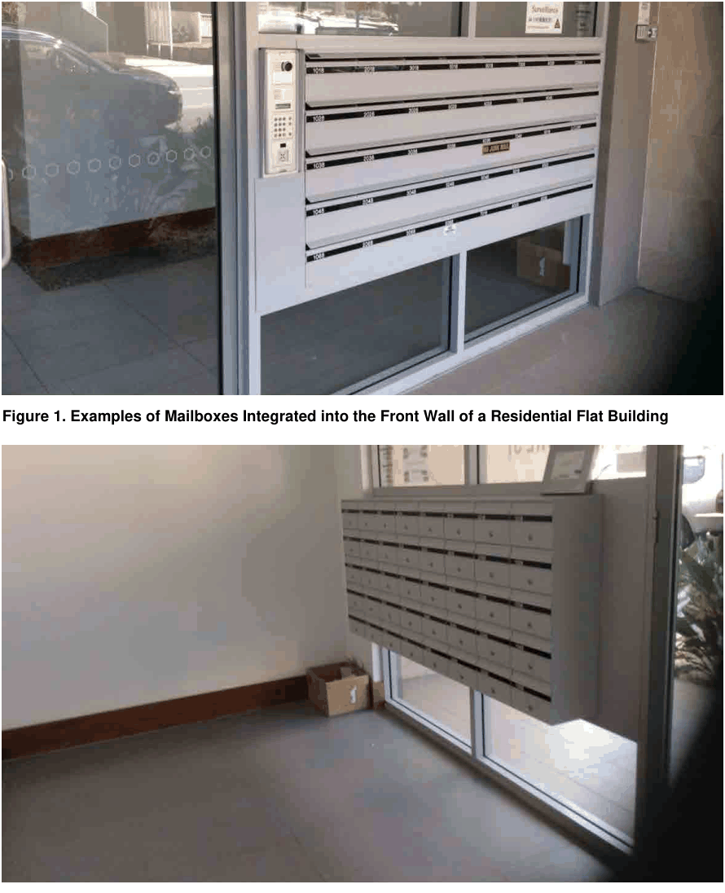

> [Picture on page 15: a picture, saved as a picture (images/section-03-development-in-centres-and-corridors-page-15-1.gif, 150 dpi).]

Figure 1. Examples of Mailboxes Integrated into the Front Wall of a Residential Flat Building

#### Figure 2. Example of Mailboxes Accessible from a Secure Internal Foyer

Fire Safety and Power Supply Utilities

P12  Development Application documentation must show all required mechanical/functional installations for utilities such as fire hydrant boosters and electrical substations. These must have coverings or shielding to screen their setting so as to minimise their visual impacts.

P13  Fire safety utilities such as fire hydrant boosters must be screened, accessible at all times and integrated within the overall architectural design of the building.

P14  Large power supply utilities such as electrical substations must be shielded from public view or encapsulated within the building envelope.

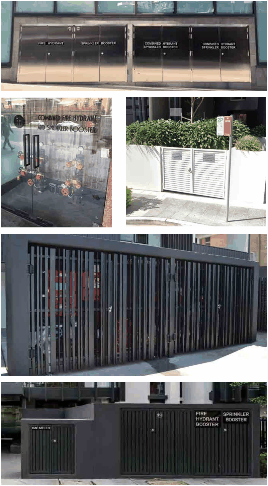

> [Picture on page 16: a picture, saved as a picture (images/section-03-development-in-centres-and-corridors-page-16-1.gif, 150 dpi).]

#### Figure 3. Examples of enclosed fire safety utilities

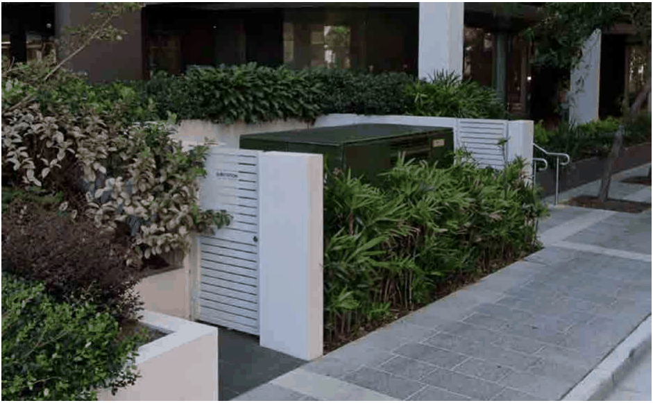

> [Picture on page 17: a picture, saved as a picture (images/section-03-development-in-centres-and-corridors-page-17-1.gif, 150 dpi).]

#### Figure 4. Example of a screened large power supply utility / substation

Mechanical and Ventilation Equipment

P15  Mechanical ventilation and plant equipment must not be visible from the public domain, or be attached to the external façades or elevations. It must be located within a central plant area and screened from public view.

P16  Mechanical ventilation and plant equipment must not adversely affect the architectural quality and presentation of façades, elevations or roof features.

P17  If mechanical ventilation and plant equipment must be visible from the public domain it must be incorporated within the building design and not detract from the architectural quality of the elevations or roof features.

P18  Specifications, designs and technical information of mechanical and ventilation equipment must be provided to Council at the development application stage.

#### 3.2.5 Subdivision and Car Parking Spaces Objectives

O1 To promote the orderly and transparent development of land.

O2 To ensure subdivided car parking spaces are not separated from the uses for which they were provided.

#### Provisions

P1 An application for Strata Title or Community Title subdivision of land may include a car parking space only where the parking space is part of another lot.

P2 Consent must not be granted to Strata Title or Community Title subdivision which results in the subdivision of car parking alone.

#### 3.2.6 Site Isolation Overview

Isolated sites in centres and corridors are those sites whose size and locations could potentially significantly limit development as a result of not being included in an adjoining development proposal. Sites may not be defined as isolated if they have the future potential to amalgamate with an alternate adjoining property.

#### Objectives

O1 To encourage site consolidation of allotments for development in order to promote the efficient use of land and to avoid the creation of isolated sites.

O2 To encourage the development of existing isolated sites in a manner that responds to the site’s context and characteristics and that maintains a satisfactory level of amenity.

#### Provisions

P1 The creation of isolated sites is discouraged.

P2 Where a development may result in the creation of an isolated site or sites, the applicant is required to demonstrate that negotiations between the owners of the properties commenced at an early stage that was prior to the lodgement of the Development Application. Where no satisfactory result is achieved, the Development Application must include evidence of negotiations with the owners of the properties. These details must include offers to such owners. Such offers are to be reasonable and are to be based on at least one recent independent valuation and include other reasonable expenses likely to be incurred in the sale of the process.

P3 Where a development may result in the creation of an isolated site the applicant must demonstrate that orderly and economic use and development of the separate sites can be achieved that is consistent with the planning controls. Such demonstration is achieved by the applicant providing an envelope for that site, indicating height, setbacks, resultant site coverage and/or built area (building and basement), sufficient to understand the relationship between the development and that site, the likely impacts the development will have on each other, such as solar access, visual and acoustic privacy, impacts for residential development and traffic impacts if that site is on a main road.

P4 The development of an isolated site is not to detract from the character of the streetscape and is to achieve a satisfactory level of amenity, including solar access, visual and acoustic privacy.

#### 3.2.7 Residential Flat Buildings and Shop Top Housing Objectives

O1 To clarify the application of DCP provisions to these forms of development.

#### Provisions

P1 In the B4 Mixed Use zone, both residential flat buildings and shop top housing are permitted with consent. For the purposes of implementation of the BLEP 2012 in this zone, where the residential component of a mixed development comprises three of more dwellings, it will be regarded as a residential flat building, not shop top housing. In these cases there will be no restriction on ground floor uses.

Where the residential component of a mixed development comprises one or two dwellings, it will be regarded as shop top housing. In this case the use of the ground floor is restricted to retail or business premises.

In the B4 Mixed Use zone development comprising residential flat buildings or shop top housing will be subject to the same provisions of Part 3 of this DCP, together with SEPP 65 and the Apartment Design Guide (ADG).

For any shop top housing, there is no numerical relationship between the number of dwellings and the ground floor retail or business premises.

P2 In the B1 Neighbourhood Centre, B2 Local Centre and B6 enterprise Corridor zones, only shop top housing is permitted. In these zones, the residential component of a mixed development comprising one or more dwellings is regarded as shop top housing, and the use of the ground floor is restricted to retail or business premises. There is no numerical relationship between the number of dwellings and the ground floor retail or business premises.

In the B2 Local Centre zone, the provisions of Part 3 of this DCP applying to residential flat buildings will also apply to shop top housing, together with SEPP 65 and the ADG.

In the B1 Neighbourhood Centre zone, development of shop top housing is likely to be minor because of the development standards and heritage restrictions applying. In this zone shop top housing development will be assessed on its merits having regard to the requirements of the BLEP 2012 and existing development in the neighbourhood centre.

In the B6 Enterprise Corridor zone, the residential component of development is restricted to about 10% of potentially available floor space of a building. In this zone the residential development will be assessed on its merits having regard to SEPP 65 and the ADG.

#### 3.2.8 Apartment Mix and Minimum Dwelling Sizes Objectives

O1 To provide housing choice to meet the socio-economic needs of the population.

#### Provisions

P1 Residential development in excess of 20 dwellings must provide a mix of dwellings containing one, two or more bedrooms.

P2 All residential developments must provide the following minimum apartment sizes:

Studio apartments - 40 square metres. One bedroom apartments - 50 square metres. Two bedroom apartments - 70 square metres. Three or more bedroom apartments - 95 square metres.

P3 Calculation of the apartment size must be the net area and is exclusive of the apartment’s perimeter walls, balconies and excessive internal circulation of the dwellings. The storage areas required to be provided within each dwelling by Section 3.2.16 of this DCP section may be included in the calculation of the net area.

#### Advisory Note:

These provisions also apply to serviced apartments.

#### 3.2.9 Minimum Site Area Objectives

O1 To ensure sites are capable of accommodating development.

#### Provisions

P1 Any development with a height over 10m is generally required to have a minimum site area of 500sqm.

P2 Council will only consider a development with a minimum site area below 500 sqm where the Council is satisfied that: The development demonstrates design excellence. The development provides a good response to the streetscape and surrounding development (in terms of both existing and future development). The development provides full compliance with parking requirements without the use of automated or mechanical car parking systems.

#### 3.2.10  Building Depth Objectives

O1 To provide adequate amenity in terms of access to natural light and ventilation.

#### Provisions

P1 For development including multi dwelling housing refer to the building amenity provisions of the ADG which supplements SEPP 65 – Design Quality of Residential Apartment Development.

#### 3.2.11  Ceiling Height Objectives

O1 To provide adequate amenity.

O2 To allow for future mix of uses and contribute to flexibility of use.

#### Provisions

P1 Development must provide the following minimum ceiling heights. Dimensions are expressed from finished floor levels to finished ceiling levels: Ground level of all development (commercial and residential): 3.3 metres. Non-residential floors above ground level: 3.0 metres. Residential floors above ground level: 2.7 metres for habitable rooms and 2.4 metres for non-habitable rooms.

P2 In developments where 50% or more units on a level do not receive a minimum of 2 hours of direct sunlight to habitable spaces in midwinter (balconies excluded) the floor to ceiling height must be a minimum of 3 metres for the entire floor (approx. 3.3 metres floor to floor).

P3 Floor to ceiling heights that have been approved as per Provision P2 above cannot be reduced on subsequent approvals or modifications.

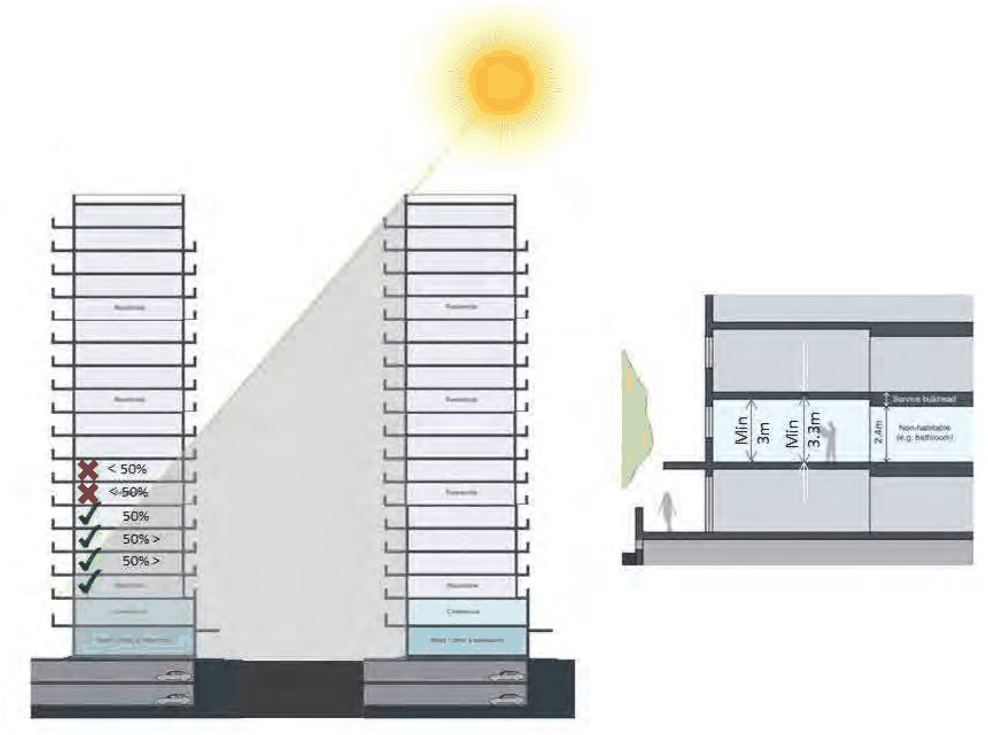

> [Picture on page 21: a picture, saved as a picture (images/section-03-development-in-centres-and-corridors-page-21-1.gif, 150 dpi).]

#### Figure 5. Increased floor to ceiling heights (Adapted from ADG 2015)

#### 3.2.12  Natural Ventilation Objectives

O1 To provide adequate amenity.

O2 To minimise the energy consumption of development through reduced reliance on mechanical ventilation.

#### Provisions

P1 For development including multi dwelling housing refer to the building amenity provisions of the ADG which supplements SEPP 65 - Design Quality of Residential Apartment Development.

#### 3.2.13  Daylight Access Objectives

O1 To orient development to optimise solar access.

O2 To minimise the energy consumption of air-conditioning of development.

#### Provisions

P1 For development including multi dwelling housing refer to the building amenity provisions of the ADG which supplements SEPP 65 - Design Quality of Residential Apartment Development.

#### 3.2.14  Visual and Acoustic Privacy Objectives

O1 To provide adequate amenity.

O2 To deliver a high standard of acoustic measures for residents within the Burwood Town Centre, High and Medium Density Areas, and Active Precincts – Zones R1. R3. E1 and MU1.

O3 To enable the delivery of housing in mixed use areas that include entertainment and other noise generating activities

#### Provisions

P1        Development must be located and orientated to maximise visual privacy between development on the site and adjacent development by: Providing adequate rear and side setbacks. Utilising the site layout to increase building separation. For example, orientation of buildings on narrow sites to the front and rear of the lot, thereby utilising the street width and rear garden depth to increase the apparent building separation distance.

P2 Detailed site and building design elements may be incorporated to increase privacy without compromising access to light and air. Design detailing may include: Solid or semi-solid balustrades to balconies. Offset windows of dwellings. Recessed balconies and/or vertical fins. Louvres or screen panels to windows and/or balconies. Fencing. Vegetation as a screen between spaces. Pergolas or shading devices to limit overlooking.
