#### P7    Noise Emission Standards

Any new building, or existing building subject to substantial alterations or additions for the purpose of changing its use to a child care facility, must be designed as not to emit noise exceeding the requirements of the AAC Child Care Centre Guidelines.

#### 3.2.15  Private Open Space Objectives

O1 To provide all dwellings in centres and corridors with secure private open space, either in the form of a private courtyard or balcony.

O2 To provide usable private open space areas which relate well to the main internal living areas.

O3 To provide open space with soft landscaping.

#### Provisions

P1 All dwellings must have direct access to one primary open space from the main living area.

P2 The primary open space must be dimensioned to promote indoor/outdoor living. A dining table and two chairs (small apartment, i.e. 1 bedroom) or four chairs (large apartment, i.e. 2 or more bedrooms) should fit on the primary open space. The following minimum dimensions, clear of balustrades, must be achieved:

Minimum depth - 2 metres (up to one bedroom). Minimum depth - 2.5 metres (two or more bedrooms). Minimum area - 8 sq metres (one and two bedrooms). Minimum area - 10 sq metres (three bedrooms or larger).

P3 Private open space must respond to site conditions including sun, noise, wind and privacy. Sun screens, pergolas, shutters and openable walls are to be used to increase amenity where appropriate.

P4 Private open space must form an integral part of the development’s design.

#### 3.2.16  Lobbies and Internal Circulation – All Development Objectives

O1 To provide communal spaces which contribute to the overall design, experience and performance of the development.

02 To provide well designed and lit spaces for occupant movement and waiting.

03 To provide inviting communal spaces which include facilities for seating, mail boxes and supervision personnel.

#### Provisions

P1 Entry lobbies must be designed to provide facilities for seating, mail delivery and collection, and supervising personnel wherever possible.

P2 Lift lobbies must be naturally ventilated. Daylight is to enter all residential lift lobbies.

P3 Common area corridors must be designed to facilitate easy movement of people and furniture. Corridors must incorporate varied surfaces, textured and materials, and clearly identified apartment numbers.

P4 Common area corridors must be a minimum of 2 metres in width. Areas in front of arrival points i.e. lifts and fire stairs should have an additional depth up to 2.5 metres to facilitate improved internal building amenity. Access to facilities such as doors to rooms enclosing garbage chutes or vertical risers, if clustered around lift cores, should also benefit from additional corridor depth.

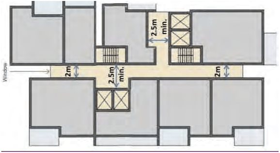

> [Picture on page 24: a picture, saved as a picture (images/section-03-development-in-centres-and-corridors-page-24-28.gif, 150 dpi).]

#### Figure 6. Corridor widths. (Adapted from ADG 2015)

P5 The name and number of a development must be clearly displayed at the entry outside the development. Suitable illumination for after-hours recognition must be provided.

#### 3.2.17  Storage for Apartments Objectives

O1 To provide adequate storage for everyday household items within easy access of the apartment.

O2 To provide storage for equipment including those associated with sporting, leisure, fitness and hobby activities.

#### Provisions

P1 For development including multi dwelling housing refer to the building configuration provisions of the ADG which supplements SEPP 65 - Design Quality of Residential Apartment Development.

P2 At least 50% of the storage area must be provided within the dwelling and 25% accessible from active areas.

P3 Where the remaining 50% of the storage is located in the basement of the development it must be linked to its associated dwelling through its relevant strata title.

#### 3.2.18  Safety and Security Objectives

O1    To ensure development is safe and secure for occupant’s visitors and other users at all times.

#### Provisions

P1 The routes between a development’s entrance and its dwellings must be designed to maximise occupant safety. The routes from car parking areas to the lift lobby are particularly important in this regard. Clear sight lines and well-lit routes must be provided.

P2 Development must comply with Council’s Burwood Community Crime Prevention and Safety Plan.

P3 Development must be provided with clearly defined site boundaries to strengthen the distinction between public and private space.

P4 Facades at ground level must be activated by locating after hours uses so they are visible from the publicly accessible areas.

P5 Development access must be controlled by:

Restricting access from balconies, roofs and windows of neighbouring development. Providing separate access from public and common areas. Providing separate access for residents in mixed-use developments. Providing an audio or video intercom system at the pedestrian or vehicular entrance or in the lobby for visitors to communicate with residents. Providing secure keyed or electronic access for residents.

P6 Concealment opportunities must be minimised from development by:

Eliminating blind or dark alcoves near lifts and stairwells. Providing clear sight lines and well lit routes throughout the development. Providing appropriate levels of illumination for all common areas.

P7 Residential development must be oriented so that primary windows and private open space address the street and publicly accessible areas.

P8 Where, as a result of the nature of the development, there are specific security requirements, security measures must form an integral part of the building design.

Security Grilles and Shutters

P9 Fully enclosed roller shutters are not permitted to shop fronts or other business premises. Retractable open security grilles may be considered.

P10  Security bars, roller shutters or fixed grilles visible from the public domain on any commercial, retail or business premises  are prohibited.

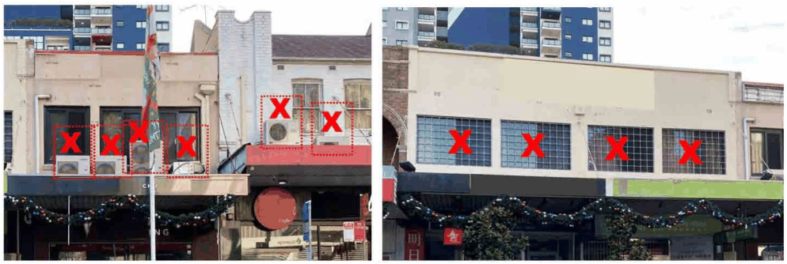

> [Picture on page 26: a picture, saved as a picture (images/section-03-development-in-centres-and-corridors-page-26-13.gif, 150 dpi).]

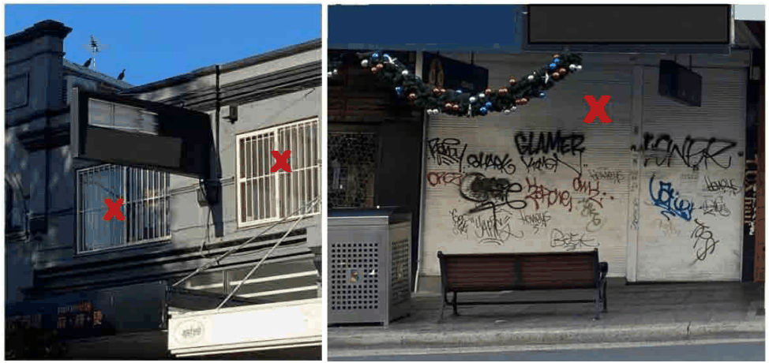

> [Picture on page 26: a picture, saved as a picture (images/section-03-development-in-centres-and-corridors-page-26-14.gif, 150 dpi).]

Figure 7. Examples of prohibited security bars, shutters or permanent grilles and air handling systems

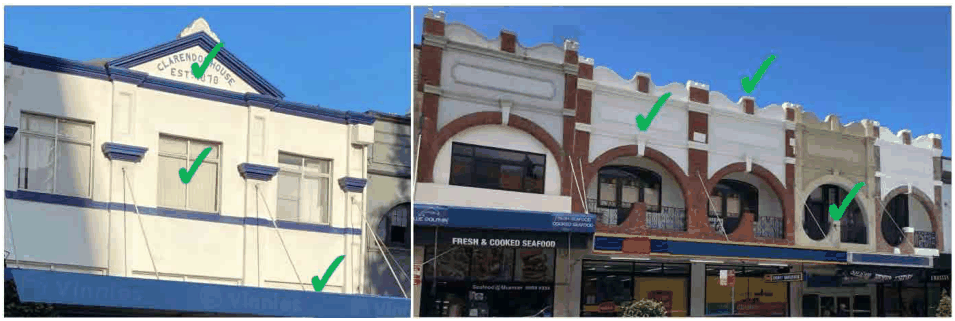

> [Picture on page 27: a picture, saved as a picture (images/section-03-development-in-centres-and-corridors-page-27-1.gif, 150 dpi).]

Figure 8. Examples of good quality facades without security bars, permanent grilles or air handling systems

#### 3.2.19  Access and Mobility Objectives

O1 To ensure development is designed to facilitate access by the whole community including those with mobility impairment.

#### Provisions

All Development

P1 The main entry of development must be designed and identified for use by persons with a mobility impairment.

P2 The main entry must be accessible from the street footpath in accordance with Australian Standard (AS) 1428: Design for Access and Mobility.

P3 Safe and convenient access must be provided in all development, car parks and communal facilities.

P4 Compliance with AS 1428.1 is required with respect to access requirements on new building work.

P5 Tactile indicators must be provided on the ground immediately adjacent to the approach and departure sides of any changes in floor levels in the public domain which incorporate a step, ramp, stepped ramp or the like in accordance with AS 1428.4.

Residential Component of Development

P6 At least 10% of dwellings in a development must be provided as adaptable housing to Adaptable House Class A or B standard to cater for ageing in place and mobility impaired residents, in accordance with AS 4299: Adaptable Housing.

P7 At least one car parking space must be provided and allocated to each dwelling required to be provided as accessible or adaptable housing under this Section and the car parking space must be accessible in accordance with the provisions of AS 1428.2 to facilitate automatic vehicular wheelchair loading and unloading.

P8 For development providing between 20 to 79 dwellings, one accessible visitor car parking space must be provided on site must be accessible in accordance with the provisions of AS

1428.2 to facilitate automatic vehicular wheelchair loading and unloading.

P9 For development providing 80 or more dwellings, additional accessible visitor car parking spaces must be provided on-site which are accessible, as per P8 above, at the rate of one per each 60 dwellings or part thereof.

#### 3.2.20  Awnings and Associated Structures Overview

Awnings attached to buildings and free standing awning/shade structures including semi-permanent umbrellas provide weather protection for pedestrians and contribute to the creation of a comfortable environment for people to walk, shop and dine in the public domain. Awnings and associated structures should be designed to enhance the character of the streetscape.

Under the BLEP 2012 road reserves are generally zoned the same as the adjoining land. In the Burwood Town Centre and its extension along Burwood Road North and in the Strathfield Town

Centre most roads are zoned B4 Mixed Use. The installation of any structures that are not attached to the building such as outdoor dining area, free standing awning/shade or umbrella constitutes development in the B4 zone that is permitted with development consent.

For new developments, proposed outdoor dining area and/or awnings and free standing awning/shade and shelter structures should be included in the overall Development Application for the development.

Where an outdoor dining area and/or an awning or a free standing shelter structure is proposed as an addition to existing development, a Development Application is required to be submitted.

The following subsections provide location and design guidelines for applicants and also serve as criteria for assessment of Development Applications.

#### 3.2.20.1 Awning Style - Attached to Buildings Objectives

O1 To provide pedestrian amenity with continuous overhead weather protection.

O2 To provide a consistent streetscape to ensure visual continuity.

#### Provisions

P1 Awnings must be provided above the public domain (i.e. footpath) for buildings built to the street front boundary, where awnings are part of the streetscape character.

P2 Where development has a set back from the street boundary, and there is formal pedestrian access from that street, provision of an awning over the access to the building is encouraged.

P3 New awnings must be of the traditional steel box design, in a straight form, supported from above, or cantilevered. Glass awnings may be considered where these do not adversely impact the streetscape consistency and visual continuity.

P4 New awnings must be integrated and compatible with the adjacent awnings that are consistent with this DCP.

P5 Change in height of the awning is not permitted unless it steps down or up to follow the terrain/ level of the street.

P6 Awning length must extend across the entire street front and connect with the adjoining awnings, except above vehicle entry points or service entrances.

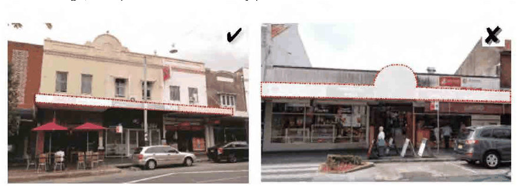

> [Picture on page 29: a picture, saved as a picture (images/section-03-development-in-centres-and-corridors-page-29-29.gif, 150 dpi).]

Awning forms should be compatible with that of the adjacent properties.

Awnings with designs that detract from the continuity of the streetscape are discouraged.

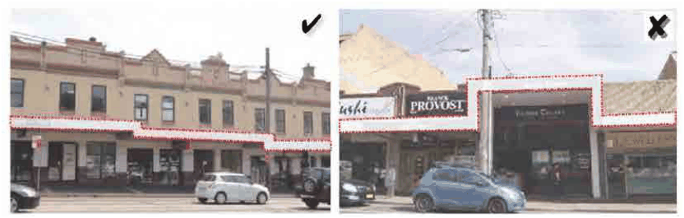

> [Picture on page 30: a picture, saved as a picture (images/section-03-development-in-centres-and-corridors-page-30-1.gif, 150 dpi).]

Awnings are to step down to follow the terrain/level of the street. Drastic changes in height that break the continuity of the awning

alignment with the rest of the streetscape are discouraged.

#### 3.2.20.2 Awning Dimensions - Attached to Buildings Objectives

O1 To provide sufficient clearance and adequate shelter for pedestrians.

O2 To provide a continuous and harmonious streetscape.

O3 To define and mark buildings on street corners.

O4 To afford visibility to shopfronts from the opposite footpath.

#### Provisions

P1 Awning height measured from the footpath to the underside of the awning must be a minimum of 3.2 metres and a maximum of 3.5 metres. If signs are incorporated under the awning, they must allow a minimum clearance of 2.6 metres above the footpath.

P2 The height of the awning fascia must be between 0.4 metres and 0.6 metres.

P3 Any change in the awning height to accommodate sloping streets must have a maximum step height of 0.6 metres.

P4 For footpaths that are wider than 3 metres, new awnings must be setback from the edge of the kerb by a minimum of 1.2 metres to avoid conflict with parked vehicles and street trees. For footpaths less than 3 metre wide, new awnings must be setback from the edge of the kerb by a minimum of 0.6 metres.

P5 The awnings for corner buildings must be splayed have a consistent length and design and can be slightly higher from the footpath to define the corner. The maximum awning height between the footpath and the underside of the awning is 3.5 metres.

P6 Awnings must continue around buildings located on street corners.

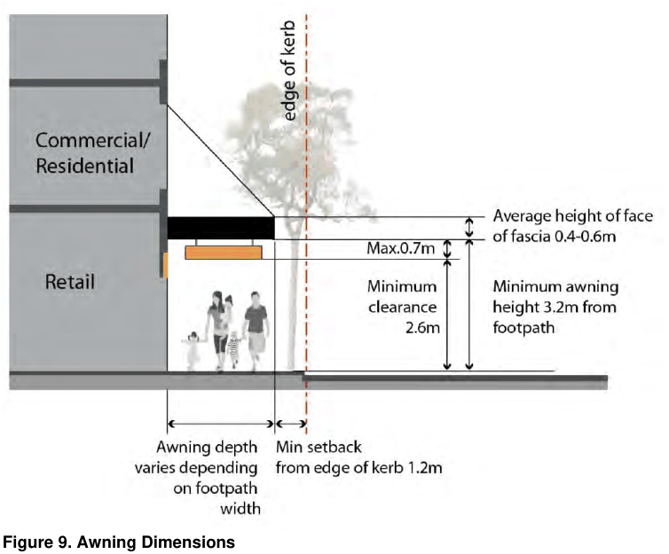

> [Picture on page 31: a picture, saved as a picture (images/section-03-development-in-centres-and-corridors-page-31-1.gif, 150 dpi).]

#### Figure 9. Awning Dimensions

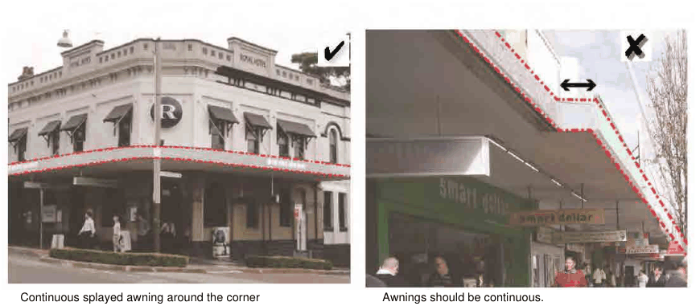

> [Picture on page 31: a picture, saved as a picture (images/section-03-development-in-centres-and-corridors-page-31-3.gif, 150 dpi).]

Continuous splayed awning around the corner

Awnings should be continuous.

Mechanical Ventilation Systems

P7 Mechanical ventilation, specifically air handling units and other plant equipment must not be visible from the public domain, be attached to the external façades or elevations, placed above awnings or anywhere on a shopfront elevations. It must be located within a central plant area and screened from public view.

P8 Mechanical ventilation and plant equipment must not adversely affect the architectural quality and presentation of shopfront façades, decorative pediments, and parapet outlines or roof features.

P9 Specifications, designs and technical information of mechanical and ventilation equipment must be provided to Council at the development application stage for new builds, refurbishments and alterations.

#### 3.2.20.3 Materials and Colours of Awnings - Attached to Buildings Objectives

O1 To define and create a consistent edge of the awning.

O2 To provide a consistent character underneath the awning.

O3 To avoid visual clutter and to enhance the public domain.

O4 To increase personal safety and security through the use of artificial lighting.

#### Provisions

P1 Awnings, including their underside, must be constructed with high quality and low maintenance materials with simple detailing to reduce visual clutter.

P2 Under awning supporting structures, ducts, cables and wiring must be concealed from view. Lights should be integrated within the awning, e.g. LED down-lights.

P3 Artificial lighting must be installed in awnings at no greater than 6 metre centres and enable face recognition.

P4 Awnings must adopt a coordinated colour scheme that is compatible with the building. Multiple, bright, and rainbow colours are discouraged.

P5 Awnings must be regularly maintained to ensure ongoing structural adequacy and weather protection.

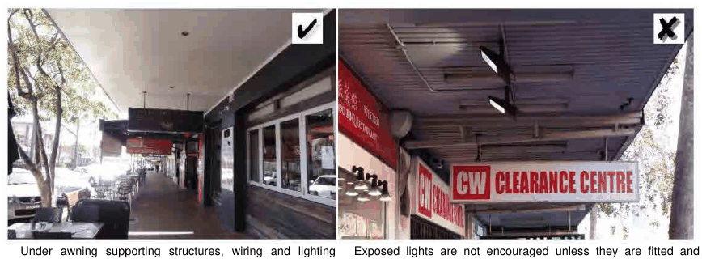

> [Picture on page 32: a picture, saved as a picture (images/section-03-development-in-centres-and-corridors-page-32-18.gif, 150 dpi).]

Under awning supporting structures, wiring and lighting should be concealed unless they are consistent with the character of the building.

Exposed lights are not encouraged unless they are fitted and integrated within the fascia or consistent with the character of the building.

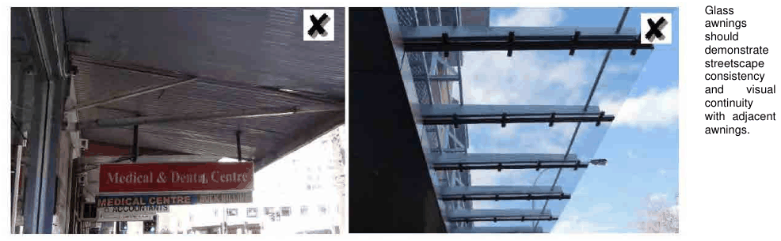

> [Picture on page 32: a picture, saved as a picture (images/section-03-development-in-centres-and-corridors-page-32-25.gif, 150 dpi).]

Glass awnings should demonstrate streetscape consistency and visual continuity with adjacent awnings.

Exposed under awning supporting structures are not encouraged unless they are consistent with the character of the building.

#### 3.2.20.4 Awning Extensions Objectives

O1 To provide additional overhead weather protection to outdoor dining areas.

O2 To maintain a harmonious and consistent public domain with minimal visual clutter and high levels of visual connection between both sides of the footpath.

#### Provisions

P1 There are three types of awning extensions:

straight drop extensions, retractable extensions and permanent extensions.

P2 Awning extensions must be positioned a minimum of 1 metre away from the centreline of any tree, parallel to the edge of the kerb.

P3 Full awning extensions that drop to the ground, whether they are made of transparent or opaque materials, e.g. cafe blinds, and side screens or panels at the side edges of the awning extension are not permitted.

P4 An awning extension should at least not detract from and preferably improve the overall streetscape character and appearance.

P5 Awnings must be regularly maintained to ensure ongoing structural adequacy and weather protection.

Straight Drop Extensions

P5 These are awning devices attached to the main awning for the premises that are vertically retractable. They cannot be permanent fixtures.

P6 A straight drop extension is to be used only where the footpath has a width of 4 metres or less.

P7 This type of extension must be attached under the fascia of the main awning and the fixing mechanisms must not be visible from the street. The fascia of the main awning is to remain exposed.

P8 A minimum clearance of 2.6 metres from the underside of the extension to the footpath below must be maintained. The outer surface of the extension (including any structural element) must maintain a 0.6 metres clearance from the kerb line.

P9  The type of extension should not exceed 4 metres in horizontal length for any individual segment.

P10 A straight drop extension may use a narrow structural profile on both sides to provide additional strength for different weather conditions.

P11 The fabric for this type of extension must be made of light weight canvas or a similar material.

P12 A coordinated colour scheme that is compatible with the main awning, with limited contrasting colours should be used for straight drop extensions. A selection from a palette of dark colours (dark green, indigo, black) is encouraged. Multiple, bright, and rainbow colours are discouraged.

P13 Display of any advertising text or signs on the straight drop extension is not supported. Any proposals of this nature are to be included in the development application.

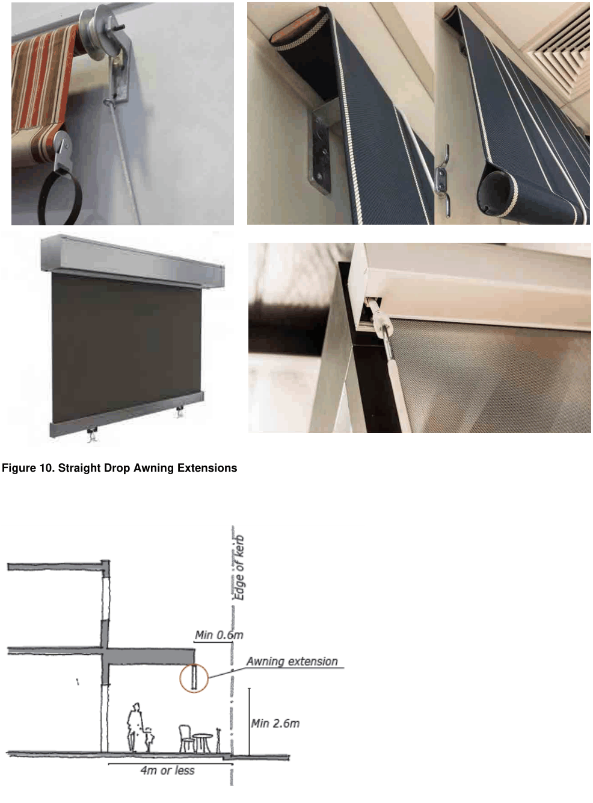

> [Picture on page 34: a picture, saved as a picture (images/section-03-development-in-centres-and-corridors-page-34-3.gif, 150 dpi).]

#### Figure 10. Straight Drop Awning Extensions

#### Figure 11. Straight Drop Awning Extensions

Retractable Awning Extensions (Horizontal)

P14 These are awnings attached to the main awning for the premises and are retractable in the horizontal plane to provide flexibility of use and to deal with variable weather conditions. They are not permanent fixture.

P15 A retractable awning extension is to be used only where the footpath has a width of 4 metres or more.

P16 This type of extension must be attached under the fascia of the main awning and the fixing mechanisms must not be visible from the street. The fascia of the main awning is to remain exposed.

P17 A minimum clearance of 2.6m from the underside of the extension to the footpath below must be maintained.

P18 A maximum 200mm plastic/canvas drop at the outer edge of the retractable awning is allowed for extra weather protection.

P19 The outer edge of the retractable awning is to have a minimum of 0.6 metres clearance from the edge of the kerb.

P20 A gutter profile must be installed at the outer edge of the retractable awning to direct rain water to the street.

P21 No vertical elements that attach the awning to the ground are permitted.

P22 The structural elements on the underside of the retractable extension are to be the minimum required to properly support and operate the awning, and are to be comprised of high quality architectural elements.

P23  This type of awning extension should not exceed more than four segments where it is parallel to the kerb.

P24 A coordinated colour scheme that is compatible with the main awning, with limited contrasting colours should be used for the awning extension. A selection from a palette of dark colours (dark green, indigo, black) is encouraged. Multiple, bright, and rainbow colours are discouraged.

P25 Display of any advertising text or signs on the retractable extension is not supported. Any proposals of this nature are to be included in the development application.

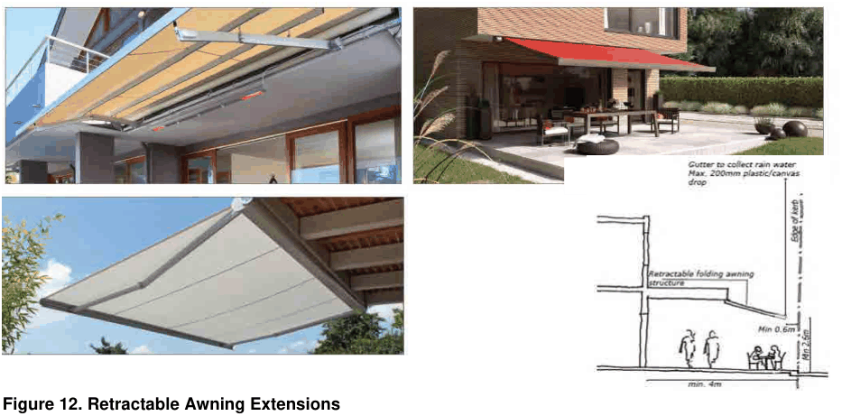

> [Picture on page 35: a picture, saved as a picture (images/section-03-development-in-centres-and-corridors-page-35-29.gif, 150 dpi).]

#### Figure 12. Retractable Awning Extensions

Permanent Awning Extensions

P26 These are awnings attached to the main awning for the premises as permanent structures that are not retractable.

P27 A permanent awning extension is to be used only where the footpath has a width of 4 metres or more.

P28 This type of extension must be attached under the fascia of the main awning and the fixing mechanisms must not be visible from the street. The fascia of the main awning is to remain exposed.

P29 A minimum clearance of 2.6 metres from the underside of the extension to the footpath below must be maintained.

P18 A maximum 200mm plastic/canvas drop at the outer edge of the permanent awning is allowed for extra weather protection.

P19 The outer edge of the permanent awning is to have a minimum of 0.6 metres clearance from the edge of the kerb.

P20 A gutter profile must be installed at the outer edge of the permanent awning to direct rain water to the street.

P21 No vertical elements that attach the awning to the ground are permitted.

P22 The structural elements on the underside of the extension are to have a narrow profile and be the minimum required to support the awning. The awning extension is to be comprised of high quality architectural elements.

P23  This type of extension should not exceed 4 metres in horizontal length for any individual segment.

P24 A coordinated colour scheme that is compatible with the main building, with limited contrasting colours should be used for the awning extension. A selection from a palette of dark colours (dark green, indigo, black) is encouraged. Multiple, bright, and rainbow colours are discouraged.

P25 Display of any advertising text or signs on the permanent extension is not supported. Any proposals of this nature are to be included in the development application.

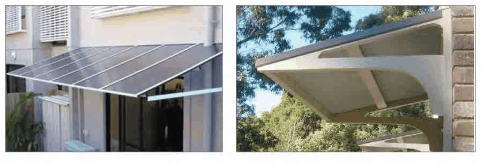

> [Picture on page 36: a picture, saved as a picture (images/section-03-development-in-centres-and-corridors-page-36-28.gif, 150 dpi).]

Note: These photos provide examples of awnings that may be used as permanent awning extensions.

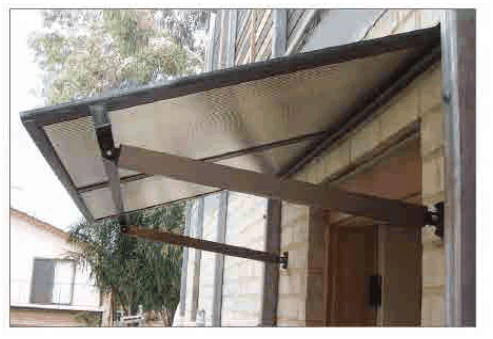

> [Picture on page 37: a picture, saved as a picture (images/section-03-development-in-centres-and-corridors-page-37-4.gif, 150 dpi).]

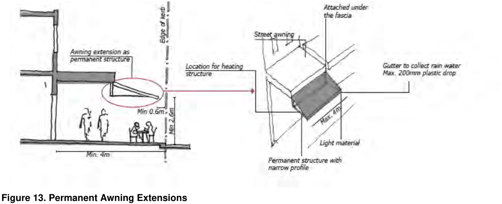

> [Picture on page 37: a picture, saved as a picture (images/section-03-development-in-centres-and-corridors-page-37-5.gif, 150 dpi).]

#### Figure 13. Permanent Awning Extensions

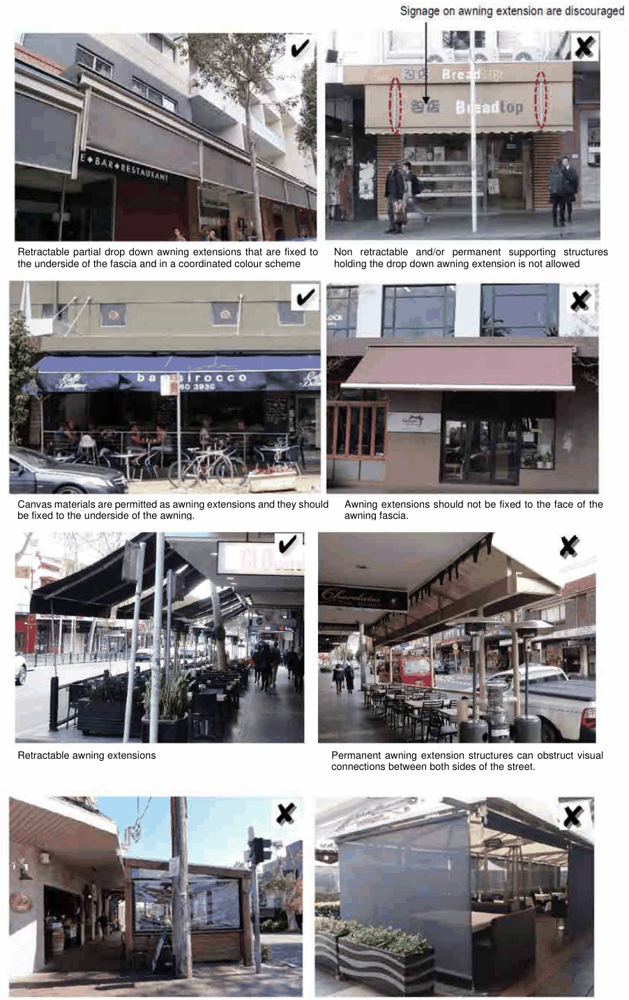

> [Picture on page 38: a picture, saved as a picture (images/section-03-development-in-centres-and-corridors-page-38-1.gif, 150 dpi).]

Retractable partial drop down awning extensions that are fixed to the underside of the fascia and in a coordinated colour scheme

Non retractable and/or permanent supporting structures holding the drop down awning extension is not allowed

Canvas materials are permitted as awning extensions and they should be fixed to the underside of the awning.

Awning extensions should not be fixed to the face of the awning fascia.

Retractable awning extensions

Permanent awning extension structures can obstruct visual connections between both sides of the street.

Side screens or panels on the side of the awning extension and café blinds that drop to the ground are not permitted.

#### 3.2.20.5 Permanent Free Standing Awnings/Shade and Shelter Structures Objectives

O1 To provide additional overhead weather protection to outdoor dining areas.

O2 To provide for variety in style and form of overhead weather protection including free standing shade structures and semi-permanent umbrellas.

O3 To maintain a harmonious and consistent public domain with minimal visual clutter and high levels of visual connection between both sides of the footpath.

#### Provisions

P1 Free standing awnings/shade structures will be considered only in the sections of the footpath that have a minimum depth of 5 metres.

P2 The structures may use any of the 4 styles indicated in the Figure 14.

P3  Styles 1 & 2 should be used in corners or sections of a street without awnings. Styles 3 & 4 should be mixed with street awnings for extra protection.

P4 The design and appearance of the structures are to be based on minimum structural elements with narrow profiles not exceeding 120mm and use of high quality architectural features.

P5 A free standing awning/shade structure must maintain a minimum clearance of 2.6 metres from the underside of the structure to the footpath below.

P6 The free standing awning structure (non-umbrella) must maintain a minimum 0.6 metres setback from the kerb line and a 0.3 metres clearance from any overhead main awning.

P7 A free standing umbrella is to be located behind low metal posts set into the pavement that have a minimum setback from the kerb of 0.6 metres.

P8 Canvas or other cover material used in the structures is to select from a palette of dark colours (dark green, indigo, black).

P9 Display of any advertising text or signs on the structure is not supported. Any proposals of this nature are to be included in the development application.

P10 Side drops of plastic or other material to provide extra weather or shade protection whether retractable or not are not permitted for Styles 1 & 2.

P11 For Styles 3 & 4 a side drop of plastic or other material to provide extra weather or shade protection whether retractable or not may be included provided it has a maximum drop of 200mm.

P12 For Styles 3 & 4 a gutter profile must be installed to direct rain water to the street. Suitable for deeper footpaths and higher awnings above 3.5m.

P13 Heating or lighting fixtures should be attached directly to the structure’s frame.

P14 The structure is required to be integrated and aligned with any street fences, bollards, balustrades, posts and safety guards existing or proposed by the applicant where the structure is to be installed.

P15 The vertical posts or other structural elements supporting a free standing awning/shade structure must be coordinated with existing or proposed street posts or balustrades to avoid adding clutter to the streetscape.

P16 The location of a free standing awning/shade structure at a street corner or along a section of streets should at least not detract from and preferably improve the overall streetscape character and appearance.

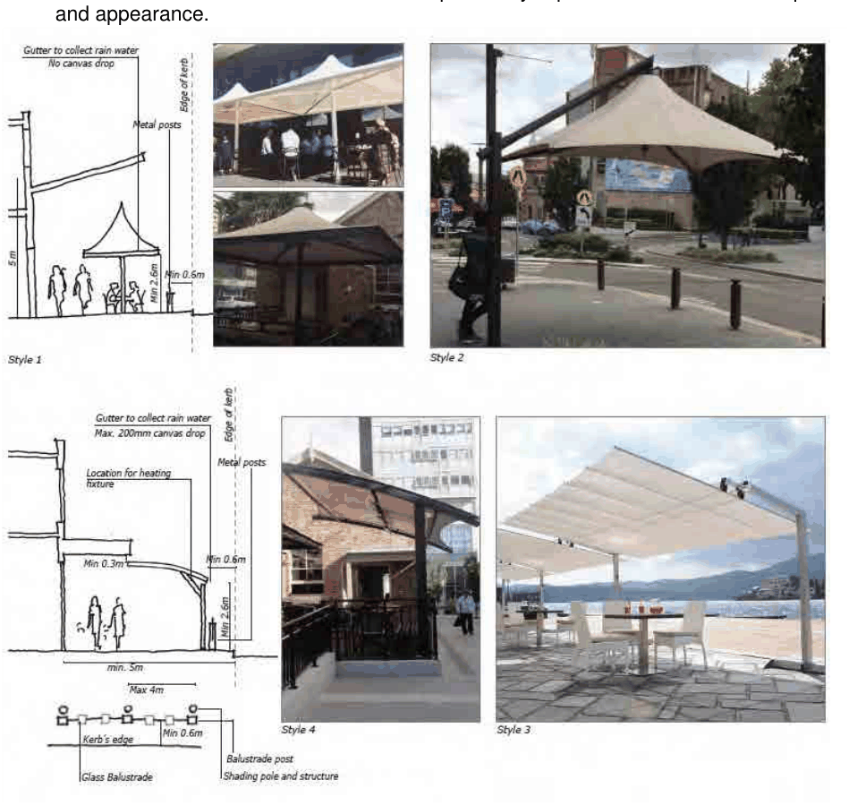

> [Picture on page 40: a picture, saved as a picture (images/section-03-development-in-centres-and-corridors-page-40-7.gif, 150 dpi).]

#### Figure 14. Styles of Permanent Free Standing Awnings/Shade Structures

#### 3.2.20.6 Location of Awnings in Burwood Road

Burwood Road from Parramatta Road to Woodside Avenue provides many potential locations for outdoor dining areas that may include awning extensions or free standing shade and shelter structures that give additional weather protection.

This section of Burwood Road has many intersections with side streets and has different footpath widths and existing awning heights along its length, as well as different existing awning styles and streetscape characters.

#### Objective

O1 To indicate the preferred locations for the different types of awning extensions or free standing shade structures along Burwood Road.

#### Provisions

P1 The Figure 15 provides the map indicating the preferred locations.

P2 Specific intersections are identified as locations for use of retractable awnings to maintain the continuity of the streetscape.

P3 The majority of the street length is identified for more than one possible awning extension type, to enhance the variety of the streetscape.

P4 Straight drop and retractable awning extensions are identified for use in street sections with narrow footpaths (as specified above).

P5 Sections of street with wider footpaths are identified for use with free standing umbrellas or shade structures. The map in Figure 15 also indicates the preferred locations of free standing shade structures Style 2, umbrellas with a central post (Style 1) or fixed free standing shade structures (Styles 3 and 4).

Burwood Road Burwood,

#### Parramatta Road to Victoria Street

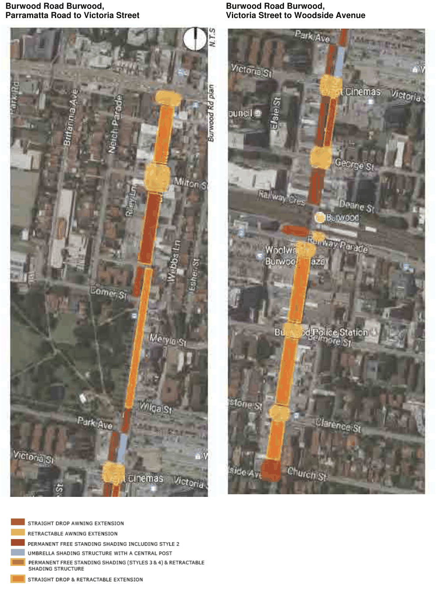

> [Picture on page 42: a picture, saved as a picture (images/section-03-development-in-centres-and-corridors-page-42-3.gif, 150 dpi).]

Burwood Road Burwood,

#### Victoria Street to Woodside Avenue

#### Figure 15. Appropriate Locations for Specific Awning Types

3.3 Area Based Controls – Burwood Town Centre and Burwood Road North
