### 3.3 Area Based Controls – Burwood Town Centre and Burwood Road North

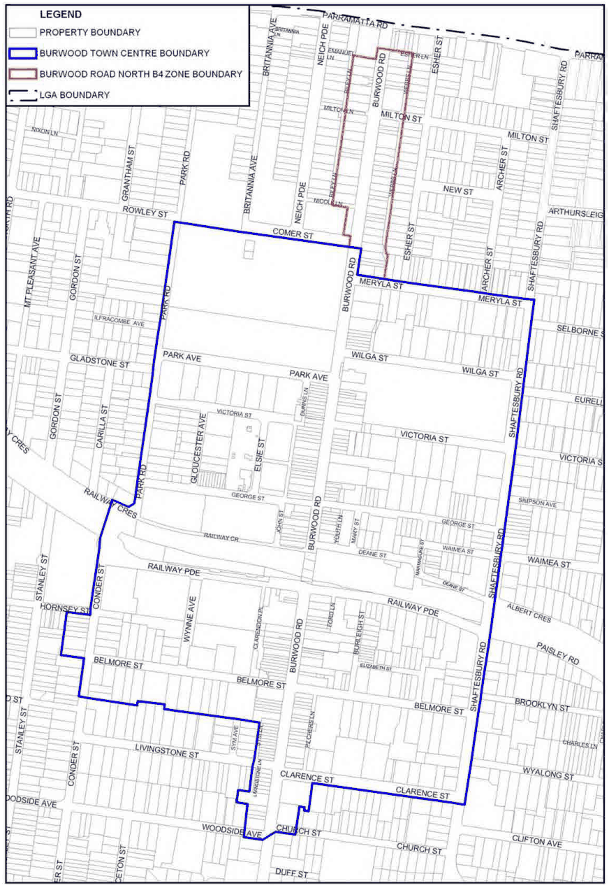

> [Picture on page 43: a picture, saved as a picture (images/section-03-development-in-centres-and-corridors-page-43-3.gif, 150 dpi).]

Figure 16. Burwood Town Centre and Burwood Road North Areas

3.3 Area Based Controls – Burwood Town Centre and Burwood Road North

#### Aims

The aims for the BTC and the contiguous Burwood Road North area are:

To provide for a vibrant centre with a level of amenity that reflects its Major Centre status. To provide for a built form that supports appropriate urban design outcomes To ensure a building scale that complements existing heritage items and human-scale streetscape environments.

To deliver a high standard of acoustic measures for residents within the Burwood Town Centre, High and Medium Density Areas, and Active Precincts – Zones R1. R3. E1 and MU1.

To enable the delivery of housing in mixed use areas that include entertainment and other noise generating activities

#### 3.3.1 Burwood Town Centre Building Height Plane Overview

The BLEP 2012 controls height through the maximum permissible building heights established in the Height of Buildings Map for the whole LGA, and through the application in addition of a Building Height Plane (BHP) in the BTC. This subsection indicates the objectives of the BHP and further explains how the BHP is determined and applied.

#### Objectives

O1 To maintain the amenity of land outside and adjoining the BTC and provide such land with adequate solar access.

O2 To illustrate how the BHP controls are applied.

#### Provisions

P1 The height of buildings on land within the BTC is not to project above the BHP as identified in Clause 4.3A and on the map marked - “Building Height Plane Map in the BLEP 2012.

#### Advisory Note:

The BTC is not orientated true north which explains the difference of solar angles along different parts of the Town Centre boundary as illustrated in Figure 17.

P2    For ease of reference the BHP particulars from the BLEP 2012 are set out in the map and table in Figure 17.

P3 For the purposes of providing additional guidance, Figure 17 to Figure 22 indicate the operation of the BHP in Conder Street and Wynne Avenue, Belmore Street, Clarence Street and Shaftesbury Road.

#### Advisory Note:

The Building Height Plane established under the Building Height Plane Map in the BLEP 2012 cannot be varied under Clause 4.6 of the BLEP 2012.

3.3 Area Based Controls – Burwood Town Centre and Burwood Road North

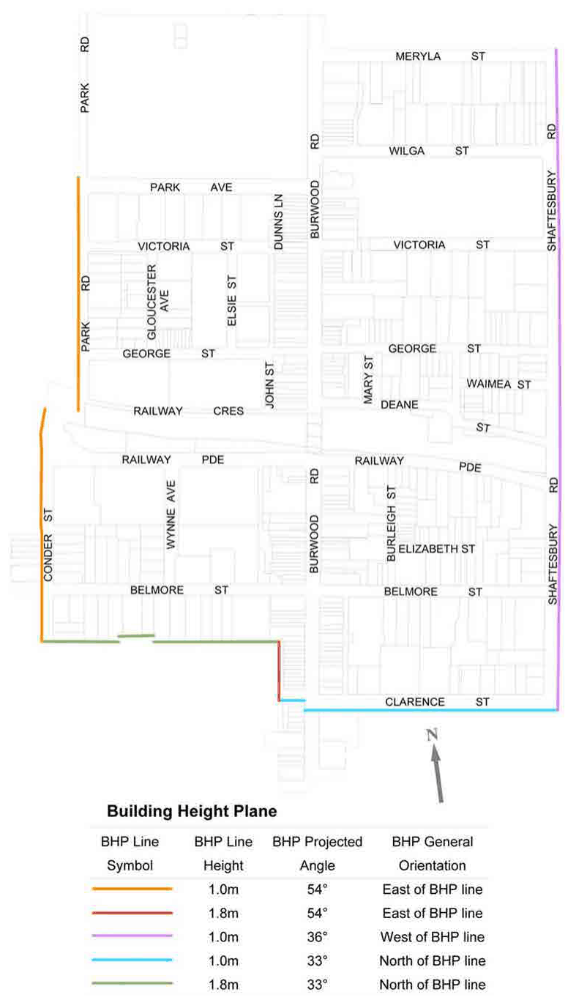

> [Picture on page 45: a picture, saved as a picture (images/section-03-development-in-centres-and-corridors-page-45-2.gif, 150 dpi).]

3.3 Area Based Controls – Burwood Town Centre and Burwood Road North

#### Figure 17. BTC Building Height Plane Map and Table

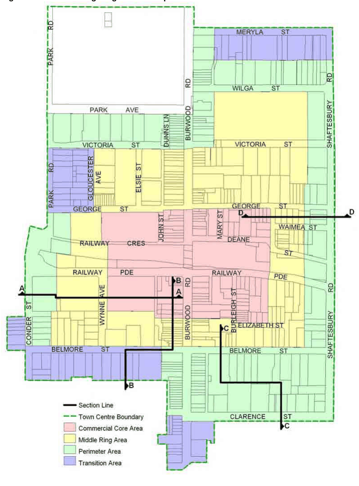

> [Picture on page 46: a picture, saved as a picture (images/section-03-development-in-centres-and-corridors-page-46-3.gif, 150 dpi).]

#### Figure 18. Building Height Plane Diagram Showing the Location of Section Plans

3.3 Area Based Controls – Burwood Town Centre and Burwood Road North

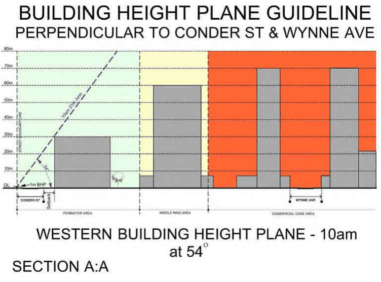

> [Picture on page 47: a picture, saved as a picture (images/section-03-development-in-centres-and-corridors-page-47-2.gif, 150 dpi).]

#### Figure 19. Building Height Plane Section A:A

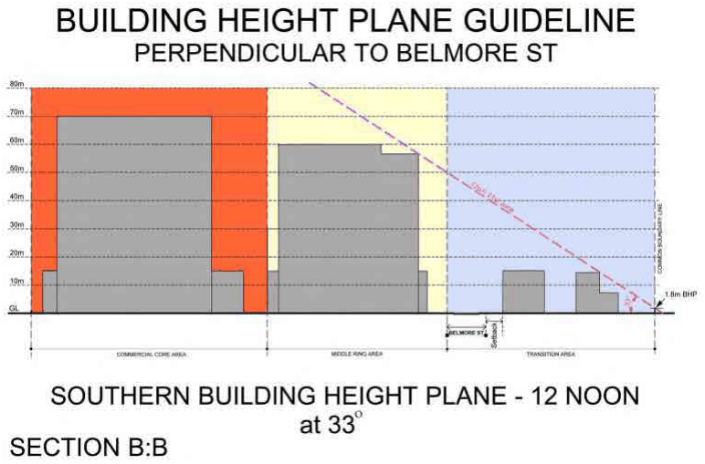

> [Picture on page 47: a picture, saved as a picture (images/section-03-development-in-centres-and-corridors-page-47-4.gif, 150 dpi).]

#### Figure 20. Building Height Plane Section B:B

3.3 Area Based Controls – Burwood Town Centre and Burwood Road North

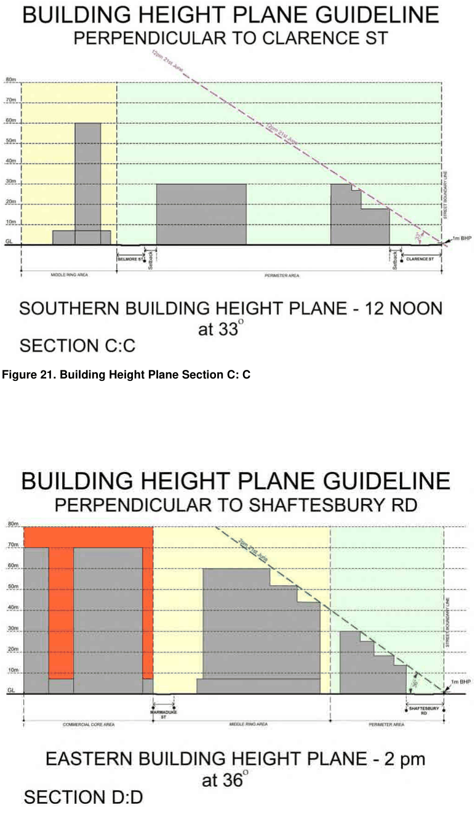

> [Picture on page 48: a picture, saved as a picture (images/section-03-development-in-centres-and-corridors-page-48-2.gif, 150 dpi).]

#### Figure 21. Building Height Plane Section C: C

#### Figure 22. Building Height Plane Section D: D

3.3 Area Based Controls – Burwood Town Centre and Burwood Road North

P4 For the purpose of providing additional guidance, a BHP is to be calculated in accordance with the following formula:

#### H = V + (D x tan a)

H is the height measured in metres of a point in a BHP.

V is the height, specified in the BHP particulars table in P3 for the relevant BHP and measured in metres above ground level, at the street alignment or property boundary.

D is the horizontal distance, from the point in the BHP to the BHP line, measured in metres and being perpendicular to the BHP line, specified in the BHP particulars table in P3 for the relevant BHP.

a is the vertical angle in degrees specified in the BHP particulars table in P3, corresponding to the distance D for the relevant BHP.

The following diagrams illustrate how the formula applies:

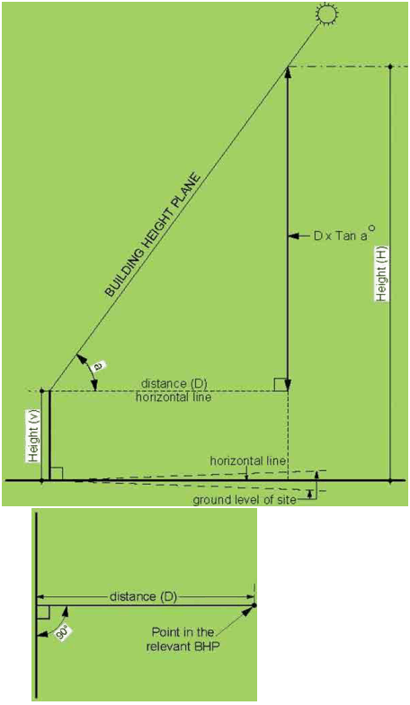

> [Picture on page 49: a picture, saved as a picture (images/section-03-development-in-centres-and-corridors-page-49-15.gif, 150 dpi).]

#### Figure 23. Building Height Plane Diagrams

#### Advisory Note:

The BHP formula calculates the height to a point on the BHP from a point horizontal with ground level at the street alignment. For sites with ground levels different to the street alignment ground level, the difference should be taken into account by the user to determine the height of a point in the BHP vertically above the ground.

3.3 Area Based Controls – Burwood Town Centre and Burwood Road North

#### 3.3.2 Burwood Town Centre Areas Overview

The BTC is divided into Areas known as the Commercial Core, Middle Ring, Perimeter and Transition Areas. These are shown in Figure 24 - Burwood Town Centre Areas map.

For each of the four Areas, this section provides more detailed controls that aim to achieve the desired urban form in each area consistent with the development standards in the BLEP 2012.

Burwood Road is the main street in the BTC. It has a distinct role and current and future built form, and is subject to specific building controls.

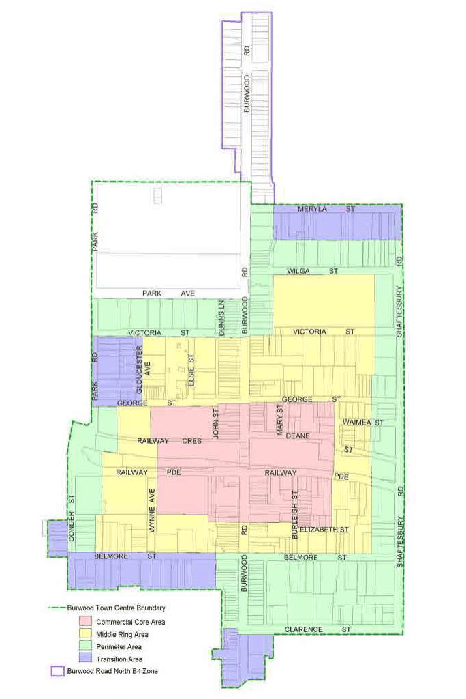

> [Picture on page 50: a picture, saved as a picture (images/section-03-development-in-centres-and-corridors-page-50-11.gif, 150 dpi).]

#### Figure 24. BTC Area Map Together with the Burwood Road North Area

3.3 Area Based Controls – Burwood Town Centre and Burwood Road North

#### Commercial Core and Middle Ring Areas Overview

The Commercial Core and Middle Ring Areas are the inner parts of the BTC. It is envisaged that much of the commercial and retail development will be concentrated in these Areas. Residential development is also anticipated to the extent permitted under Clause 4.4A which imposes a maximum residential floor space ratio.

#### Podium Height Objectives

O1 To develop human-scale street environments.

O2 To facilitate higher density development while maintaining the existing character of street development fronting Burwood Road.

#### Provisions

P1 Development in the Commercial Core and Middle Ring Areas built to the street front must not have a podium height greater than 15 metres.

Burwood Road

P2      Development along Burwood Road built to the street front must not be greater than 13 metres in height.

P3 Street front  development  along  Burwood  Road  must  enhance  the  existing streetscape and be of a similar scale, form, bulk, placement and character to adjoining and nearby street front development.

#### Street Front Setbacks Objectives

O1 To develop and create a strong definition of streets and public spaces.

O2 To ensure that the built form assists in forming the character of the public urban space.

O3 To provide wider footpaths and improved pedestrian access at identified streets.

#### Provisions

P1 Development must be built to the street front boundary except where a minimum of 3 metre, 6 metre or 8 metre setback is required as indicated in Figure 25. These measurements are taken from the street boundary after any land acquisition required by BLEP 2012 has been completed.

P2 Setback areas must be free of any projections or encroachments, except for approved awnings (provided in accordance with Section 3.2.19 of this DCP) and at- grade landscaping.

P3 All ground level setbacks are to be finished at-grade with Council’s footpath and finished with materials to match Council’s current public domain requirements.

3.3 Area Based Controls – Burwood Town Centre and Burwood Road North

Burwood Road

P4 Development on Burwood Road must be built to the street front boundary.

P5 All development on Burwood Road that is located on a corner site must be built to the street front boundary as set out in Figure 25.

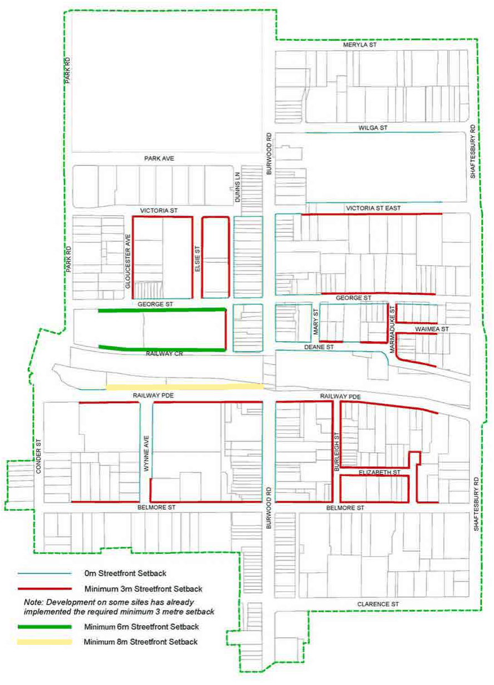

> [Picture on page 52: a picture, saved as a picture (images/section-03-development-in-centres-and-corridors-page-52-6.gif, 150 dpi).]

#### Figure 25. Commercial Core and Middle Ring Areas: Street front setbacks

3.3 Area Based Controls – Burwood Town Centre and Burwood Road North

P6 Notwithstanding P4 and P5 above, for the construction of a new building, substantial redevelopment, or substantial refurbishment of an existing building on sites 121-125 Burwood Road and 168 Burwood Road, Burwood, a unique urban design response must be prepared to achieve the following outcomes:

Enhance the heritage view of the former Burwood Post Office. Facilitate and establish a public plaza along the Burwood Road frontage. Improve pedestrian safety, access, and movement to and around the site.

To achieve these outcomes:

(i) For the construction of a new building, a minimum street frontage setback of 8 metres to Burwood Road and 3 metres to Railway Parade must be provided.

(ii) For the substantial redevelopment of existing buildings, a minimum street frontage setback of 8 metres to Burwood Road must be provided.

(iii) For the substantial refurbishment of existing buildings, the façade must be opened and unimpeded pedestrian circulation at ground level along Burwood Road is to be provided.

(iv) For subclauses (ii) and (iii) above, Council may consider an alternate creative design solution which in the opinion of Council provides an equivalent or better design whilst meeting the intended design outcomes of the clause.

#### Definitions:

Substantial redevelopment refers to any building modification that results in any one or a combination of the following:

Modifies the floor layout of the building’s existing gross floor area by 51% or more. Increases the building’s gross floor area by 51% or more. Intensifies patronage at the site by 51% or more.

Substantial refurbishment refers to any building modification that results in any one or a combination of the following:

Modifies the floor layout of the building’s existing gross floor area by 15% to 50%. Increases the building’s existing gross floor area by 15% to 50%. Intensifies patronage at the site by 15% to 50%.

#### Secondary Setbacks Objectives

O1 To establish the spatial proportions and enhance the urban qualities of the street.

#### Provisions

P1 Where development in the Commercial Core and Middle Ring Areas exceed 15 metres in height, the part of the development above 15 metres must be set back a minimum of 6 metres from the street front boundary, unless otherwise specified in P3 and Figure 28. Refer to Figure 26 and Figure 27.

P2 Setback areas must be free of any projections or encroachments.

3.3 Area Based Controls – Burwood Town Centre and Burwood Road North

Burwood Road

P3 Where development along Burwood Road exceeds 13 metres in height, the part of the development above 13 metres must be set back a minimum of 8 metres from the street front boundary. Refer to Figure 5(a).

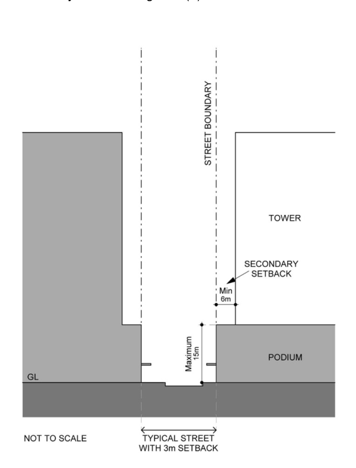

> [Picture on page 54: a picture, saved as a picture (images/section-03-development-in-centres-and-corridors-page-54-6.gif, 150 dpi).]

#### Figure 26. Commercial Core and Middle Ring Areas: Typical Secondary Setbacks

3.3 Area Based Controls – Burwood Town Centre and Burwood Road North

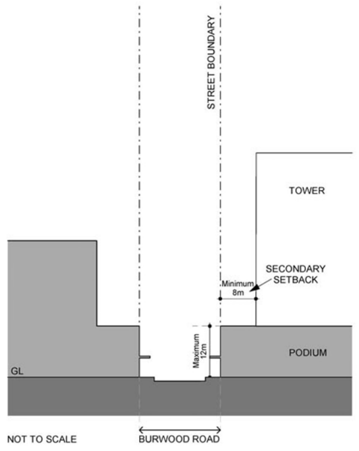

> [Picture on page 55: a picture, saved as a picture (images/section-03-development-in-centres-and-corridors-page-55-2.gif, 150 dpi).]

#### Figure 27. Burwood Road: Burwood Road Secondary Setbacks – Section Diagram

3.3 Area Based Controls – Burwood Town Centre and Burwood Road North

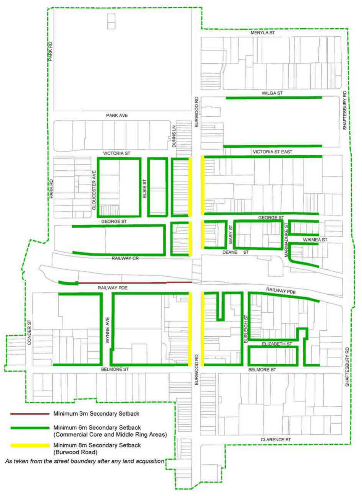

> [Picture on page 56: a picture, saved as a picture (images/section-03-development-in-centres-and-corridors-page-56-2.gif, 150 dpi).]

#### Figure 28. Commercial Core and Middle Ring Areas: Secondary Setbacks

#### Side and Rear Setbacks Objectives

3.3 Area Based Controls – Burwood Town Centre and Burwood Road North

01 To define the urban form of development in the Commercial Core and Middle Ring Areas.

#### Provisions

P1 For residential development refer to the building separation setback provisions of the ADG which supplements SEPP 65 - Design Quality of Residential Flat Development.

P2 Other street front development up to 15 metres in height must be built to the side boundary and may be built to the rear boundary. Refer to Figure 29.

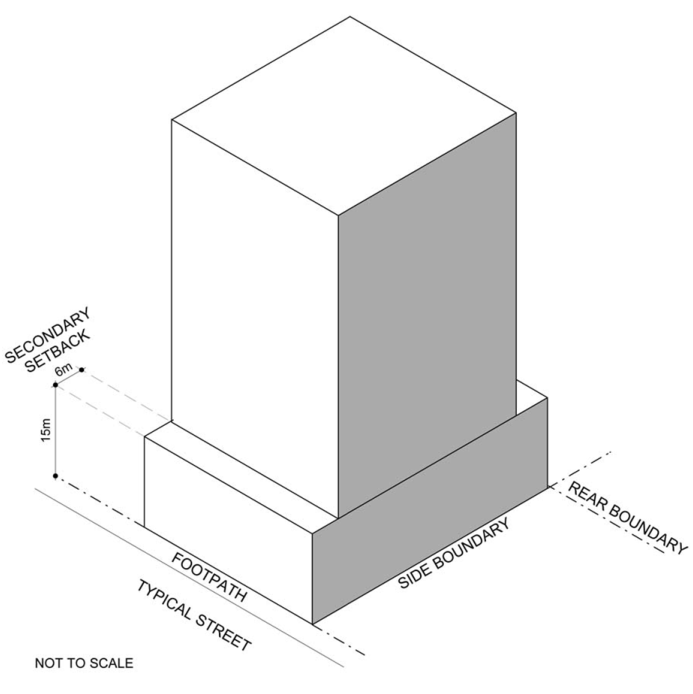

> [Picture on page 57: a picture, saved as a picture (images/section-03-development-in-centres-and-corridors-page-57-9.gif, 150 dpi).]

Figure 29. Commercial Core and Middle Ring Area: Typical Midblock Development Setbacks

#### Building Separation/Frontage Overview Overview

Building separation provides appropriate levels of amenity for the private and public domain.

#### Objectives

O1 To ensure that development has appropriate massing and spacing between buildings and frontage to any building.

O2 To assist in achieving acceptable levels of visual and acoustic privacy.

O3 To ensure distant views and vistas are achieved.

#### Provisions

3.3 Area Based Controls – Burwood Town Centre and Burwood Road North

P1 For all development refer to the building separation provisions of the ADG which supplements SEPP 65 - Design Quality of Residential Flat Development.

#### Advisory Note:

The same rules apply to residential and non-residential development in terms of building separation.

P2 The building separation requirements established under P1 must be shared equally with adjoining development across a boundary (refer to Figure 30. The applicant must demonstrate that daylight access, urban form, open space and visual and acoustic privacy can be satisfactorily achieved.

P3 The maximum length in any direction of any part of a building parallel to the street above 15 metres in height is 45m (refer to Figure 31). This portion of the building must be suitably articulated to alleviate building mass and improve building appearance.

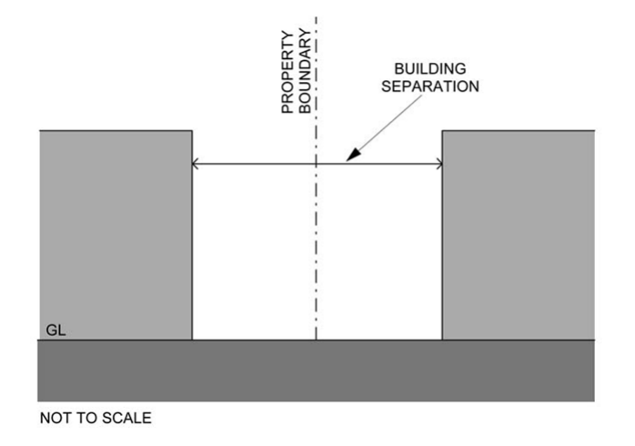

> [Picture on page 58: a picture, saved as a picture (images/section-03-development-in-centres-and-corridors-page-58-14.gif, 150 dpi).]

#### Figure 30. Separation between Buildings across a Property Boundary

3.3 Area Based Controls – Burwood Town Centre and Burwood Road North

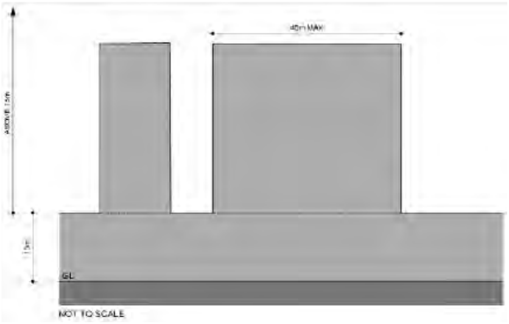

> [Picture on page 59: a picture, saved as a picture (images/section-03-development-in-centres-and-corridors-page-59-2.gif, 150 dpi).]

#### Figure 31. Separation between Buildings on the Same Site – Section Diagram

#### Communal Open Space Objectives

O1 To provide communal passive and active recreational opportunities.

O2 To provide communal open space that facilitates soft landscaping.

O3 To ensure that communal open space is consolidated, configured and designed to be usable and attractive.

#### Provisions

Podium Areas

P1 Podium areas must be made accessible as communal open space.

P2 Landscaping must be provided in communal open space. A minimum 0.6 metre soil depth must be provided over 50% of the area to support planting or soft landscaping.

Roof Tops

P3 Accessible communal open space may be provided on roof tops of development.

P4 The design of roof top communal open space must also have regard to its visual and acoustic impact and effects of wind.

P5 For residential development refer to the communal open space provisions of the ADG which supplements SEPP 65 – Design Quality of Residential Flat Development.

Advisory Note: Any opportunity for rooftop gardens or landscaping is encouraged to add to residential and visual amenity. Designs should encourage “greener” rooftops that incorporate planting, while minimising concrete and expanses of hard surfaces. Section 3.2.3 requires at least 50% of the rooftop area to be vegetated.

3.3 Area Based Controls – Burwood Town Centre and Burwood Road North

#### Perimeter and Transition Areas Overview

The  Perimeter  and  Transition  Areas  are  located  around  the  boundary  of  the  BTC. Residential development is expected to predominate in these Areas as it is not restricted.

#### Street Front Setbacks Objectives

O1 To improve the quality of the public domain.

O2     To invigorate the street front to provide the opportunity for commercial development at ground level.

O3 To develop appropriate street edge setbacks for development in the Perimeter and Transition Areas, which reflect the established setbacks throughout these Areas as well as have regard for the desired future character for the Areas.

#### Provisions

P1 Development must be built in accordance with the street front setback requirements shown in Figure 32. Building setbacks from the street front are taken from the street boundary after any land acquisition required by BLEP 2012 has been completed.

Burwood Road

P2 Development on Burwood Road must be built to the street front boundary.

P3 All development on Burwood Road that is located on a corner site must be built to the street as set out in Figure 32.

P4 Development must have a setback from the street front boundary on the east side of Conder Street extending from Railway Parade to Belmore Street that is consistent with Item 47 in Schedule 5 and the Heritage Map of BLEP 2012, being the former Burwood Council Office building (1887 building only).

P5 Development must have the setback required as shown in Figure 32 for all other streets.

Building  setbacks  of  0-6m  from  the  street  front  are  taken  from  the  street  front boundary after any land acquisition required by BLEP 2012 has been completed.

P6 Setback areas must be free of any projections or encroachments, except for approved awnings (provided in accordance with Section 3.2.19 of this DCP) and at grade landscaping.

3.3 Area Based Controls – Burwood Town Centre and Burwood Road North

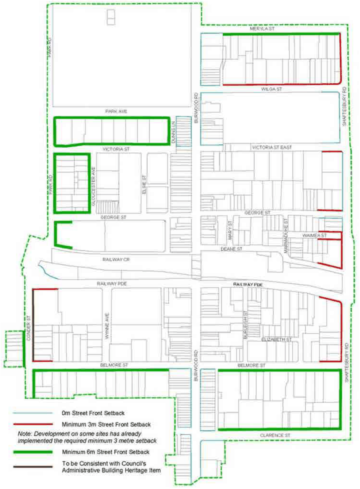

> [Picture on page 61: a picture, saved as a picture (images/section-03-development-in-centres-and-corridors-page-61-2.gif, 150 dpi).]

Figure 32. Perimeter and Transition Areas: Street Front Setbacks

3.3 Area Based Controls – Burwood Town Centre and Burwood Road North

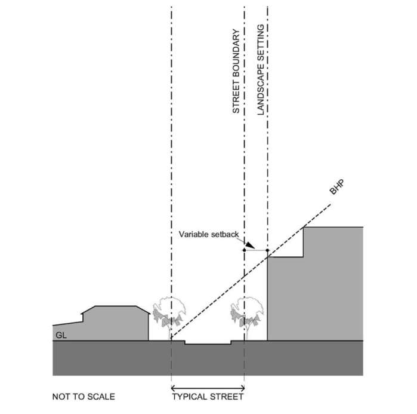

> [Picture on page 62: a picture, saved as a picture (images/section-03-development-in-centres-and-corridors-page-62-2.gif, 150 dpi).]

#### Figure 33. Perimeter and Transition Areas: Typical Street Front Setbacks

#### Secondary Setbacks Objectives

O1 To facilitate higher density development while maintaining the existing character of street development fronting Burwood Road.

#### Provisions

Burwood Road

P1      Development along Burwood Road built to the street front must not be greater than 13 metres in height. Where development exceeds 13 metres in height, the part of the development above 13 metres must be setback a minimum of 8m from the street front boundary in Burwood Road, and a minimum of 6m from the street boundary in side streets (except for Railway Parade). Refer to Figure 34.

P2 Street front development along Burwood Road must enhance the existing streetscape and be of a similar scale, form, bulk, placement and character to adjoining and nearby street front development.

3.3 Area Based Controls – Burwood Town Centre and Burwood Road North

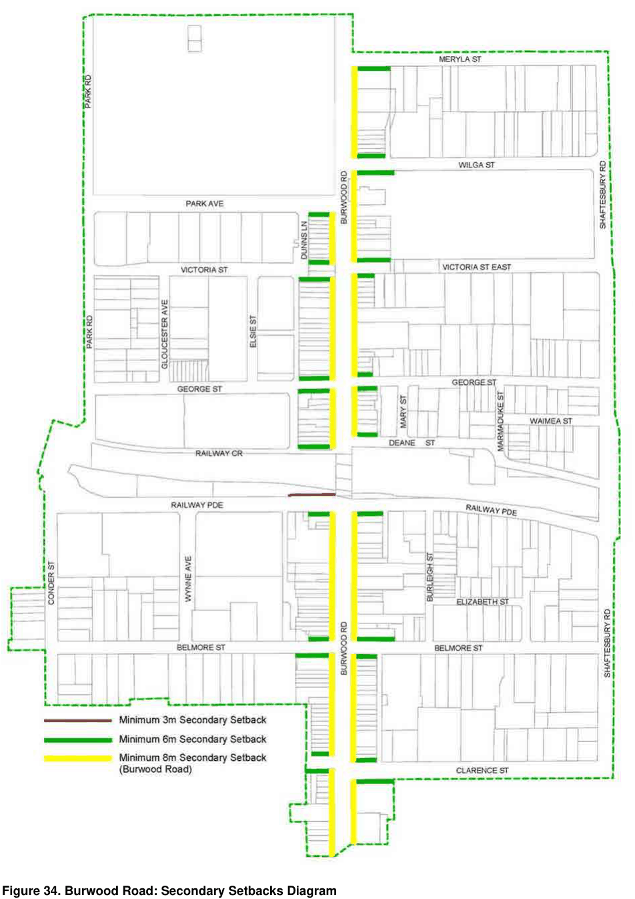

> [Picture on page 63: a picture, saved as a picture (images/section-03-development-in-centres-and-corridors-page-63-2.gif, 150 dpi).]

#### Figure 34. Burwood Road: Secondary Setbacks Diagram

3.3 Area Based Controls – Burwood Town Centre and Burwood Road North

#### Side and Rear Setbacks Objectives

O1 To minimise the amenity impact of development on adjoining properties.

#### Provisions

P1 For residential development refer to the side and rear setbacks provisions of the ADG which supplements SEPP 65 – Design Quality of Residential Flat Development.

#### Building Separation Objectives

O1 To ensure appropriate amenity of developments.

#### Provisions

P1 For all development refer to the building separation provisions of the ADG which supplements SEPP 65 - Design Quality of Residential Flat Development.

P2 The setbacks as set out in P1 must be shared equally with the adjoining development. The applicant must demonstrate that daylight access urban form, open space and visual and acoustic privacy can be satisfactorily achieved. Where agreement cannot be reached between the property owners, the separation distance should be distributed equally between the two properties.

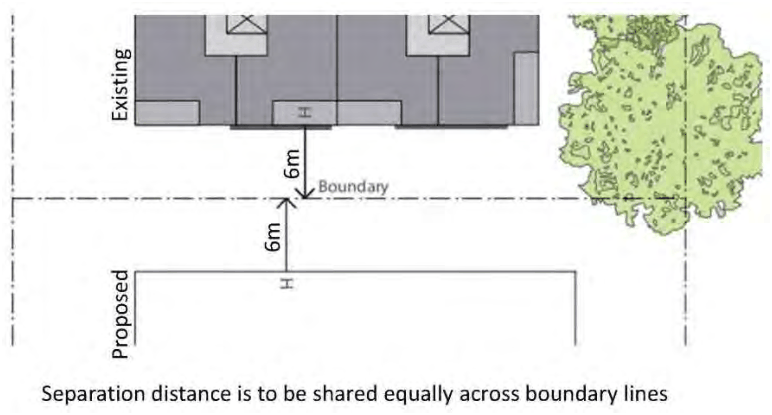

> [Picture on page 64: a picture, saved as a picture (images/section-03-development-in-centres-and-corridors-page-64-19.gif, 150 dpi).]

#### Figure 35. Separation distances

#### Communal Open Space Objectives

O1 To provide communal passive and active recreational opportunities.

O2 To provide communal open space to facilitate soft landscaping wherever possible.

O3 To ensure that communal open space is consolidated, configured and designed to be usable and attractive.

3.3 Area Based Controls – Burwood Town Centre and Burwood Road North

O4 To provide a pleasant outlook and contribute to privacy between buildings.

#### Provisions

P1 The street front setback areas must be provided as communal open space, except for circumstances referred to in Section 3.8.2 Treatment of Street front Setbacks.

P2 Where the ground floor uses are commercial, fencing of the street front setback is prohibited.

P3 Where ground floor uses are residential, the  street  front  setback  area  may  be secured, however the setback is to remain a communal space with only one perimeter fence, and must not to be further divided.

P4 Existing mature trees must be retained wherever possible.

P5 Where existing trees are removed, they must be replaced at a ratio of two new trees for each tree removed.

P6 At least 50% of the street front setback areas must be provided as planting or soft landscaping.

P7 Canopy trees must be provided at the rate of 1 per 30 sq metres of landscaped area provided within the street front setback area.

P8 Development which requires a minimum 6 metre setback from  the  street  front boundary, in a landscaped front setting, are to provide deep soil zones and provide trees planted as selected from Council’s Street Tree Management Strategy (STMS).

P9 Development which requires a setback from the street front boundary, in  a landscaped front setting, that is less than 6 metres, are to plant trees from the following list:

Callistemon viminalis ‘Hannah Ray’. Callistemon ‘Kings Park Special’. Callistemon citrinus. Buckinghamia celsissima. Bauhinia variegate. Albizia julibrissin. Backhousia citriodora. Lagerstroemia indica. Leptospermum petersonii. Gordonia axillaris. Melaleuca ‘Revolution Green’. Tristaniopsis laurina. Photinia x fraseri. Tibouchina grandulosa ‘Alstonville’.

3.3 Area Based Controls – Burwood Town Centre and Burwood Road North

Burwood Road

P10 Podium areas must be made accessible as communal open space.

P11 Accessible communal open space may be provided on roof tops of development

P12 The design of roof top communal open space must also have regard to its visual and acoustic impact and the effects of wind.

Advisory Note: Any opportunity for rooftop gardens or landscaping is encouraged to add to residential and visual amenity. Designs should encourage “greener” rooftops that incorporate planting, while minimising concrete and expanses of hard surfaces. Section 3.2.3 requires at least 50% of the rooftop area to be vegetated.

3.3 Area Based Controls – Burwood Town Centre and Burwood Road North

#### 3.3.3 Area Based Controls - Burwood Road North Overview

This section applies to the Burwood Road North area shown on the map in Figure 16. This area is expected to develop with a mix of land uses including commercial fronting Burwood Road and residential accommodation. It will have a similar character to other areas of the BTC with Burwood Road frontage and where Perimeter Area development standards apply.

#### Street Front Setbacks Objectives

O1 To improve the quality of the public domain.

O2 To invigorate the street front to provide the opportunity for commercial development at ground level.

#### Provisions

P1 All development must be built to the street front boundary of Burwood Road and any side street (Figure 36).

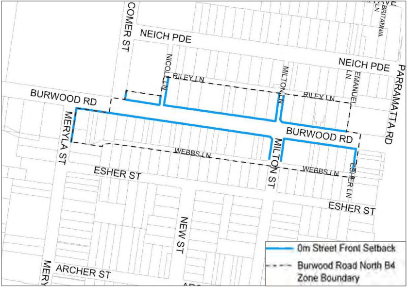

> [Picture on page 67: a picture, saved as a picture (images/section-03-development-in-centres-and-corridors-page-67-16.gif, 150 dpi).]

#### Figure 36. Burwood Road North: Street Front Setback

3.3 Area Based Controls – Burwood Town Centre and Burwood Road North

#### Secondary Setbacks Objectives

O1 To facilitate higher density development while maintaining the existing character of street development fronting Burwood Road.

#### Provisions

Burwood Road

P1 Development along Burwood Road built to the street front must not be greater than 13 metres in height. Where development exceeds 13 metres in height, the part of the development above 13 metres must be setback a minimum of 8m from the street front boundary in Burwood Road, and a minimum of 6m from the street boundary in side streets (Figure 37).

P2 Street front development along Burwood Road must enhance the existing streetscape and be of a similar scale, form, bulk, placement and character to street front development in Burwood Road.

P3 Setback areas must be free of any projections or encroachments.

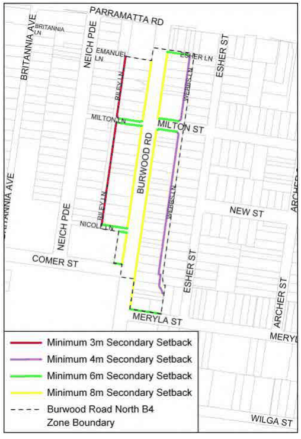

> [Picture on page 68: a picture, saved as a picture (images/section-03-development-in-centres-and-corridors-page-68-17.gif, 150 dpi).]

#### Figure 37. Burwood Road North: Secondary, Side and Rear Setbacks

3.3 Area Based Controls – Burwood Town Centre and Burwood Road North

#### Side and Rear Setbacks Objectives

O1 To minimise the amenity impact of development on adjoining properties in residential zones to the east and west.

#### Provisions

P1 Buildings at the rear of properties fronting Burwood Road may be built to the street front of Riley Lane or Webbs Lane to a maximum height of 13 metres. Any part of a building above 13 metres is to be setback a minimum of 3 metres from Riley Lane and 4 metres from Webbs Lane (Figure 37).

P2 All development is required to have regard to the side and rear setbacks provisions of the ADG which supplements SEPP 65 – Design Quality of Residential Apartment Development.

P3 Setback areas must be free of any projections or encroachments, except for at-grade landscaping.

#### Other Provisions

In the Burwood Road North area the requirements for building separation and communal open space are the same as those applying to the Perimeter and Transition Areas of the BTC.

Special perimeter and transition areas

P1 Secondary setbacks above 15m street wall height to be minimum 6m.

P2 Projections, encroachments or lightweight balconies must not penetrate the secondary setback.
