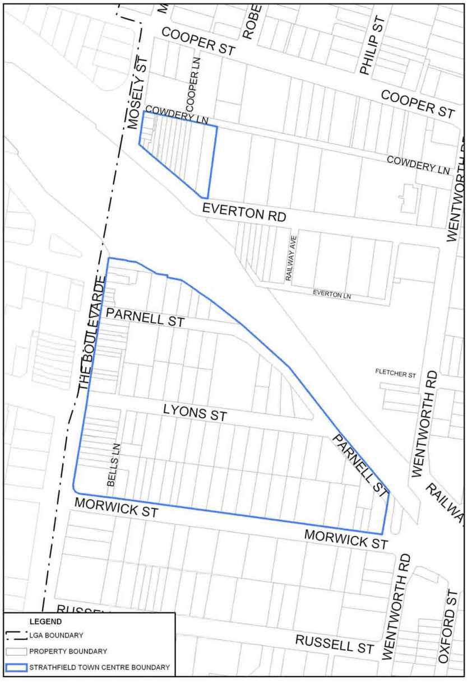

### 3.4 Area Based Controls – Strathfield Town Centre

### 3.4 Area Based Controls – Strathfield Town Centre

> [Picture on page 70: a picture, saved as a picture (images/section-03-development-in-centres-and-corridors-page-70-3.gif, 150 dpi).]

#### Figure 38. Area of Strathfield Town Centre in Burwood LGA
