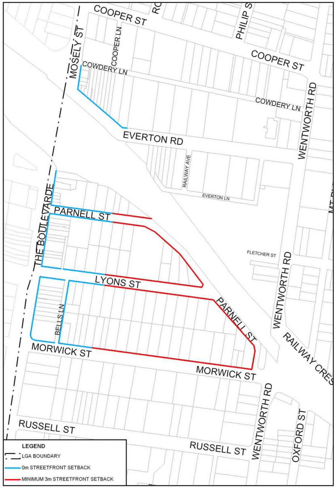

### 3.4 Area Based Controls – Strathfield Town Centre

> [Picture on page 73: a picture, saved as a picture (images/section-03-development-in-centres-and-corridors-page-73-2.gif, 150 dpi).]

#### Figure 39. Street Front Setbacks in Strathfield Town Centre
