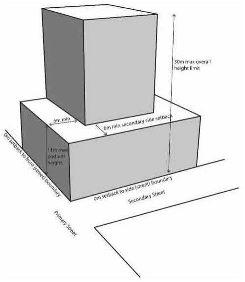
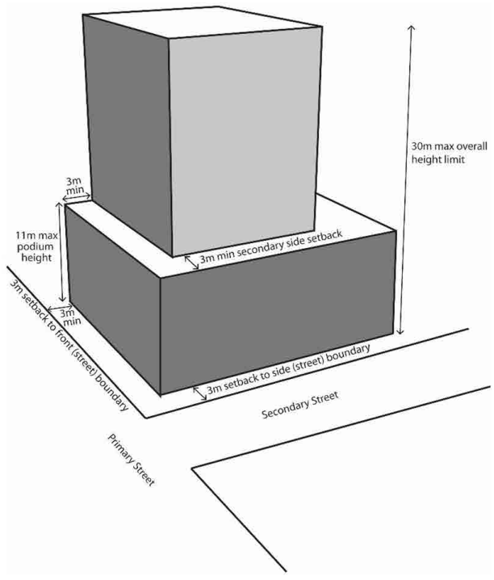

### 3.4 Area Based Controls – Strathfield Town Centre

> [Picture on page 74: a picture, saved as a picture (images/section-03-development-in-centres-and-corridors-page-74-2.gif, 150 dpi).]

Figure 40. Height Limits and Setback Requirement Where 0m Street Front Setback Applies

> [Picture on page 74: a picture, saved as a picture (images/section-03-development-in-centres-and-corridors-page-74-4.gif, 150 dpi).]

Figure 41. Height Limits and Setback Requirement Where 3m Minimum Street Front Setback Applies
