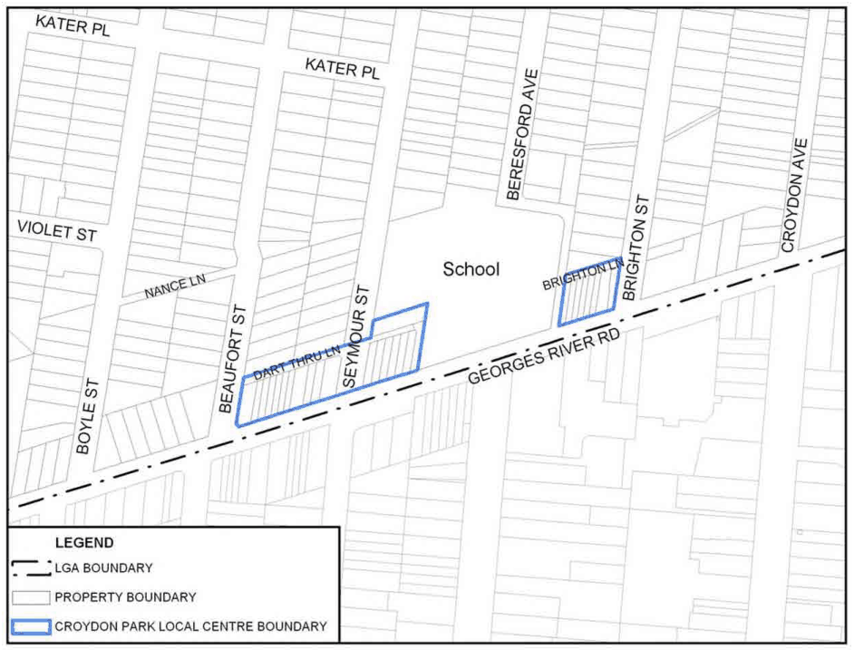

### 3.5 Area Based Controls – Local and Neighbourhood Centres

> [Picture on page 79: a picture, saved as a picture (images/section-03-development-in-centres-and-corridors-page-79-2.gif, 150 dpi).]

#### Figure 42. Croydon Park Local Centre

#### 3.5.2 Enfield Local Centre Overview

Enfield Local Centre (Figure 43) comprises the retail and commercial activities located along Liverpool Road from Burwood Road in the east and continuing onto Coronation Parade in the west.

Near the intersection of Liverpool Road and Coronation Parade/The Boulevarde the centre comprises a mixture of traditional linear shops and newer buildings of a similar height and style. Around the intersection of Liverpool Road and Burwood Road the buildings include a mixture of traditional linear shops, older style residential flat buildings and newer commercial buildings as well as the cultural landmarks of the Royal Sheaf Hotel and the heritage listed St Joseph’s Church.
