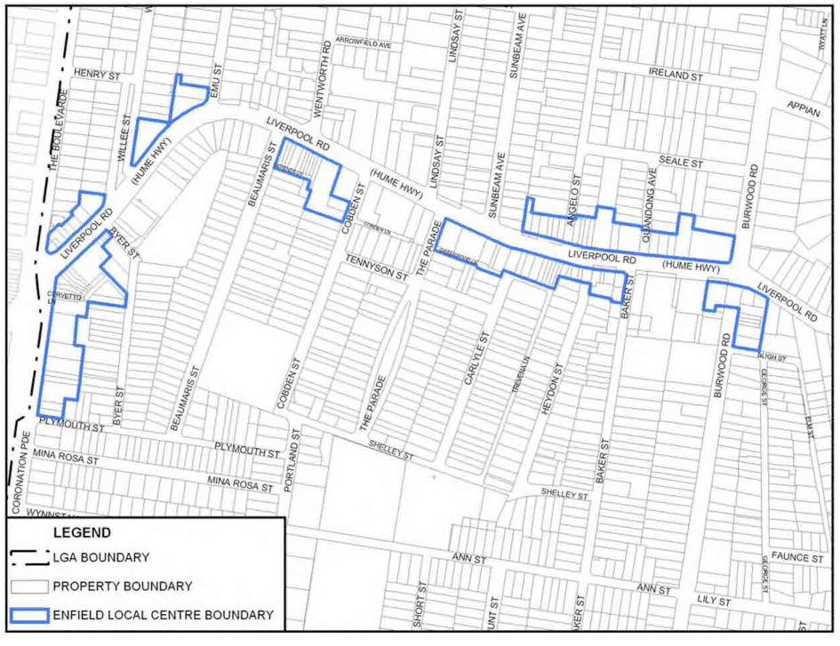

### 3.5 Area Based Controls – Local and Neighbourhood Centres

> [Picture on page 80: a picture, saved as a picture (images/section-03-development-in-centres-and-corridors-page-80-2.gif, 150 dpi).]

#### Figure 43. Enfield Local Centre

#### Desired Future Character

The B2 Local Centre zone and applicable developments standards will increase the floor space capacity overall while the maximum Residential FSR control will limit the residential floor space within shop top housing to about 88% of that potentially available on a development site.

In this context, redevelopment within the three areas that make up the Enfield Local Centre is likely to comprise new infill floor space or new construction that optimises provision of shop top housing where residents can take advantage of good public transport access and local services.

The land on the northern side of Liverpool Road between Burwood Road and Quandong Avenue that includes the Royal Sheaf Hotel site, is subject to lower development standards of 11m maximum building height and 1.5:1 FSR, in recognition of the historical development controls and the acknowledged heritage quality of the Hotel building and the Conservation Areas to the north and east.
